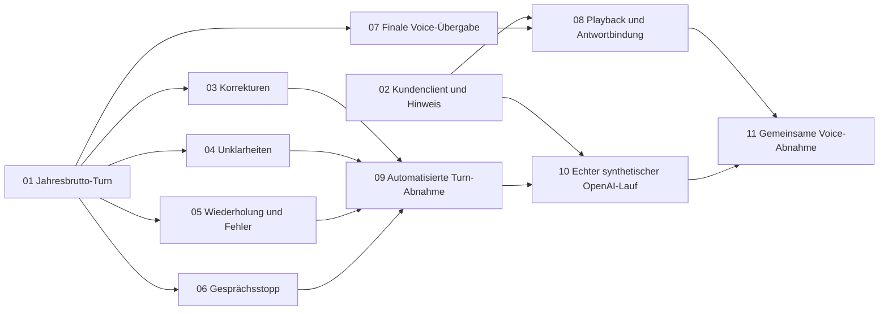

# Earnies Dialog-Extraktionsmodul: Ticketübersicht

Stand: 31.10.2026
Status: ready-for-agent
Basis der Zerlegung: Checkout `/Users/shadow/Project/hackathon/baselhackathon/basel_hack`, `main 9ab4e40`

## Verbindliche Grundlage

Diese Übersicht zerlegt die freigegebene [Spezifikation](spec.md) in ausführbare Tickets. Die [Integrationsvereinbarung](integration-agreement.md) ersetzt abweichende Aussagen im [abgeschlossenen Interview](interview-decisions.md). Dessen historische Monatsbrutto-Definition und damalige Backend-Lücken werden nicht erneut beauftragt. Kein neues Entscheidungsinterview und keine Änderung der Spezifikation.

Der ursprüngliche Nutzerauftrag autorisierte ausschließlich die lokalen Tickets und die Übersicht. Der frühere Ausschluss von Ticketerstellung innerhalb der Spezifikation bezog sich auf deren damalige Erstellung. Der anschließende Nutzerauftrag autorisiert die Versionierung und den Push der Tickets samt benötigten Quellen auf einen separaten Dokumentationsbranch; Implementierung, externe Issues und Branch-Merges sind weiterhin nicht Teil dieses Auftrags.

## Bei der Zerlegung geprüfter Code- und Branchstand

- `HEAD`, lokaler Branch `main` und lokale Tracking-Referenz `origin/main`: **9ab4e40**. Damit kein Fortschritt gegenüber der angegebenen Spezifikationsbasis auf diesem Main; `git diff 9ab4e40` leer und versionierter Arbeitsbaum sauber.
- Atomare Vorschlagspakete, autorisierter Extraktionskontext, explizite Ersetzung und persistente Unklarheiten sind bereits integriert. Gebundene Kundenbestätigungen und abgeleiteter Gesprächsstatus sind seit **4e02151** vorhanden; der gemeinsame Übergabe-/Stoppvertrag liegt auf **9ab4e40** vor.
- Lokale Tracking-Referenz `origin/feature/life-insurance-live-backend`: **563a187**, älter als die integrierte Grundlage. Kein Ticket zum erneuten Merge oder zur Neuimplementierung ihrer Funktionen.
- Lokale Tracking-Referenz `origin/feature/voice`: **a00f48f**. Die gelesene Voice-Implementierung extrahiert eigene Fragebogenantworten/Notizen und speichert lokale Antworten; das beweist keinen gemeinsamen Vorschlags-/Bestätigungsweg. Anschluss bei Dario belassen.
- Kein `ErniDialogModule`, kein begrenztes `submit_intake_proposals` und kein synthetischer Extraktionsadapter im geprüften Main gefunden. Die vorhandenen Backend-Demos reichen vorgefertigte Pakete ein, ohne Earnies tatsächlichen Dialog-/Modellweg.
- Angular besitzt Mock, CaseStore und Consent-Screen; der Datenquellenmodus `api` wirft weiterhin ausdrücklich einen Fehler und verweist auf FE-20. Die fehlenden Kundenanschlüsse werden deshalb in 02 erfasst; vor Umsetzung bestehende Arbeiten des Besitzers erneut prüfen und anschließen.
- Gemeinsame Backend-Verarbeitungshinweise behaupten derzeit ausdrücklich, es würden keine externen KI-Modelle aufgerufen. Für den aktivierten synthetischen Adapter müssen sie zusammen mit der Kundenanzeige konsistent werden; Zuständigkeit hierfür in 02 ausdrücklich aufgeteilt.
- `GLOSSARY.md` gelesen; `GLOSSARY-MAP.md` und `docs/adr/` existieren hier nicht. Keine ADR-/Glossaränderung erforderlich.
- Nur lokale Referenzen und Quelltexte geprüft. Kein Fetch, Checkout-Wechsel, Merge, Build, Testlauf oder externer Modell-/Rechneraufruf. Remote-Tracking-Referenzen sind kein Nachweis des aktuellen Serverstands.

Beim anschließenden Push-Auftrag wurde `origin/main` abgerufen und auf **2ae587c** geprüft. Gegenüber `9ab4e40` sind Avatar-Dock, Sprachauswahl und zugehörige UI-Änderungen hinzugekommen. Die hier maßgeblichen Extraktionsverträge, Fallservice, Verarbeitungshinweise und der noch fehlende Kunden-API-Provider sind unverändert; kein zusätzlich implementierter Earnie-Aufnahmeweg wurde gefunden. Der Dokumentationsbranch setzt auf `2ae587c` auf, ohne Branch-Merge oder Änderung am Anwendungscode. Die Ticketabhängigkeiten bleiben gültig.

### Wiederverwendete Grundlagen und Belegstellen

Diese Links dienen der Orientierung im geprüften Stand, nicht als verbindliche Dateivorgaben für die Umsetzung:

| Vorhanden | Gelesene Belegstellen | Folge für die Tickets |
|---|---|---|
| Gemeinsame Runtime und optionale Nest-Module | [Runtime](../../code/apps/api/src/insurance/runtime.ts), [HTTP/Guard](../../code/apps/api/src/insurance/http.ts), [Modul-Integrationstest](../../code/tests/extraction-workflow.test.mjs) | 01 schließt an, baut keinen neuen Dienst. |
| Kontext, Pakete, Ersetzung, Idempotenz und Annahme | [ExtractionWorkflow](../../code/apps/api/src/insurance/extraction.ts), [Workflow-Verträge](../../code/packages/contracts/src/proposal-workflow.ts), [vorhandene Tests](../../code/tests/extraction-workflow.test.mjs) | 01/03/05 verwenden vorhandene Mutationen; kein Grundlagen-Ticket für Valentin. |
| Beantwortete Unklarheit und ausstehende Annahme | [Gesprächsstatus](../../code/apps/api/src/insurance/ambiguity-dialogue.ts), [Vertrag und Beispiele](../../documentation/baselhack/plans/voice-confirmation-and-dialogue.md) | 04 übernimmt die Ableitung, statt sie selbst zu speichern. |
| Gebundene getrennte Kundenaktionen | [Bestätigungsverträge](../../code/packages/contracts/src/customer-confirmation.ts), [Service](../../code/apps/api/src/insurance/customer-confirmations.ts), [Tests](../../code/tests/customer-confirmations.test.mjs) | 02/08 schließen Anzeige und echte Ereignisse an; Backend nicht neu entwickeln. |
| Finaler Voice-Eingang und Playback | [Gesprächsverträge](../../code/packages/contracts/src/conversation.ts), [Voice-Anleitung](../../documentation/baselhack/plans/voice-confirmation-and-dialogue.md) | 07/08 erhalten strikte Schemas, Rollen und Bindungen. |
| Menschliche Übergabe und Stoppsignal | [Übergabevertrag](../../documentation/baselhack/plans/human-advisor-handover.md), [Tests](../../code/tests/human-handover.test.mjs) | 06/07/08 stoppen ihre tatsächlichen Module; keine neue Übergabelogik. |
| Fehlender Kunden-API-Anschluss und vorhandener Consent | [Datenquellen-Provider](../../code/apps/web/src/app/core/advisor/provide-advisor-data-source.ts), [Consent](../../code/apps/web/src/app/core/consent/consent.ts) | 02 bleibt beim Angular-Besitzer und nutzt vorhandene Clientstrukturen. |
| Bisheriger Backend-Hinweis | [Verarbeitungshinweise](../../code/apps/api/src/insurance/messages.ts) | Gemeinsame Texte in 02 bei Valentin, Anzeige beim Angular-Besitzer. |

## Tickets und direkte Abhängigkeiten

Alle Tickets haben `Type: task`. `ready-for-agent` beschreibt den Triagezustand und hebt Blocker nicht auf. 11 ist wegen der gemeinsamen realen Voice-/Anzeigeabnahme `ready-for-human`. Verwendet werden ausschließlich die lokalen Triagewerte; keine neuen Statuswerte. Vor Bearbeitung müssen die Voraussetzungen gemäß lokalem Tracker-Workflow erledigt sein; Abschlussantwort und Nachweise unter `## Answer` im jeweiligen Ticket ergänzen und hier verlinken. Die leeren `## Comments` nehmen spätere Kommentare auf.

| Nr. | Ticket / beobachtbares Ergebnis | Owner | Blocked by | Status |
|---|---|---|---|---|
| 01 | [Jahresbrutto aus einem finalen Dialog-Turn vorschlagen](issues/01-jahresbrutto-dialog-turn.md#answer): tatsächlicher Modul-/Modell-/Tool-Weg bis zum unbestätigten Pflichtvorschlag | Earnie | Keine | resolved |
| 02 | [Prüfstand und getrennte Kundenaktionen im Angular-Client anschließen](issues/02-kundenclient-pruefstand-bestaetigung.md): echter Prüfstand, korrekter Hinweis, getrennte Kundenaktionen | Angular-Besitzer; Valentin für gemeinsame Backend-Hinweise | Keine | resolved |
| 03 | [Eindeutige Korrekturen ohne Verlust zusammengehöriger Angaben übernehmen](issues/03-korrekturen-vorschlagspakete.md): nachvollziehbarer Nachfolger statt Datenverlust | Earnie | 01 | ready-for-agent |
| 04 | [Personen- und Einkommensunklarheiten bis zur Antwortübernahme führen](issues/04-unklarheiten-dialogstatus.md): gezielte Klärung statt geratener Zuordnung/Jahresbasis | Earnie | 01 | ready-for-agent |
| 05 | [Turns bei Wiederzustellung, Versionswechsel und Fehlern zuverlässig verarbeiten](issues/05-retries-konflikte-fehler.md): keine Duplikate oder veralteten Mutationen | Earnie | 01 | ready-for-agent |
| 06 | [Laufende Extraktion beim gemeinsamen Gesprächsstopp verwerfen](issues/06-gespraechsstopp-extraktion.md): kein alter Vorschlag nach Übergabe/Resume | Earnie | 01 | ready-for-agent |
| 07 | [Finale Voice-Beiträge an Earnies gemeinsamen Dialogweg übergeben](issues/07-voice-finale-turn-uebergabe.md): Darios finaler Beitrag erreicht den gemeinsamen Fall | Dario | 01 | ready-for-agent |
| 08 | [Voice-Frage, tatsächliches Playback und neue Antwort eindeutig binden](issues/08-voice-frage-playback-antwort.md): zwei getrennte, tatsächlich wiedergegebene Kundenfragen | Dario; Kundenaufrufe beim Angular-Besitzer | 02, 07 | ready-for-agent |
| 09 | [Vollständige Dialog-Turn-Abnahme ohne externe Dienste nachweisen](issues/09-automatisierte-dialog-turn-abnahme.md): gesamter automatisierter Modulnachweis | Earnie | 03, 04, 05, 06 | ready-for-agent |
| 10 | [Synthetische Extraktionsqualität mit echtem OpenAI separat abnehmen](issues/10-synthetische-openai-abnahme.md): tatsächliche Extraktionsqualität nachgewiesen | Earnie | 02, 09 | ready-for-agent |
| 11 | [Gemeinsamen Voice-Weg mit zwei getrennten Bestätigungen abnehmen](issues/11-gemeinsame-voice-integrationsabnahme.md): vollständige echte gemeinsame Integration | Dario gemeinsam mit Earnie und Angular-Besitzer | 08, 10 | ready-for-human |

## Empfohlene Umsetzungsreihenfolge

1. **Mit 01 beginnen.** Es liefert den kleinsten vollständigen Durchstich von finaler Äußerung bis zum gemeinsamen unbestätigten Vorschlag. 02 kann unabhängig parallel beim Angular-Besitzer beginnen, mit einem über den vorhandenen Backend-Workflow vorbereiteten Paket.
2. Nach 01 sind 03, 04, 05, 06 und 07 unabhängig freigegeben. Für Earnie empfiehlt sich 03 → 04 → 05 → 06 auf derselben Modulgrenze; diese Reihenfolge ist eine Arbeitspräferenz, keine zusätzliche Blockerkette. Bei paralleler Umsetzung Änderungen am gemeinsamen Modul koordinieren.
3. 08 beginnt, sobald 02 und 07 vorliegen. 09 beginnt, sobald 03–06 ihre jeweiligen Verhaltensnachweise geliefert haben. Voice-Anschluss und automatisierte Modulabnahme können unabhängig voneinander voranschreiten.
4. 10 folgt auf 09 und den korrigierten Kunden-/Backend-Hinweis aus 02. Ein simulierter Erfolg gilt nicht als Modellabnahme. Ein echter externer Lauf gehört ausschließlich zum ausdrücklich gestarteten separaten Abnahmeweg.
5. 11 folgt auf 08 und 10. Erst diese gemeinsame Abnahme deckt tatsächliche Wiedergabe, Anzeige und beide Bestätigungen ab.

### Warum diese Kanten gelten

- 02 braucht 01 nicht: Pakete und Kundenbestätigungen sind bereits im Backend erzeugbar. Der erforderliche Frontend-Anschluss muss daher nicht auf Earnies Extraktion warten.
- 03–06 brauchen den tatsächlichen Turn aus 01, aber nicht gegenseitig ihre Implementierung. Benötigte Ausgangszustände können mit dem vorhandenen Fallservice vorbereitet werden.
- 07 braucht Earnies Moduleingang; 08 braucht zusätzlich den Kundenclient, weil Dario keine Kunden-Zugangsdaten und keine eigenen Bestätigungsrechte erhält.
- 09 braucht weder Angular noch echte Voice: Die festgelegte Grenze endet beim beobachtbaren Fallservicezustand.
- 10 braucht die automatisiert belegte Transport-/Fehlergrenze und konsistente Verarbeitungshinweise. 11 braucht zusätzlich den angeschlossenen realen Voice-/Kundenweg.
- Valentins gemeinsame Backend-Grundlagen sind vorhanden und deshalb keine fiktiven neuen Blockertickets. Tatsächlich entdeckte gemeinsame Vertrags-/Berechtigungs-/Persistenzfehler bleiben bei Valentin; sie werden mit konkretem Befund erfasst, nicht vorsorglich neu entwickelt.

## Drei getrennte Testgrenzen

| Grenze | Primärer Nachweis | Was sie belegt | Was sie nicht ersetzt |
|---|---|---|---|
| Automatisierter vollständiger Dialog-Turn | Verhaltenstests in 01/03–06, Gesamtnachweis 09 | Earnies echte Orchestrierung, echter Fallservice, temporärer verschlüsselter Store, reale Rollen/Schemas; nur Modelltransport simuliert | Tatsächliche Modellqualität, STT/TTS und Kundenanzeige |
| Separater synthetischer OpenAI-Lauf | 10 | Echte Modellantworten mit erfundenen Daten, Pflichtfall/Korrektur/Unklarheit/Klärung, geprüfte Payload-Grenze | Echte Voice-/Playback- und Kundenintegration |
| Gemeinsame Voice-Integrationsabnahme | Anschluss 02/07/08, tatsächliche Abnahme 11 | Finaler Beitrag bis Paket, tatsächliche Anzeige/Wiedergabe, gebundene neue Antwort, Paketannahme und zweite getrennte Profilbestätigung | Allgemeine Produktionsfreigabe oder Freigabe realer Kundendaten |

Der verbindliche erste Fall bleibt überall: **119’000 CHF Jahresbrutto → 11’900’000 Rappen → `person_demo_1` → `insurance.persons.0.grossAnnualIncomeCents`**, zunächst als unbestätigter Vorschlag. `financial.persons.0.income` bezeichnet das bestehende Budget-Netto und bleibt unverändert. Erst Paketannahme ändert den Entwurf; erst die zweite gesonderte Bestätigung erzeugt eine neue bestätigte Profilversion.

## Grenzen und Fortschrittsnachweise

Kein vorgeschaltetes Prefactoring erforderlich: Die nötigen Runtime-Anschlüsse und Prüfungen existieren. Nicht beauftragt sind Decisions-Pflichtgate, zusätzlicher Anbieter, eigener Store/Microservice, allgemeiner Fragebogen, neue Personenstrukturen, Brutto-Netto-Ableitung, Telefonie oder allgemeiner Frontend-/Voice-Umbau. Konkretes Modell, endlicher Timeout und Ausführungszeitpunkt sind Umsetzungsparameter; daraus entsteht kein neues Entscheidungsinterview oder erfundenes Latenz-SLA.

Die Übersicht und Tickets beauftragen zukünftige Nachweise; sie behaupten keine heute ausgeführten Tests oder Abnahmen. Ein Zugangsmangel oder fehlender realer Voice-Anschluss muss im jeweiligen `## Answer` als fehlender Nachweis sichtbar bleiben. Ein reiner Fixture-/Mock-Erfolg schließt weder 10 noch 11 ab.

## Verwendung aus dem Repository

Die elf Tickets, diese Übersicht, die Spezifikationsquellen und das referenzierte Domain-Glossar werden auf `docs/ernest-ai-backend-tickets` versioniert. Nach Auschecken dieses Branches sind sie auch in einem anderen Checkout vorhanden. Persönliche Agent-/Skill-Konfiguration bleibt lokal ausgeschlossen. Der Ausschluss von `.scratch/` verhindert nicht das Laden bereits versionierter Dateien.

Zum Einstieg diese Übersicht und die verbindlichen Quellen lesen, dann das konkrete Ticket öffnen. Empfohlen ist 01; 02 kann unabhängig beim Angular-Besitzer beginnen. Den aktuellen Code vor jeder Umsetzung prüfen und bereits erledigte Arbeit berücksichtigen. Nicht auf Basis einer veralteten Ticketkopie oder ohne erledigte Blocker starten. Ein Push startet kein Ticket automatisch; die Ausführung wird jeweils ausdrücklich beauftragt.

Historische Aussagen in den Quellen über ausschließlich lokale Verfügbarkeit oder damals noch nicht angelegte Tickets beziehen sich auf deren Erstellungszeitpunkt. Die fachliche Rangfolge der Quellen und die drei Testgrenzen bleiben unverändert.

## Umsetzungsnachweis 31.10.2026

Ausschließlich **01** ist abgeschlossen; [Umsetzung und Prüfergebnisse](issues/01-jahresbrutto-dialog-turn.md#answer). Feature-Branch `feature/ernie-01-jahresbrutto-dialog-turn` basiert auf dem frisch abgerufenen `origin/main` **6f84c65**. Der vollständige finale Text-/Voice-Turn erzeugt den unbestätigten Jahresbrutto-Pflichtvorschlag, ohne Budget-Netto, Entwurf oder bestätigte Snapshots zu ändern. Build, Client-Typprüfung, 25 Vertragsschemas und **178/178 Tests** einschließlich 15 neuer vollständiger Dialog-Turn-Tests sind erfolgreich; nur der Modelltransport wurde simuliert. Keine echte OpenAI-Abnahme, keine Commits, Pushes oder Branch-Merges.

02 kann weiterhin unabhängig beim vorgesehenen Besitzer starten. Durch 01 sind die direkten Blocker von 03–07 erfüllt; keines dieser Tickets wurde hier gestartet. Die übrigen Abhängigkeiten gelten unverändert. Die isolierte Testumgebung und das vorhandene Angular-Lockfile-Problem sind im Answer dokumentiert.

## Comments
