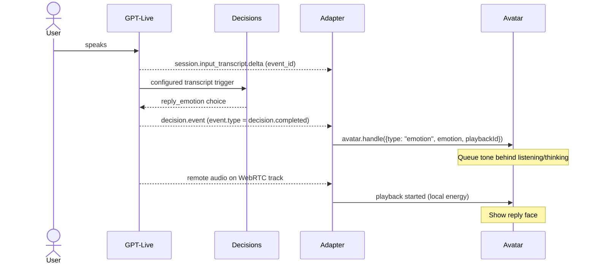

# Avatar interface: voice → avatar

Handoff for Dario (Voice). Lukas owns the avatar side. This extends **I06 VoicePlaybackEvent** in [interface-contracts.md](../../documentation/baselhack/plans/interface-contracts.md) with the technical work states (listening/thinking) the contract already allows, plus one new event: `emotion`.

## In one sentence

The voice layer gives the avatar **the audio it plays** and a stream of **`AvatarEvent`s**. It never sets the face directly.

```js
import { createPaxAvatar } from "./pax-avatar.js";

const avatar = createPaxAvatar(hostElement, { emotionHoldMs: 5000 });
avatar.attachAudio(remoteStream);   // MediaStream or <audio> element that the user hears
avatar.handle(event);               // every AvatarEvent, in the order they happen
```

Types: [`pax-avatar.d.ts`](pax-avatar.d.ts). Reference implementation for GPT-Live: [`openai-realtime-adapter.js`](openai-realtime-adapter.js).

`emotionHoldMs` is configurable per instance (default `5000`; `0` disables the hold). It must be a finite non-negative number. The first emotion applies immediately; later requests keep only the latest candidate until the current hold expires. Repeated answers for the same emotion do not restart the hold. The live demo sets this option in [`realtime.html`](realtime.html).

`attachAudio` accepts a `MediaStream`, `HTMLMediaElement`, a function returning the current 0..1 level, or `null` to detach. Read `state` for `{ face, activity, playing, replyEmotion, level }`. `reset()` starts a fresh conversation; `destroy()` stops animation, clears timers and audio resources, and empties the host. Design/demo code can call `show(face)` for any of the eleven expressions, always replaying its entry gesture.

## The three events

| Event | Send when | Current GPT-Live adapter source |
|---|---|---|
| `{ type: "activity", state: "listening" }` | The user starts speaking | Microphone energy stays above threshold for 150 ms |
| `{ type: "activity", state: "thinking" }` | The user finished; the reply is being prepared | 1.2 s local microphone silence |
| `{ type: "activity", state: "idle" }` | Nothing is happening (call ended) | on close |
| `{ type: "emotion", emotion, playbackId }` | Whenever a tone is known, ideally before `playback started`; send every answer, the avatar queues and stabilises | `decision.event` → `decision.completed` choice; local `playbackId` |
| `{ type: "playback", event: "started", playbackId }` | Audio is **actually audible**, not just requested | Remote-stream energy rises (audibility caveat below) |
| `{ type: "playback", event: "ended", playbackId }` | Audio played to the end | 600 ms remote-stream silence |
| `{ type: "playback", event: "cancelled", playbackId }` | Audio was cut off (barge-in, stop, new turn) | Adapter cleanup while playing; explicit app stop should also send this |
| `{ type: "playback", event: "error", playbackId }` | Playback failed | App/player error; current adapter has no explicit mapping |

`turnId` and `replyId` from I06 may be added to `playback` events; the renderer accepts but does not use or forward them.

### Emotion reference

Allowed values are defined by `ReplyEmotion` in [`pax-avatar.d.ts`](pax-avatar.d.ts); classifier descriptions live in `EMOTION_CHOICES` in [`server.mjs`](server.mjs).

| `emotion` value | Use when the advisor… |
|---|---|
| `neutral` | Is calm and factual; default when unsure |
| `acknowledging` | Briefly confirms understanding or summarizes, without a new explanation |
| `curious` | Asks about wishes, circumstances, or missing information |
| `explaining` | Explains calculations, pension gaps, connections, or next options |
| `shocked` | Reacts to something truly alarming or unexpected, beyond ordinary concern |
| `empathetic` | Shows quiet sympathy for loss, illness, or hardship |
| `pleased` | Offers a warm greeting or shares joy about good news |
| `recovering` | Corrects a misunderstanding or retries an explanation |
| `presenting_offer` | Actually presents a concrete offer or finished result, rather than announcing one |

```ts
avatar.handle({ type: "emotion", emotion: "empathetic", playbackId });
```

`playbackId` is optional; include it to associate the emotion with a playback segment and reject late results after that segment finishes. For a direct design/demo preview, use `avatar.show("empathetic")`. `listening` and `thinking` are activity states, not reply emotions.

## What the avatar guarantees

- **No twitching on false barge-ins.** While a playback is running, `listening`/`thinking` do not change the face. Only `playback cancelled` interrupts the reply visually.
- **Late events are ignored.** Events for the last 50 finished `playbackId`s (including ended/cancelled/error) are dropped (`handle()` returns `false`); `reset()` clears that history.
- **Early emotions wait for the reply.** An `emotion` that arrives while the user speaks or the advisor thinks (e.g. from the input transcript trigger) is queued and shown when playback starts. Otherwise it is shown right away.
- **Minimum emotion hold.** All reply emotions, including `neutral`, use the same `emotionHoldMs` interval, including during listening/thinking and playback. The latest candidate wins at expiry; candidates tied to finished playback are discarded. Activity faces and cancellation remain immediate; explicit `reset()` and design-only `show()` bypass the hold.
- **Relax after the reply.** Return to neutral after both the minimum emotion hold and ~1.5 s after playback end have elapsed. A new user turn clears old candidates and returns to neutral if the hold has elapsed; listening/thinking can still show immediately.
- **Calm expression motion.** Each expression has a subtle tilt, breath, nod or sway; warm expressions lift once on entry and recovery briefly resets. Audio only adds tiny eye emphasis when explaining; it never drives body motion. Reduced-motion preferences suppress decorative motion and blinking while preserving all eye shapes and decorations.


## GPT-Live prototype mapping

The reference adapter uses `gpt-live-1` for voice. [`server.mjs`](server.mjs) configures native Decisions delegation on `gpt-6-luna` for `ui_action`, plus independent input/output transcript triggers for reply emotions. The legacy filename `openai-realtime-adapter.js` does not mean it uses the Realtime API.

The browser action registry only logs pension-picture and human-advisor requests; it does not display a picture or contact anyone. It returns one result per delegation through `session.commentary.append`. Actions time out after 3 s; a 10 s watchdog answers stalled delegations. Invalid messages and nonfatal errors are logged. See [integration options](#integration-options) for alternatives and limitations.

## About the interruptions

"Interrupted" is decided by the voice layer, not by the avatar; the avatar only shows `playback cancelled`. With GPT-Live there are no server-side VAD or noise-reduction settings (they were Realtime-only and are removed from `server.mjs`). What remains:

| Cause | Fix |
|---|---|
| The advisor hears its own voice from the laptop speakers | Browser echo cancellation (on in the adapter); a **headset** at the demo |
| Room noise | Browser noise suppression (on in the adapter); a headset or a quieter spot |
| Face twitches on noise or echo | Already handled: during playback the avatar ignores `listening`/`thinking` |

## Integration options

These decisions are independent: emotion source, activity/playback source, session ownership, and frontend host. The avatar contract stays the same.

### 1. Where emotions come from

**A. Transcript-triggered Decisions (current; recommended for the standalone voice demo).** Configure `session.triggers` at session creation alongside `session.delegation`; `transport` is a sibling of `session` in the WebRTC request. Each entry uses `type`, `event_type`, and `decisions.questions`; a choice question uses `type`, `name`, `instructions`, and `choices` with `value` and optional `description`. This is the current input trigger structure (shortened choices):

```js
// Inside session.triggers; use all nine EMOTION_CHOICES from server.mjs.
{
  type: "decisions",
  event_type: "session.input_transcript.delta",
  decisions: { questions: [{
    type: "choice", name: "reply_emotion",
    instructions: "Which emotion should the advisor show in the reply?",
    choices: [{ value: "neutral", description: "Calm default; use if unsure." }],
  }] },
}
```

The second entry uses `event_type: "session.output_transcript.delta"`, question name `emotion`, and instructions about the advisor's current words. **Live supplies the trigger model and trigger ID**; omitting them here is intentional. Triggers run independently of delegation, not only when Live requests an action. Native integration requires `api.decisions.write`; no Decisions-specific alpha header is needed. [Official setup and triggers](https://developers.openai.com/api/docs/guides/decisions-voice).

On the WebRTC data channel (or server WebSocket), receive the source transcript delta with `event_id`, then a `decision.event` envelope. A transcript result has `delegation_id: null`, `trigger_id`, `source_event_type`, `source_event_id`, and nested `event`. For `event.type === "decision.completed"`, read `event.decision.answers`, select `{ type: "choice", name: "reply_emotion" | "emotion", choice }`, validate the choice against the nine emotions, and emit:

```js
avatar.handle({ type: "emotion", emotion: answer.choice, playbackId: source.playbackId });
```

`source.playbackId` is the adapter's local segment ID saved when the matching `source_event_id` arrived; it is not an OpenAI response ID. Live may combine pending deltas and return results out of order. Track the newest applied source independently for input and output, discard older results, and discard finished playback IDs. The adapter does this; it ignores missing/failed/invalid answers. If adding WebRTC event filtering, allow **both transcript types and `decision.event`**; a trigger result is delivered only if its source transcript event is allowed. Keep `session.delegation.created` for actions. [Result shape and ordering](https://developers.openai.com/api/docs/guides/decisions-voice#react-to-transcripts).

Tune the German `EMOTION_CHOICES` descriptions in [`server.mjs`](server.mjs), keeping the values unchanged. Distinguish acknowledgment from explanation, concern from genuine shock, and announcing an offer from actually presenting it. Test ambiguous utterances and corrections. Input predicts the reply tone; output follows what Live actually says. Pax queues input emotions behind listening/thinking rather than changing the listening face as in the docs' example.

**Cost/latency:** native delegation avoids an app round trip; transcript Decisions can overlap speech, but arrival before playback is not guaranteed. Decisions usage is additional to voice duration; caching can reduce repeated-input cost. Standalone `/v1/decisions` has input-token pricing and no output-token charge; consult its pricing rather than assuming a per-delta price for native triggers. Keep both directions initially; if needed, evaluate output-only for simpler timing and fewer evaluations. Measure actual latency/usage. [Decisions pricing/caching](https://developers.openai.com/api/docs/guides/decisions#pricing-and-availability), [voice/backend accounting](https://developers.openai.com/api/docs/guides/voice-latency-cost?api=live).

**B. Delegated or application-requested Decisions (optional).** `session.delegation: { type: "decisions", decisions: { model: "gpt-6-luna", questions: [...] } }` lets Live request classification when its instructions say to delegate. Match `session.delegation.created`'s `delegation.id` to `decision.event.delegation_id`; read completed answers by question name, run the action once, and report its actual outcome via `session.commentary.append` with that ID. This is the current `ui_action` path. Use it for discrete actions, not continuous expression changes. `decision.item.create` appends evidence/state (wait for `decision.item.created`); it is not a documented manual “run emotion now” command. [Native delegation](https://developers.openai.com/api/docs/guides/decisions-voice#let-live-delegate).

For application-controlled timing, call **`POST /v1/decisions`** from the backend with `model`, accumulated transcript `input`, and `questions`, then map its named choice answer to the same AvatarEvent. Use this when classifying only at meaningful checkpoints or during a custom/client delegation. It adds app orchestration and a request round trip; accumulate fragments and discard outdated results. This is a standalone Decisions request, not another configured Live trigger type. [Decisions API](https://developers.openai.com/api/docs/guides/decisions), [application-owned transcript work](https://developers.openai.com/api/docs/guides/live-delegation#react-to-transcript-fragments).

**C. Backend emotion (recommended once Earnie owns replies).** Agree an optional `AgentReply.emotion` field with Earnie; I05 does not currently define it. Dario validates it and sends the same `emotion` event with the reply's actual playback ID before audio starts. No Decisions call is needed. Pick one emotion authority per reply so backend and transcript classifications do not compete.

**D. No emotion source (required fallback).** Activity/playback still work. A fresh avatar stays neutral during playback unless the voice service explicitly sends a default `explaining` emotion; there is no automatic audio-to-emotion classifier. Keep this path available if Decisions is rejected or unavailable.

### 2. Where activity and playback come from

**Keep local energy for the demo**, with a headset. The adapter samples microphone/remote-stream RMS every 50 ms, uses threshold `0.015`, and requires 150 ms of sustained microphone energy before emitting listening. Thinking follows 1.2 s of microphone silence, so brief noise and ordinary speech pauses do not flip activity. These are `INPUT_ONSET_MS` / `INPUT_SILENCE_MS` in the adapter, separate from the renderer’s 5 s reply-emotion hold. Remote audio still emits playback started immediately and ended after 600 ms silence. Cleanup cancels active playback and emits idle. Silence is an estimate, not a turn boundary or a reliable server interruption signal.

The documented Live events offer transcript deltas with approximate `start_ms`/`end_ms`, lifecycle events (`session.started`/`session.closed`), and audio data. They do **not** offer Realtime's speech-start/stop or output-buffer boundary events. Primary WebSocket `session.output_audio.delta` has no timing fields or output-audio-done event; WebRTC audio arrives on the media track. Transcript gaps cannot establish silence. These events can support caption/activity heuristics, not replace actual playback tracking. [Speech/transcripts](https://developers.openai.com/api/docs/guides/live-conversations#manage-speech-and-transcripts).

A later server sideband can receive reflected output audio with `start_ms`/`end_ms`, but those ranges still do not prove the user heard it. For strict I06 playback, use an app-controlled player/queue and explicit stop/error callbacks; this adds buffering and synchronization work. [Reflected audio and playback control](https://developers.openai.com/api/docs/guides/voice-server-controls?api=live).

### 3. Where the session is created

**Dev:** keep `server.mjs` for the isolated prototype. **Angular integration:** move its `POST /session` into Dario's NestJS VoiceAdapter. The browser posts `{ sdp }`; the backend calls `POST https://api.openai.com/v1/live/sessions` with `{ session, transport: { type: "webrtc", sdp } }`, keeps the API key/configuration server-side, and returns the JSON answer. Apply `transport.sdp`, then wait for `session.started`; do not send `session.start` on WebRTC. [WebRTC setup](https://developers.openai.com/api/docs/guides/voice-webrtc?api=live).

Preserve the **one voice-only retry**: currently only a 4xx mentioning triggers/decisions/delegation causes retry without `triggers` and `delegation`, with action instructions removed. Return `X-Avatar-Decisions: disabled` and log the degraded mode. This is app fallback policy, not an API guarantee; it does not retry every voice/auth/network failure.

**Transport recommendation: browser WebRTC.** A primary server WebSocket at `wss://api.openai.com/v1/live/sessions` is supported: send `session.start`, wait for `session.started`, then stream audio/JSON. It requires server audio plumbing; OpenAI recommends WebRTC even for server audio connections. [WebSocket setup](https://developers.openai.com/api/docs/guides/voice-websockets?api=live).

**Optional backend observer:** save `session.id` from creation and attach `wss://api.openai.com/v1/live/sessions/{session_id}/attach` using the backend project key. This sideband listens to/controls the **same** WebRTC session; do not send another `session.start`. Use it for private actions, server transcript checks or application-owned Decisions calls while browser audio stays on WebRTC. Assign one action owner to avoid duplicate execution; forward validated backend emotions to Angular. Current code has no sideband. [Sideband setup](https://developers.openai.com/api/docs/guides/voice-server-controls?api=live#attach-to-the-existing-session).

### 4. Frontend hosting

**Angular (recommended for the team app):**

1. Copy `pax-avatar.js` and `pax-avatar.d.ts` to e.g. `src/app/avatar/`. They are dependency-free ES modules with type declarations.
2. Mount outside `NgZone` so animation frames do not trigger zone-based change detection:

   ```ts
   import { AfterViewInit, Component, ElementRef, NgZone, OnDestroy, ViewChild, inject } from "@angular/core";
   import { createPaxAvatar, type PaxAvatar } from "./pax-avatar.js";

   @Component({ selector: "pax-avatar", standalone: true, template: `<div #host></div>` })
   export class PaxAvatarComponent implements AfterViewInit, OnDestroy {
     @ViewChild("host", { static: true }) host!: ElementRef<HTMLElement>;
     private zone = inject(NgZone);
     avatar?: PaxAvatar;

     ngAfterViewInit() {
       this.zone.runOutsideAngular(() => {
         this.avatar = createPaxAvatar(this.host.nativeElement);
       });
     }
     ngOnDestroy() { this.avatar?.destroy(); }
   }
   ```
3. Hand the mounted instance to the voice service. Call `attachAudio(stream)` once per call and `handle(event)` for each AvatarEvent. Reserve `show()` for design/demo overrides.
4. Use the NestJS session endpoint described above, retaining its retry behavior.
5. Port/reuse `connectOpenAIRealtime` from the reference adapter: callbacks are `onAvatarEvent(ev)`, `onAudioStream(stream)`, `onTranscript(delta, playbackId)`, and optional `onLog`. Replace the demo registry with real app actions. Close the voice connection on teardown as well as calling avatar `destroy()`; avatar destruction does not close WebRTC or stop the microphone.

**Any page:** import `createPaxAvatar` in `<script type="module">`, mount into an element, and wire the same audio/events. Serve modules over HTTP(S); no Angular dependency. Multiple avatars can coexist with unique SVG definition IDs; each needs its own instance and `destroy()`. Use `reset()` between conversations.

### Decision table

| Option | Pros | Cons | Hackathon demo? |
|---|---|---|---|
| Input + output transcript Decisions | Current adapter; early tone + spoken-word refinement | Extra usage; late/out-of-order answers | **Yes**, standalone voice |
| Delegated Decisions | Discrete choice/action routing | Only runs on delegation | UI actions only |
| Backend on-demand Decisions | App chooses checkpoints/context | Extra request/orchestration | Defer |
| Earnie's AgentReply emotion | Same reply/context; no extra classifier | Needs agreed field | **Yes**, when available |
| No emotion/default explaining | Voice works without classifier | Less expressive | **Yes**, fallback |
| Local audio energy | Already implemented | Approximate segments/audibility | **Yes**, headset |
| App-controlled playback queue | Explicit played/stopped state | Buffering/synchronization work | Defer unless I06 needs it now |
| NestJS + browser WebRTC | Key stays backend; fits team stack | Move dev endpoint | **Yes**, integrated app |
| Primary server WebSocket | Central audio/event handling | More audio plumbing | Defer |
| WebRTC + backend sideband | Private server actions on same call | Ownership/event forwarding | Only if backend needs it |
| Angular / plain ES module | Same renderer in app / isolated demo | Host owns lifecycle | **Yes**, choose host by demo |

### Recommended path and one turn

For the isolated demo, keep the current dev server, WebRTC adapter, two transcript triggers, and local energy tracking. For the team demo, mount in Angular outside NgZone and move session creation to NestJS. Preserve the voice-only fallback and use a headset. Prefer Earnie's emotion when AgentReply is ready; use one authority per reply. Add sideband only when backend event handling is needed. Financial reply content remains Earnie's responsibility under I05.



This is the early-decision case; a decision may arrive after playback starts. Output transcript triggers refine the face during the reply, subject to avatar stabilization.

### Known gaps

- **No trigger/schema mismatch found:** current `session.triggers`, omitted trigger model/ID, and nested `decision.event` answer parsing match the official transcript example. There is no `set_emotion` tool or Realtime playback event in this path.
- **I06 audibility:** the adapter measures the remote stream before speaker playback. Autoplay failure can still produce `started`; it only logs `audioElement.play()` rejection. It does not currently emit playback `error` for this case.
- **Ordering/identity:** local silence segments have no server turn IDs; pauses and interruptions both produce `ended`. Source ordering is per direction, so a late input decision can supersede an output decision; there is no cross-direction precedence. Pax's finished-ID rejection covers only its bounded recent-ID history, not all past IDs.
- **Actions/context:** demo actions only log and return commentary. They do not append confirmed app state through `decision.item.create`/`decision.item.created` as the docs' stateful action example does. Add that context if real actions need it; never report a demo as completed work.
- **Fallback:** a voice-only retry disables explicit Decisions configuration, not voice itself. No emotion means neutral unless the app sends `explaining`; the renderer does not infer it from sound. Session creation currently does not save a backend session ID or attach a sideband.
