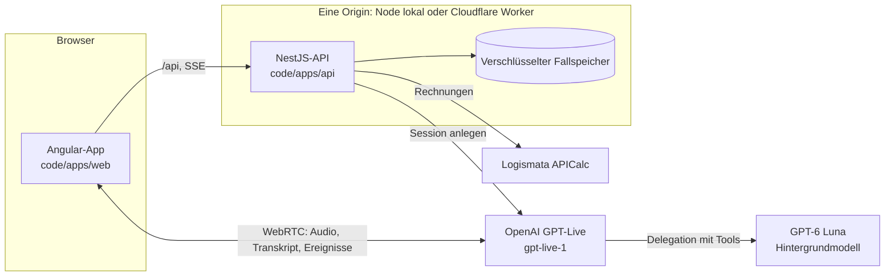

# Architektur

Stand: 01.11.2026. Pax Digital Advisor „Paxi“: ein KI-Vorsorgeberater, mit dem man spricht. Er erfasst die Lebenssituation im Gespräch, rechnet mit den Logismata-Rechnern der Challenge, zeigt Grafiken, Risiken und eine Empfehlung und führt bis zu einer Demo-Police. Ausschliesslich erfundene Daten, kein echter Vertrag.

## Bausteine

| Baustein | Pfad | Aufgabe |
|---|---|---|
| Web-App | `code/apps/web` | Angular 22. Paxi in der Mitte, Tabs Grafiken, Risiken, Chat, Info, Abschluss; Live-Stimme über WebRTC; Annahme, Bestätigung, Abschlussweg |
| API | `code/apps/api` | NestJS. Ein gemeinsamer Fall pro Kunde: Aufnahme, Vorschläge, Bestätigung, Berechnung, Empfehlung, Angemessenheitsprüfung, Demo-Vertragsweg, Dossier; Voice-Sessions und Auswertung der Gesprächsturns |
| Verträge | `code/packages/contracts` | Zod-Schemas, von API und Web-App gemeinsam benutzt; JSON-Schemas in `schemas/` werden daraus exportiert |
| Fachlogik | `code/packages/domain` | Budget, Kapital, Pflichtfelder (`intakeQuestions`), Lebensversicherungsbedarf |
| Worker | `code/apps/worker` | Cloudflare Worker `paxi`: dieselbe NestJS-API in einem Durable Object plus die gebaute App als statische Dateien |
| Voice-Agent | `code/voice-agent` | Darios eigenständiger Paxi (Konfiguration `paxi`). Seine Persona und Skills speisen auch die eingebaute Live-Stimme |
| Avatar | `code/avatar-prototype` | Paxis Gesicht und Emotionen; die App übernimmt die Dateien beim Start (`sync-voice-avatar`) |

Die Gesprächsführung im Detail: [Live-Stimme](live-voice.md). Regeln und Einwilligungen: [Compliance](compliance.md). Routen und Rollen: [Team-API-Leitfaden](baselhack/plans/team-api-guide.md).

## Ein Gespräch, von der Stimme bis zur Police

1. **Einwilligungen.** Profilhinweis (`lifemap-synthetic-v2`), Sprachdemo (`voice-synthetic-v1`) und Modellextraktion (`extraction-synthetic-v1`) sind getrennt; ohne sie gibt es kein Gespräch.
2. **Gespräch.** Die API legt die GPT-Live-Session an, der Browser verbindet sich per WebRTC. Jeder Satz wird als Turn am Fall gespeichert.
3. **Erkennung.** GPT-Lives Hintergrundmodell liest die Angaben aus, das Backend prüft sie gegen das gespeicherte Transkript und macht daraus Vorschlagspakete (`voice-lab/turns`).
4. **Übernahme und Berechnung.** In der Live-Konfiguration übernimmt die App jedes Paket sofort (`demo-accept`); sobald das Profil vollständig ist, wird es bestätigt und mit Logismata gerechnet. Die Grafiken wachsen mit jeder Antwort, vorläufig bis zur Berechnung.
5. **Empfehlung und Abschluss.** Bedarf vor Produkt; für FondsStar, LifeStar und Auszahlungsplan zuerst die Angemessenheitsprüfung. Danach Demo-Offerte, Antrag, simulierte Pax-Prüfung, Demo-Police im Kundenportal und das Beratungsdossier.

## Datenhaltung

Die API besitzt den Fallzustand; App und Agenten greifen nur über sie zu. Es gibt keine SQL-Datenbank.

| | Lokal (`npm start`) | Cloudflare Worker |
|---|---|---|
| Ablage | `code/.local/lifemap/cases.enc` (Verzeichnis 0700, Schlüssel 0600) | Speicher des Durable Objects, aufgeteilt in Blöcke mit atomarem Manifest |
| Verschlüsselung | AES-256-GCM über den ganzen Zustand | dasselbe, Schlüssel `LIFEMAP_STORE_KEY` (Secret) |
| Schreiben | serialisierte Transaktionen, atomarer Austausch, Prozesssperre | serialisiert im einen Durable Object |
| Aufräumen | Intervall-Timer | Alarme des Durable Objects |

Gleichzeitige Änderungen schützt `expectedCaseRevision`: Ein veralteter Stand ergibt einen Konflikt statt eines stillen Überschreibens. Fälle laufen nach 24 Stunden ab, Sitzungen nach einer Stunde, Agent-Zugänge nach höchstens 15 Minuten. Auf dem Worker hält der Speicher höchstens 25 Fälle; ein neuer Demo-Start ersetzt dann zuerst unerreichbare, sonst die ältesten. Für mehrere Instanzen, Backups und Schlüsselverwaltung wäre PostgreSQL mit anwendungsseitiger Verschlüsselung der nächste Schritt; das ist nicht gebaut.

## Konfigurationen

Alle Befehle im Verzeichnis `code/`, Zugangsdaten in der Root-`.env` (Vorlage `.env.example`).

| Befehl | App-Konfiguration | Wofür |
|---|---|---|
| `npm run dev:live` | `live` | Das Produkt: leerer Fall, Paxi stellt die Person im Gespräch auf, übernimmt automatisch und rechnet |
| `npm run dev:demo` | `demo` | Demo-Start mit der Persona Müller, fertig gerechnet; Live-Stimme mit Übernahme-Karte |
| `npm run dev:debug` | `debug` | Wie `demo`, plus Voice-Lab-Ansicht mit Trace |
| `npm run dev:paxi` | `paxi` | Darios eigenständiger Paxi in eigenem Fenster (Port 3100) |
| `npm --prefix apps/web start` | `development` | Nur die App mit Mock-Daten, ohne Backend |

Die Backend-Seite ist immer `npm start` (Port 3000) mit `PAX_DEMO_START=1`; `dev:*` startet Backend und App (Port 4200) zusammen. Die öffentliche Version ist der Build `live-production` auf dem Worker.

## Deployment

Jeder Push auf `main` führt `.github/workflows/deploy-cloudflare.yml` aus: Backend-Tests, Web-Tests, Typprüfung des Workers, dann `npm run deploy -w @pax/worker` (`apps/worker/scripts/deploy.mjs`, bis zu drei Versuche, bei Fehlschlag das Wrangler-Log) und ein Smoke-Test gegen https://paxi.rushworks.workers.dev. Die Secrets (`LIFEMAP_STORE_KEY`, `LOGISMATA_BEARER_TOKEN`, `OPENAI_API_KEY`) liegen nur in Cloudflare. Einzelheiten, lokale Prüfung und Diagnose: [Worker-README](../code/apps/worker/README.md).

## Tests

| Befehl | Umfang |
|---|---|
| `npm test` | Build, Verträge und alle Backend-Tests; Logismata und OpenAI ersetzt |
| `npm --prefix apps/web test -- --watch=false` | Web-App (Vitest) |
| `npm --prefix apps/web run check:tokens` / `check:i18n` | Kontraste nach WCAG AA, Vollständigkeit DE/FR/IT/EN |
| `npm run test:all` | Backend, Voice-Agent und Web-App |
| `npm run test:live` | Alle 24 Logismata-Operationen echt, mit erfundenen Daten |
| `npm run test:live:conversation` | Ein ganzes erfundenes Live-Gespräch mit der echten Erkennung |

Abdeckung am 01.11.2026: Backend 99 % der Zeilen, Web-App 97 %, Voice-Agent 87 %. Die Zuordnung der Anforderungen zu Code und Tests steht in der [Requirements-Matrix](baselhack/reports/life-insurance-requirements.md).
