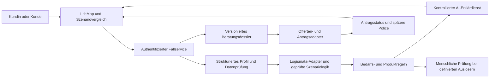

# Pax Digital Advisor: LifeMap

**Recherche- und Umsetzungsplan für BaselHack 2026 · Stand: 30.10.2026 · Sprache: Deutsch**

LifeMap macht die finanzielle Lebenssituation sichtbar, lässt Kundinnen und Kunden mögliche Veränderungen ausprobieren und leitet erst danach passende Vorsorgeschritte und Pax-Lösungen ab. Das Kernprodukt ist eine interaktive Lebens- und Versorgungskarte mit einem erklärenden AI Advisor.

**Prüftiefe:** Ausgewählte Abschnitte und Seiten wurden inhaltlich bzw. visuell geprüft; eine vollständige Durchsicht aller Seiten und Videos ist noch nicht erfolgt.

**Status:** Die Quellen wurden heruntergeladen, technische Beispiele erfasst und die Planung ausgearbeitet. Eine eigene Advisor-App ist noch nicht implementiert. Die beschriebenen Funktionen und Arbeitspakete sind der Bauplan für den Prototyp.

## 1. Entscheidung und Nutzenversprechen

**„Verstehe heute, was deine Entscheidungen für morgen bedeuten.“**

Die Oberfläche verbindet drei Elemente:

- **LifeMap:** Haushalt, Ziele, Budget und bestehende Versorgung aus allen drei Säulen.
- **Future Lab:** Vergleich von Familie/Arbeitspensum, Wohneigentum und Pensionierung mit nachvollziehbaren Annahmen.
- **Beratungsdossier:** bestätigte Angaben, Quellen, Berechnungen, Alternativen und Gründe für jeden vorgeschlagenen Schritt. Das Dossier begleitet Offerte, Antrag und spätere Police.

Der AI Advisor fragt gezielt nach entscheidungsrelevanten Unbekannten und erklärt Ergebnisse. Finanzielle Berechnungen und Produktregeln kommen aus kontrollierten, versionierten Komponenten. Der Advisor darf auch zum Ergebnis kommen, dass aktuell keine zusätzliche Versicherung nötig ist oder zuerst Informationen fehlen.

## 2. Was tatsächlich verfügbar ist

| Ressource | Verifizierter Stand | Konsequenz für den Prototyp |
|---|---|---|
| Challenge-Material | Alle 10 angebotenen PDFs, zusammen 268 Seiten, aus dem Original-ZIP extrahiert | Personas, Vorsorgeanalysen, Angemessenheitsprüfung und fünf vollständige Muster-Offerten als Arbeitsgrundlage |
| Ergänzende PDFs | 6 technische Tarifunterlagen und 19 weitere Produkt-/Fondsunterlagen, zusammen 123 Seiten | Regeln und Produktunterschiede strukturiert erfassen; Versionsdatum mitführen |
| Logismata | OpenAPI 3.1.0, APICalc-Version 1.2, 24 Operationen | Serveradapter statt eigener unkontrollierter Versicherungsrechnung |
| Rechnerbeispiele | Zu allen 24 Hub-Rechnern sind Beispiel-Anfrage, sichtbare HTTP-200-Antwort und JSON-Datei gesichert | Integrationsbeispiele und Ausgangspunkt für spätere Adaptertests; keine vollständige fachliche Validierung |
| Steuerbasis | Beispielantwort: Version 26.09, Datum 10.09.2026 | Datenstand an jeder Steuerberechnung sichtbar machen |
| Quicksale | Produktübersicht und Angebotsrechner in der EDU-Umgebung geprüft; fiktive Person verwendet | Übergabefelder und Tarifoptionen sind greifbar; eine integrierbare Sales-API ist damit noch nicht nachgewiesen |
| Digitalantrag | Öffentliche Pax-Seite beschreibt Antrag, digitale Unterschrift und Wiederaufnahme für Vertriebspartner | Als vorhandenen Partnerprozess berücksichtigen; Kundenselbstbedienung und technische Anbindung mit Pax klären |
| Kundenportal | Öffentliche Portalübersicht nennt die Verwaltung privater Lebensversicherungen | Zielbild für den Policenschritt; tatsächliche Ausstellung und Portalübergabe nicht verifiziert |
| Design | Storybook, Installation, Design-Tokens, Typografie, öffentliche Markenregeln und entpackte Original-Logodateien gesichert | Pax-Auftritt übernehmen; Paketberechtigung und Schriftlizenz vor Umsetzung prüfen |

**Ablage im Team-Repo:** `documentation/baselhack`. Fachquellen stehen unter `references/` sowie im gemeinsamen Ordner `documentation/challenge_material/`. PDF-Texte und Vorschauen stehen unter `generated/`; Logos und Videos unter `assets/pax/` im Repo. Das Quellenverzeichnis am Dokumentende führt jedes PDF und die ergänzenden Seiten auf. Die Originaldateien bleiben unverändert.

**Ablagestruktur:** Redundante PDF-Kopien wurden zusammengeführt; alle Herkunftslinks bleiben im Katalog. Logo-ZIPs sind vollständig in `assets/pax/logos/` entpackt. Es wird standardmäßig kein ZIP erzeugt.

**Zugang:** Der Bearer-Token ist mit ausdrücklicher Nutzerfreigabe ausschließlich unter `private/logismata.env` mit Dateirechten `0600` abgelegt. `private/` ist von Git und dem auslieferbaren Materialpaket ausgeschlossen. Das ausgelesene JWT-Ablaufdatum ist **03.11.2026, 23:59:59 Europe/Zurich**; die JWT-Signatur wurde bei dieser Metadatenprüfung nicht verifiziert. Für spätere Nutzung Zugang im Hub prüfen. Kein Token gehört ins Frontend oder in dieses Dokument.

## 3. Anforderungen an das Ergebnis

| Challenge-Anforderung | Geplante Umsetzung | Nachweis in der Demo |
|---|---|---|
| Lebenssituation und Entwicklungsziele | Bestätigbares Haushaltsprofil, Ziele, Budget und offene Angaben | Zielwahl und persönliche Prioritäten vor der ersten Produktempfehlung |
| Alle drei Säulen | AHV/IV, berufliche Vorsorge sowie 3a/3b und bestehende private Absicherung mit Quellenstatus | Sichtbare Aufteilung der Leistungen und des verfügbaren Kapitals |
| Familie, Eigenheim, Pensionierung | Drei echte Szenariomodule auf demselben Profil | Eine Änderung führt zu neu berechneten, gespeicherten Ergebnissen |
| Situationsgerechte Pax-Lösung | Zunächst Bedarf und Handlungsoptionen; danach regelbasierter Produktvergleich | Begründung, Alternative, Einschränkung und verbleibende Lücke |
| Advisory bis Police | Durchgängiger gespeicherter Fall mit klaren Statusübergängen | Nachvollziehbarer Weg bis zur ausdrücklich simulierten oder tatsächlich angebundenen Police |
| Intelligente Rückfragen | Fragen nach Auswirkung auf die Entscheidung und Datenlücken priorisieren | Advisor fragt nach fehlenden PK-/Arbeitgeberleistungen statt voreilig mehr Versicherung vorzuschlagen |
| Menschliche Beratung | Definierte fachliche Auslöser und vollständige Übergabe | Ein Grenzfall wird mit Erklärung an eine Person übergeben |
| Erklärbarkeit und Datenschutz | Dokumentierte Kriterien, kontrollierte Datenwege, Zugriffsschutz und prüfbare Berechnungen | Herkunft und Annahmen lassen sich öffnen; kein ungeprüfter Modellversand |

Mehrsprachigkeit DE/FR/IT/EN, NPS und aggregierte Abbruchanalysen sind Erweiterungen. Voice und Avatar kommen erst nach einem funktionierenden Kern.

## 4. Erkenntnisse aus den Unterlagen, die den Plan verändern

### 4.1 Versorgungslücken ändern sich über die Zeit

Der gelieferte Paar-Vorsorgecheck zeigt im konkreten Krankheitsfall zunächst einen jährlichen Überschuss von CHF 2’321 und ab dem im Beispiel hinterlegten Ende der Kinderleistungen eine Lücke von CHF 14’029. Beim Tod durch Krankheit wächst die jährliche Lücke im selben Referenzfall von CHF 4’106 auf CHF 20’660. Bei gestaffelter Pensionierung wechselt der Haushalt von einem Überschuss von CHF 8’605 zu einer Lücke von CHF 33’827, sobald beide pensioniert sind.

**Designentscheidung:** Die zentrale Grafik ist eine Zeitachse mit Ereignissen und Leistungsphasen. Ein heutiger grüner Status darf eine spätere Unterdeckung nicht verstecken. Diese Zahlen sind Werte des bereitgestellten Musterfalls, keine allgemeinen Leistungszusagen. Insbesondere darf aus dem dort gesetzten Enddatum keine allgemeine Regel „Kinderrenten enden immer mit 18“ abgeleitet werden.

**Quelle:** Paar-Vorsorgecheck, PDF-Seiten 4, 7 und 16; diese Seiten wurden zusätzlich gerendert und visuell geprüft.

### 4.2 Krankheit und Unfall getrennt behandeln

Der Einzelpersonen-Vorsorgecheck weist bei Erwerbsunfähigkeit durch Krankheit im dritten Jahr CHF 7’200 Jahreslücke aus, durch Unfall im dargestellten Vergleich keine Lücke. Seine dargestellte Alterslücke beträgt CHF 23’641 jährlich.

**Designentscheidung:** Krankheit und Unfall werden als unterschiedliche Fälle modelliert. Arbeitgeberleistungen, Taggeld, UVG und PK-Leistungen werden koordiniert und nicht ungeprüft addiert. Die Beispielanalysen sind Referenzfälle; sie ersetzen keine aktuelle Berechnung mit vollständig identischen Eingaben und Annahmen.

**Quelle:** Einzelpersonen-Vorsorgecheck, PDF-Seiten 3–5 und 9–11.

### 4.3 Fehlender Bedarf ist keine bewiesene Bedarfsfreiheit

Beim bereits durchgeführten synthetischen Risiko-Test führte ein nicht gesetzter Bedarf zu einer ausgegebenen Null-Lücke. Mit einem Bedarf von CHF 90’000 ergab Szenario 1 CHF 69’268 Einkommen und CHF 20’732 Lücke. Der separat archivierte Standarddatensatz enthält die unveränderten Hub-Beispiele und ist vom zuvor geänderten Testfall zu unterscheiden.

**Designentscheidung:** Unbekannte Angaben bleiben `unknown`; keine Umwandlung in Null ohne fachlich begründete Regel. Ohne bestätigten Bedarf gibt es keine Aussage „ausreichend versichert“. Jahres- und Monatsbeträge sind explizit gekennzeichnet.

### 4.4 Haushaltsplanung und persönliche Angemessenheit sind verschieden

Die Angemessenheitsprüfung für qualifizierte Lebensversicherungen betrachtet bei der persönlichen Einkommens- und Vermögenserfassung ausdrücklich eigene Werte ohne Hinzurechnung des Partners. Sie prüft finanzielle Tragbarkeit, Anlageziel, Horizont, Kenntnisse, Erfahrung und Risikobereitschaft. Unvollständige Angaben erlauben keine abgeschlossene Prüfung. Das Formular erklärt außerdem, dass es nur unverändert verwendet werden darf.

**Designentscheidung:** Haushaltsübersicht und persönliches Anlageprofil sind getrennte Datensichten. Ein gemeinsames Vermögen legitimiert nicht automatisch eine individuelle Sparverpflichtung. Der digitale Vorabdialog im Prototyp ist als Vorprüfung gekennzeichnet und ersetzt das unveränderte offizielle Formular oder einen von Pax freigegebenen digitalen Prozess nicht. Die im Formular gezeigte Punkte- und Garantiegewichtung wird vor fachlicher Freigabe nicht als eigener verbindlicher Prüfprozess ausgegeben.

**Quelle:** Angemessenheitsprüfung, PDF-Seiten 1–6; insbesondere Seiten 3 und 6 visuell geprüft.

### 4.5 Sparprämie, Risikoschutz und Prognose auseinanderhalten

Die LifeStar- und FondsStar-Muster enthalten garantierte Leistungen, Szenarien, Kosten, Rückkaufswerte und Zusatzversicherungen. Im FondsStar-Muster bezieht sich die viermonatige Befreiung bei Familienzuwachs auf Kosten- und Risikoprämien. Das darf nicht als vollständige Weiterzahlung der Sparprämie erklärt werden. Der Auszahlungsplan trennt garantierte von fondsabhängigen Auszahlungen und ist im Muster zeitlich befristet.

**Designentscheidung:** Keine Gleichsetzung von Fondsprognose und Garantie, von Einzahlung und Rückkaufswert oder von Auszahlungsplan und lebenslanger Rente. Vorzeitiger Ausstieg, Kosten und Flexibilität werden vor der Entscheidung sichtbar.

**Quellen:** LifeStar-Muster, PDF-Seiten 1–8; FondsStar-Muster, Seiten 1–3; Auszahlungsplan-Muster, Seiten 1–4.

### 4.6 Prämien und Deckungsvarianten verständlich erklären

Das EU-Muster weist CHF 811.50 Bruttoprämie und CHF 704.70 aktuell ermäßigte Jahresprämie aus. Die Ermäßigung ist nicht garantiert; auch EU-Prämien können laut Musterbedingungen angepasst werden. Quicksale und die technischen Unterlagen zeigen Varianten ohne Unfall- oder ohne Deckung psychischer Leiden sowie verschiedene Wartefristen.

**Designentscheidung:** Kein Ranking nur nach der niedrigsten sichtbaren Prämie. Ein Wechsel der Variante muss die Folgen für die analysierten Risiken zeigen. Die Nettoprämie wird nicht als dauerhaft garantierter Preis dargestellt. Musterpreise gelten ausschließlich für die jeweilige Musterperson und Konfiguration.

**Quellen:** EU-Muster, PDF-Seiten 1–4; technische SIR-Unterlagen; Quicksale-EDU-Prüfung. Die technischen SIR- und Todesfallblätter tragen ältere Stände aus 2023; deren Verbindlichkeit gegenüber neueren Bedingungen ist mit Pax zu klären.

### 4.7 Basisinformationen gehören zur Entscheidung

Bei der ergänzenden Suche im offiziellen Download-Center wurden zwölf weitere relevante PDFs gesichert: Basisinformationen zu LifeStar-/FondsStar-Varianten, Pax 3a und Auszahlungsplan, zwei angebotene UBS-Fondsunterlagen sowie Produktübersicht, Fondsübersicht und Fondsbroschüre. Die Basisinformationsblätter unterscheiden sich ausdrücklich von Werbematerial und erläutern Produktart, Risiken und Kosten.

**Designentscheidung:** Vor einer qualifizierten Produktempfehlung die zum konkreten Tarif passende Basisinformation mit Version zugänglich machen und im Beratungsdossier referenzieren. Fondsinformationen und versicherungsbezogene Informationen sind unterschiedliche Ebenen: Ein Fonds-Kostenausweis ersetzt nicht den gesamten Versicherungskostenausweis. Pax 3a bleibt eine eigene Produktkonfiguration; aus dessen digitalem Einstieg wird keine allgemeine Gleichsetzung mit anderen 3a-Verträgen abgeleitet.

**Quellen:** Zusätzliche PDFs im Inventar unter `references/products/key-information/` und `references/funds/`; insbesondere die ersten Seiten der Basisinformationen zu Pax 3a und FondsStarPlanInvest.

### 4.8 Nachgeladene Produktblätter und Medien

Die zwei nachgeladenen Produktblätter sind unter [FondsStar](<../references/products/flyers/fondsstar.pdf>) und [LifeStar](<../references/products/flyers/lifestar.pdf>) abgelegt; beide wurden auf allen zwei Seiten visuell geprüft. Das LifeStar-Blatt unterscheidet neben Garantie- und Fondsanlage eine zusätzliche, variabel verzinste, im Produktblatt als „risikolos“ bezeichnete Anlage. Der Plan muss diese konkrete Anlagekomponente und ihre vertraglichen Regeln erfassen, statt alle Varianten auf einen einzigen Garantie-/Fonds-Schieberegler zu reduzieren. Umschichtungsmöglichkeiten und eine automatische Anpassung an 3a-Grenzbeträge sind getrennt von einer individuellen Tragbarkeit zu erklären.

Die 16 identifizierten Videodateien und 16 verfügbaren Untertiteldateien ergänzen die Quellenbasis, einschließlich der drei Quicksale-Anleitungen. Sie sind technisch auf lesbare Bild- und Tonstreams geprüft, aber nicht vollständig inhaltlich gesichtet. Erklärungen aus den Videos werden daher nicht ungeprüft als verbindliche Prozess- oder Vertragsregeln übernommen. Der Medienkatalog führt Quelle, Downloadstatus, Auflösung, Untertitel und Prüftiefe getrennt auf.

### 4.9 Aktuelle öffentliche Analyse als bestehende Referenz

Die öffentliche [Pax/vlot-Analyse](https://www.pax.ch/de/private-vorsorge/vorsorgeanalyse/embedded) wurde am 30.10.2026 mit einem erfundenen Paar und zwei Kindern bis zum 17-seitigen PDF-Export getestet. Bereits vorhanden sind ein Familienprofil, drei Säulen über Renten und Kapitalverzehr, Steuerbetrachtung, eine Lückenrangfolge und eine zeitversetzte Pensionierung. Der PoC muss seinen zusätzlichen Nutzen gegenüber diesem Ist-Stand zeigen. Die Challenge-Beschreibung einer ausschließlich menschlichen Beratung ist deshalb als Aufgabenbeschreibung und nicht als vollständige Bestandsaufnahme der aktuellen öffentlichen Website zu lesen.

Die LifeMap-Demo konzentriert sich auf gezielte Rückfragen, explizite Ziele und Tragbarkeit, gemeinsam veränderte Zukunftsszenarien mit erklärtem Vorher-/Nachher-Effekt sowie die Fallübergabe bis zur klar gekennzeichneten Demo-Police. Bestehende Säulentabellen und PDF-Export sind die Referenzbasis. vlot und Logismata dürfen weder fachlich noch technisch ohne Nachweis gleichgesetzt werden.

Die Referenz zeigt zwei ungeklärte Punkte: kleine Invaliditätslücken erscheinen in der Lösung als ohne Lücke, und der PDF-Export ist trotz durchlaufenem Abschluss als Entwurf mit unvollständigen Eingaben markiert. Unser Abnahmekriterium: Ergebnis, Empfehlung und Export müssen dieselbe Daten-/Annahmenversion, dieselbe Lücke und einen verständlichen Prüfstatus zeigen. Schwellenwerte und Schätzungen sind ausdrücklich zu erklären. Details, Testdaten und Grenzen stehen im [Testbericht](../reports/public-pension-analysis.md); die unveränderte [Testauswertung](../references/public-pension-analysis/reports/analysis-fictitious-family.pdf) ist keine fachlich freigegebene Kundenberatung.

## 5. Personas und Datenbasis

Es gibt zwei unterschiedliche Quellengruppen, die getrennt bleiben:

1. **Die drei Personas:** junges bzw. mittleres Erwachsenenalter als Einzelperson, verheiratetes Paar mit Baby und vermögendes Paar. Die Müller-Persona hat laut PDF CHF 20’000 Vermögen, CHF 100’000 Einkommen, einen voll arbeitenden Partner und eine nicht erwerbstätige Partnerin. Ob das Einkommen brutto oder netto gemeint ist, muss bestätigt werden.
2. **Die ausgefüllten Vorsorgeanalysen:** eigenständige Referenzfälle mit anderen Geburtsdaten, Einkommen und Vertragsangaben. Deren Zahlen dürfen nicht stillschweigend in die Müller-Persona übernommen werden.

In der vermögenden Persona stehen offenbar kopierte Müller-Bezeichnungen bei den Arbeitspensen. Das wird als Quellenunklarheit markiert und nicht automatisch Personen zugeordnet.

**Demo-Hauptfall:** die Müller-Persona. Fehlende PK-Werte, Budgetpositionen und zusätzliche Ziele wie „Eigenheim in fünf Jahren“ werden für die Demo ausdrücklich als synthetische Ergänzungen bezeichnet. Ein separater Referenzmodus zeigt die unveränderten Werte des Paar-Vorsorgechecks.

Gesundheitsdaten und echte Ausweiskopien werden für die Hackathon-Demo nicht benötigt. Die Originalunterlagen bleiben im autorisierten lokalen Arbeitsbereich und werden nicht ungeprüft an ein externes Modell übermittelt.

## 6. Beratungsablauf und Bildschirme

| Schritt | Kundenerlebnis | Gespeichertes Ergebnis |
|---|---|---|
| 1. Einstieg | Sprache, Demo-Modus und verständliche Information über Datenverarbeitung | Modus, Sprache, Informationsstand und gegebenenfalls erforderliche Einwilligungen |
| 2. Ziele | „Was möchtest du möglich machen oder absichern?“ | Priorisierte Ziele, Zeitpunkt und gewünschte Flexibilität |
| 3. Haushalt | Personen, Beziehung, Kinder, Erwerb und Betreuung | Strukturierte Beziehungen, bestätigte Angaben und offene Fragen |
| 4. Finanzbild | Einkommen, Ausgaben, Vermögen, Schulden, Rücklagen | Nachhaltig verfügbarer Betrag statt bloßes Bruttoeinkommen |
| 5. Bestehende Vorsorge | Angaben oder kontrollierter Dokumentimport zu allen drei Säulen | Leistungen/Kapital mit Quelle, Datum und Bestätigungsstatus |
| 6. LifeMap | Heute, wesentliche Ereignisse und spätere Leistungsphasen | Bestätigter Ausgangsfall |
| 7. Future Lab | Familie, Eigenheim und Pensionierung ändern und vergleichen | Berechnete Szenarioversionen mit Annahmen und Unsicherheiten |
| 8. Prioritäten | Welche Lücke ist relevant, was ist finanzierbar? | Gewählte Handlungsstrategie; auch Abwarten oder Informationsbeschaffung möglich |
| 9. Lösungen | Passende Pax-Produkte mit Alternative, Einschränkungen und Begründung | Nachvollziehbare Empfehlung und gegebenenfalls persönliches Anlageprofil |
| 10. Offerte | Leistung, Laufzeit, Wartefrist, Preis und Dokumente prüfen | Verifizierte oder klar als Demo markierte Offertenversion |
| 11. Antrag | Angaben bestätigen, erforderliche Prüfungen und Signaturprozess | Antrag mit eigenem Status; noch keine automatische Annahmebehauptung |
| 12. Portal | Bearbeitungsstand, Dokumente, spätere Police und nächste Überprüfung | Dauerhafter Fallverlauf und kontrollierter Anlass für eine erneute Beratung |

Beispiel für eine wertvolle Rückfrage: „Wie lange zahlt dein Arbeitgeber bei Krankheit weiter, und welche Leistungen stehen in deinem PK-Ausweis? Das entscheidet, welche Wartefrist zu deiner Situation passen könnte.“

Jede Rückfrage muss eine relevante Unbekannte schließen. Der Dialog darf sich nicht wiederholt auf bereits bestätigte Daten zurücksetzen.

## 7. Finanz- und Szenariomodell

### Gemeinsame Regeln

- Personen und Haushalt besitzen stabile IDs; Geldbeträge haben Währung, Zeitraum sowie Brutto-/Netto-Bezug.
- Jeder Wert trägt Quelle, Quelldatum, Gültigkeit und Status `confirmed`, `estimated`, `unknown` oder `conflicting`.
- Leistungen haben Start, Ende, Ereignis, versicherte Person, Empfänger und Koordinationsregel. Kapital und laufendes Einkommen bleiben getrennt.
- Bereits für Eigenheim oder Notreserve vorgesehenes Kapital wird nicht nochmals vollständig für die Pensionierung verwendet.
- Pro Phase gilt konzeptionell: Lücke = bestätigter Bedarf minus anrechenbare, koordinierte Einnahmen; Überschuss und Unterdeckung werden getrennt ausgewiesen. Das ist die Darstellungslogik, keine Ersatzformel für komplexe Versicherungsansprüche.
- Prognosen trennen Nominalwerte, Kaufkraftannahmen, garantierte Komponenten und unsichere Renditen.

### Familie und Arbeitspensum

Vergleichen: heutige Situation, Rückkehr in Erwerbsarbeit, reduziertes Pensum und zusätzliche Betreuungskosten. Beide Partner werden einzeln und gemeinsam betrachtet. Auch der Ausfall unbezahlter Betreuung kann Ersatzkosten verursachen. Unterschiedliche Ereignisse sind Krankheit, Unfall und Tod jeder versicherten Person.

Logismata-Risikooperationen liefern acht bezeichnete Szenarien für zwei Personen. Die API-Struktur enthält Anzahl der Kinder, jedoch in diesen Risiko-Eingaben keinen vollständigen kindbezogenen Zeitplan. Der detaillierte Verlauf mit dem Ende einzelner Kinderleistungen wird deshalb nicht als bereits verfügbare API-Funktion behauptet. Dafür braucht es einen zusätzlichen, von Pax bestätigten Ereignis- und Regelansatz oder eine passende zusätzliche Schnittstelle.

### Eigenheim

Vergleichen: weiter mieten, später kaufen, Kauf mit dafür vorgesehenen liquiden Mitteln und – soweit zulässig – Vorbezug oder Verpfändung von Vorsorgewerten. Anzeigen: Kapitalbindung, laufende Wohnkosten, Rücklagen, Steuerwirkung und Veränderung der späteren Versorgung. Auch Tragbarkeit bei Tod oder Erwerbsunfähigkeit betrachten.

Die gelieferten 24 APICalc-Operationen enthalten keine ausdrücklich ausgewiesene Hypotheken-Tragbarkeitsoperation. Die offizielle Logismata-Weboberfläche zeigt zwar ein Wohnthema, daraus folgt aber keine für das Team verfügbare API. Im MVP wird ein transparentes Planungsmodell mit offengelegten, fachlich bestätigten Annahmen verwendet; es ist keine Finanzierungszusage. Produktbezogene Regeln für privilegierte Vorbezüge stammen aus den konkreten Bedingungen und dürfen nicht auf alle Guthaben verallgemeinert werden.

### Pensionierung

Vergleichen: unterschiedliche Erwerbsaufgabe je Partner, ordentliche bzw. frühere Pensionierung, private Beiträge und Kapitalverbrauch. Übergangsphase bis zur zweiten Pensionierung separat zeigen. Für die 3. Säule werden bestehendes Guthaben, Zahlungspläne, Verfügbarkeit, Garantien und Kosten zusätzlich zum AHV-/PK-Ergebnis integriert.

`calculateRetirementBase` ist laut Swagger auf Grundlagen beim regulären Pensionsalter bezogen; `calculateRetirement` enthält `DesiredRetirementAge`. Referenzfälle und Grenzfälle sind getrennt zu prüfen. Aus der API-Unterstützung folgt keine vollständige Modellierung jeder frühzeitigen Bezugskombination.

## 8. Empfehlungen: Bedarf vor Produkt

Vor einer Empfehlung müssen entscheidungsrelevante Angaben bestätigt, bestehende Deckungen berücksichtigt und die Finanzierbarkeit beurteilt sein. Eine fehlende geeignete Lösung wird offen benannt; der Advisor verspricht keine vollständige Marktberatung außerhalb seines freigegebenen Produktumfangs.

| Erkannter Bedarf | Möglicher Bezug zu Pax | Vorher zu prüfen |
|---|---|---|
| Wiederkehrende Einkommenslücke bei Erwerbsunfähigkeit | EU-/SIR-Varianten bzw. passende Zusatzdeckung | Krankheit/Unfall, Wartefrist, Vorleistungen, Tätigkeitsprofil, Ausschlüsse und Leistungsdefinition |
| Finanzielle Folgen eines Todesfalls | Konstantes/fallendes Todesfallkapital oder Hinterbliebenenrente | Begünstigung, Beziehungen, Restschuld, Dauer, vorhandene Leistungen und Kapitalbedarf |
| Langfristiger Aufbau mit gewähltem Garantieteil | LifeStar-Varianten | Individuelle Angemessenheit, Garantieumfang, Kosten, Laufzeit und Ausstieg |
| Langfristiger fondsgebundener Aufbau | FondsStar-Varianten | Verlustrisiko, Zeithorizont, persönliche Tragbarkeit, Rückkaufswerte und Zusatzdeckungen |
| Digitaler 3a-Einstieg | Pax 3a | Beitragsspielraum, Liquidität, Gesamtkosten und tatsächliche Vertragsbedingungen; nicht pauschal mit einem Quicksale-Tarif gleichsetzen |
| Geplanter Kapitalverzehr | Pax Auszahlungsplan | Laufzeit, garantierte vs. fondsabhängige Zahlungen, Kosten und verbleibendes Kapital |
| Bedarf des Kindes und Absicherung des Versorgers | Kinderversicherung/FirstStep | Konkrete Risiko-/Sparziele, bestehender Schutz und langfristige Verpflichtung |
| Organisatorische Vorsorgehilfe | Pax Care als ergänzender Service | Leistungsumfang; kein Ersatz für größere Versorgungslücken |

Jede Empfehlung zeigt: **Ziel → belegter Bedarf → bestehende Absicherung → vorgeschlagene Maßnahme → Produktmerkmale → Preis/Bindung/Risiko → Alternative → verbleibende Unsicherheit.**

Als Alternativen kommen z. B. höhere Liquiditätsreserve, Anpassung des Zielzeitpunkts, andere Sparaufteilung, bestätigter PK-Einkauf oder vorerst kein Neuabschluss in Betracht. Steuerersparnis allein begründet keine langfristige Versicherungspflicht.

Ein Produktkatalog enthält mindestens Tarif-ID, Produktfamilie, 3a/3b, Version/Gültigkeitsdatum, zulässige Kombinationen, Leistungsereignis, Wartefrist, Garantie, Kosten, Ausschlüsse, Laufzeit, Flexibilität und Quellenverweis. Broschüre, Tarifblatt und individuelle Offerte sind unterschiedliche Dokumenttypen. Bei Widerspruch wird keine automatische Regel erfunden.

## 9. Technische Architektur und Datenfluss

**Frontend:** Der Stack wird nach Teamkenntnissen gewählt. Wenn Paketfreigabe vorhanden ist, passt Angular zur dokumentierten Pax-UI-Bibliothek. Andernfalls die dokumentierten Marken- und Design-Tokens im vorhandenen Stack nutzen, ohne die App von einer ungeklärten Paketberechtigung abhängig zu machen.

**Server:** Profilvalidierung, alle API-Aufrufe, Berechnungs- und Empfehlungsversionen, Zugriffskontrolle und Auditereignisse. Der Client erhält keine Anbieter-Zugangsdaten.

**AI:** Verarbeitet nur den freigegebenen und notwendigen Kontext. Extrahiert Angaben in ein festes Schema, schlägt Rückfragen vor und erklärt bereits berechnete Resultate. Keine freie Prämienerfindung, keine autonome Leistungszusage und keine Annahmeentscheidung. Ein ausschließlich synthetischer Demo-Modus bleibt auch ohne freigegebenes Produktionsmodell nutzbar.

**Dokumente:** Im MVP zuerst manuelle Eingabe und bestätigte Felder. Ein Import zeigt erkannte Felder mit Dokument/Seite und verlangt Bestätigung kritischer Angaben. Dokumenttext ist Datenquelle, keine Anweisung an das System. Sensible Rohdokumente werden nicht in allgemeine Telemetrie oder Modellprotokolle geschrieben.

**Adapter:** Berechnungen, Offerten, Antrag und Police sind eigene Schnittstellen. Ein Webseiten-Link oder UI-Test belegt keine unterstützte Integrations-API. Produktionsbetrieb wird nicht auf automatisierte Bedienung von Quicksale gestützt.

### Minimaler Datenkern

`Household`, `Person`, `Goal`, `BudgetItem`, `Asset`, `Debt`, `Provision`, `BenefitPeriod`, `Scenario`, `CalculationRun`, `Recommendation`, `AppropriatenessProfile`, `Quote`, `Application`, `Policy`, `ReviewTask`, `AuditEvent`.

Jeder Rechenlauf speichert Eingabeversion, Szenarioversion, Operation, Antwortstatus, Ergebnis, Quellen und Datenstand. Jede Empfehlung referenziert genau diese Läufe und die verwendete Regel-/Produktversion. Eine fachliche Begründung wird dokumentiert; interne Gedankengänge des Modells sind kein Auditbeleg.

## 10. Logismata-Integration: festgestellte Grenzen

- Basis: `https://baselhackathon2026.azurewebsites.net/viper`; Operationen per `POST /operation/standard/<operationId>` mit JSON und serverseitiger Bearer-Authentifizierung.
- `TaxLocationID` wird über die Ortssuche ermittelt. Ortsnamen, Kanton und Steuerdatenstand bleiben am Ergebnis nachvollziehbar.
- AHV-/PK-Grundlagen können in den Basisfunktionen approximiert sein. Eine Schätzung erhält niemals den Status „bestätigter PK-Ausweis“.
- Im Risiko-Schema bedeuten Szenarien 1–4 Erwerbsunfähigkeit/Krankheit, Erwerbsunfähigkeit/Unfall, Tod/Krankheit, Tod/Unfall für Person 1; 5–8 gelten für Person 2.
- **Offene Diskrepanz:** Das Risiko-Schema nennt `ErrorCode: 1` als OK, die erfassten Risiko-Beispiele liefern `0`. Das Pensionierungsbeispiel liefert `1`. Mit Logismata/Pax klären; bis dahin Antwortstatus, Szenariocode und Plausibilität gemeinsam prüfen und unklare Fälle als nicht validiert markieren.
- Die beobachteten 3a-Limits sind CHF 7’258 bzw. CHF 36’288 ohne P2. Die API-Antwort ist eine Rechengrundlage, keine vollständige Prüfung der individuellen Beitragsberechtigung und zulässigen Quote. Nicht dauerhaft hart codieren.
- Die OpenAPI verwendet für gewisse Funktionen Geschlecht und Geburtsjahr. Kundenangaben und für die Berechnung erforderliche Kategorien respektvoll unterscheiden; fehlende oder nicht abbildbare Fälle nicht erraten.
- HTTP 200 allein ist kein Nachweis für sachliche Richtigkeit, vollständige Eingaben oder regulatorische Angemessenheit.

Die vollständige Operationenliste, Pflichtfelder und archivierten Beispielantworten folgen im Anhang.

## 11. Durchgängiger Ablauf bis zur Police

Der Fall besitzt einen tatsächlichen gespeicherten Statusverlauf:

`Entwurf → Profil bestätigt → Analyse vollständig → Empfehlung geprüft → Offerte erstellt → Antrag begonnen → Angaben bestätigt → erforderliche Prüfung/Signatur → eingereicht → in Prüfung → angenommen oder Rückfrage/abgelehnt → Police ausgestellt`.

„Antrag eingereicht“ bedeutet nicht „versichert“. Eine unterschriebene Erklärung, Annahme durch Pax und Ausstellung einer Police sind unterschiedliche Ereignisse. Ein eventueller provisorischer Schutz wird nur anhand ausdrücklich bestätigter Bedingungen erklärt.

**MVP:** Den eigenen gespeicherten Fall und das Beratungsdossier vollständig umsetzen. Für nicht verfügbare Backend-Schnittstellen einen ausdrücklich beschrifteten Sandbox-Adapter mit nachvollziehbaren Statusübergängen nutzen. Die Demo zeigt eine fiktive Police ausschließlich nach einer simulierten Annahme; keine reale Unterschrift und kein echter Abschluss.

**Zielintegration:** Von Pax freigegebene Übergabe von bestätigten Stammdaten, benötigter Deckung, Tarifkonfiguration, Dokumentversionen und Beratungsbegründung. Rückmeldung zu Antrag, Prüfbedarf und Policen-ID; Wiederaufnahme ohne erneute Erfassung. Gesundheitsprüfung, Identifizierung und gegebenenfalls Geldwäschereiprüfung bleiben im dafür freigegebenen Verfahren.

Der in Quicksale beschriebene Ausweis-Scan dient der Erfassung und ersetzt laut sichtbarem Hinweis keine Identitätsprüfung. Der Prototyp darf diese Schritte nicht gleichsetzen.

## 12. Menschliche Prüfung, Datenschutz und Sicherheit

Diese Punkte sind Implementierungsanforderungen aus dem Challenge-Rahmen, keine Bestätigung einer bereits bestehenden Compliance.

| Auslöser | Verhalten |
|---|---|
| Entscheidende Daten fehlen oder widersprechen sich | Ergebnis als unvollständig markieren, gezielt nachfragen, bei Bedarf übergeben |
| Hohe Auswirkungen oder komplexer Fall | Fachliche Prüfung anhand mit Pax vereinbarter Kriterien; keine freie Risikoschwelle erfinden |
| Nicht bestandene oder unvollständige Angemessenheit | Qualifizierte Lebensversicherung nicht als geprüft passend präsentieren |
| Grenzüberschreitender Bezug, besondere Erwerbsform, unklare Begünstigung oder komplexer Vorbezug | Spezialberatung und dokumentierte offene Punkte |
| Medizinische Risikoprüfung oder Annahmeentscheidung | Freigegebener Underwriting-Prozess; kein autonomes Urteil des Sprachmodells |
| Nutzer wünscht eine Person | Übergabe mit Einwilligung/Informationsgrundlage und vorhandener Fallzusammenfassung |

Umsetzung von Beginn an:

- Datenverarbeitung vor Erhebung transparent erklären: Zweck, Empfänger, Modellumgebung, Speicherung und Rechte.
- Keine unkontrollierte Übermittlung von Kunden-, Finanz- oder Gesundheitsdaten an externe Dienste. Anbieter-, Standort-, Vertrags- und Zugriffskonzept mit Pax freigeben.
- Rollen und fallbezogene Berechtigungen; getrennte Sichtbarkeit persönlicher Daten innerhalb eines Haushalts.
- Verschlüsselte Übertragung und Speicherung, serverseitige Secrets, definierte Aufbewahrung und Löschung nach fachlich/rechtlich bestätigten Regeln.
- Auditprotokoll mit Datenzugriffen und Entscheidungs-/Rechenversionen; möglichst ohne unnötige Rohdaten, mit begrenzten Zugriffsrechten.
- Fachliche Dokumente und importierte Inhalte dürfen weder Systemregeln überschreiben noch eigenständig externe Werkzeuge auslösen.
- Gesundheitsdaten erst im nötigen, freigegebenen Prozess erfassen; keine offenen Freitextsammlungen zu Beginn.
- Abbruchanalyse mit Ereignissen wie `scenario_viewed` oder `handover_requested`; keine vollständigen Gesprächs-, Finanz- oder Gesundheitsinhalte an Marketinganalyse senden.

**Quelle:** Challenge und `legal-framework.pdf`; produktbezogene Pflichten und Formvorgaben zusätzlich aus den vollständigen Musterunterlagen. Vor einem realen Einsatz fachliche, juristische und Sicherheitsprüfung durch Pax.

## 13. Design und Sprache

Die öffentlichen Markenregeln nennen Pax Green `#8CCD0F`, Pax Purple `#3C0078` und Deep Purple `#2A0754`. Die Hausschrift ist PaxCivil; Arial wird als kompatible Ersatzschrift beschrieben. Schriftdateien nur mit geklärter Berechtigung nutzen.

Die UI-Dokumentation beschreibt `@paxch/pax-ui` für Angular 19/20, Bereitstellung über GitHub Packages und erforderlichen Paketzugang. Daraus folgt keine erteilte Zugriffsberechtigung. Token-System, Typografie und Komponentenreferenz sind lokal archiviert; die Original-Logodateien liegen entpackt unter `assets/pax/logos/online/` und `assets/pax/logos/print/`.

Für LifeMap verwenden: übersichtliche Fortschrittsanzeige, ruhige Karten, klar beschriftete Eingaben, bestätigbare Zusammenfassungen und Szenarien im direkten Vergleich. Lücken nicht nur über Rot/Grün vermitteln, sondern mit Betrag, Zeitraum und Bedeutung. Zahlen bleiben beim Sprachwechsel identisch; Übersetzungen kritischer Produktaussagen werden fachlich geprüft.

Alle vier Zielsprachen werden in der Struktur vorbereitet. Für die erste Demo DE und EN vollständig priorisieren, sofern Teamzeit und Pax-Sprachprüfung nicht die vollständige Vier-Sprachen-Abdeckung erlauben. Voice benötigt zusätzlich einen kontrollierten Datenweg; ein Avatar ist optional.

## 14. Bauplan für ein Hackathon-Wochenende

Das Team besteht aus **fünf Personen**. Die ausführliche Aufgabenverteilung und die gemeinsamen Integrationspunkte stehen im [Teamplan](<team-plan.md>). Die Zeitblöcke beziehen sich auf ein gemeinsames Fenster von ungefähr 48 Stunden, nicht auf 48 Arbeitsstunden pro Person.

| Rolle | Hauptverantwortung |
|---|---|
| Person 1 | Frontend, UX, LifeMap und Szenariovergleich |
| Person 2 | Datenmodell, Logismata und geprüfte Finanzlogik |
| Person 3 | AI-Dialog, Rückfragen und erklärbare Empfehlungen |
| Person 4 | Persistenz, Offerten-/Antragsadapter und Portal |
| Person 5 | Fachliche Qualität, Integration mit Pax und Demo |

Die Rollen entwickeln nach einem gemeinsamen Datenvertrag gleichzeitig und integrieren früh; die folgende Tabelle beschreibt den gemeinsamen Fortschritt.

| Block | Arbeit | Fertig, wenn |
|---|---|---|
| 0–4 h | Fachfragen mit Cem/Claude, Demo-Datensatz, freigegebene Modellumgebung, Paket-/API-Zugang | Offene Annahmen markiert, Grenzen des Prototyps beschlossen |
| 4–12 h | Persistentes Profil, Ziele/Budget, Serveradapter und Eingabeprüfung | Derselbe Fall lässt sich speichern und wieder öffnen; Risiko- und Altersrechnung laufen über den Adapter |
| 12–22 h | LifeMap und drei Szenariomodule | Änderungen aktualisieren Resultate und ihre Annahmen; keine Doppelzählung von Kapital |
| 22–30 h | Rückfragen, Erklärungen, Produktregeln und persönliche Vorprüfung | Empfehlung referenziert bestätigten Bedarf, Quellen und konkrete Merkmale |
| 30–38 h | Offerte, Antragsstatus, menschliche Übergabe und Portal-Sandbox | Die durchgängige Journey funktioniert mit klar bezeichneten Integrationsgrenzen |
| 38–44 h | Fachvergleich, Fehlerfälle, Datenschutzprüfung und Demo-Feinschliff | Abnahmekriterien bestanden; alle Aussagen entsprechen dem tatsächlich verfügbaren Funktionsstand |
| 44–48 h | Präsentation und Puffer | Drei-Minuten-Demo ohne manuelle Datenreparatur möglich |

**P0:** Alle Muss-Anforderungen in einem schmalen, vollständigen Fall. **P1:** zweisprachiger Dialog, einfache Dokumentextraktion, NPS und datensparsame Abbruchanalyse. **P2:** vier vollständig geprüfte Sprachen, Voice, Avatar und zusätzliche Spezialfälle.

Bei Zeitknappheit die Zahl der Zusatzprodukte und die Gestaltungskomplexität reduzieren; keines der drei Szenarien oder der Ende-zu-Ende-Statusfluss fällt weg.

## 15. Abnahme und sinnvolle Prüfungen

- [ ] Lebenssituation, finanzielles Gesamtbild und alle drei Säulen sind erfasst oder ausdrücklich als unbekannt markiert.
- [ ] Vor der Bedarfsanalyse erscheint keine priorisierte Produktempfehlung.
- [ ] Fehlende Bedarfsangaben führen nicht zu einer falschen Entwarnung.
- [ ] Krankheit/Unfall und beide Partner sind unterscheidbar; vorhandene Leistungen werden nicht doppelt gerechnet.
- [ ] Familie, Eigenheim und Pensionierung verändern nachweisbar die zugrunde liegenden Berechnungen.
- [ ] Ereignisphasen und der spätere Wegfall hinterlegter Leistungen werden sichtbar; nicht durch die API gedeckte Regeln sind fachlich bestätigt oder als Demo-Annahme markiert.
- [ ] Jahres-/Monatswerte, Brutto/Netto, Kapital/Einkommen und Garantien/Prognosen sind konsistent.
- [ ] Eine Empfehlung lässt sich bis zu Eingaben, Rechenlauf, Kriterien und Produktdokument zurückverfolgen.
- [ ] Persönliche Tragbarkeit wird nicht aus ungetrenntem Haushaltsvermögen abgeleitet.
- [ ] Nicht passende oder unvollständige Fälle gelangen nachvollziehbar zur menschlichen Prüfung.
- [ ] API-Fehler, Zeitüberschreitung und ungültiger Token erzeugen keine erfundenen Resultate.
- [ ] Antwortschemata werden gegen die gesicherten Beispiele geprüft; die Risiko-ErrorCode-Diskrepanz ist geklärt oder sichtbar abgefangen.
- [ ] Szenarien verändern genau die vorgesehenen Annahmen; Daten bleiben bei Rücknavigation und Wiederaufnahme erhalten.
- [ ] Autorisierung trennt Fälle verschiedener Personen; Secrets und sensible Rohdaten fehlen in Frontend und allgemeiner Telemetrie.
- [ ] Empfehlung, Offerte, Antrag, Annahme und Police besitzen unterschiedliche Status; simulierte Schritte sind eindeutig bezeichnet.

Für Referenzvergleiche die bereitgestellten Analysen mit identischen Annahmen nachstellen. Historische Musterwerte nicht als erwartete aktuelle API-Werte erzwingen. Die archivierten 24 Beispielantworten sind Integrationsmaterial, keine Versicherungsmathematik-Zertifizierung.

## 16. Drei-Minuten-Demogeschichte

1. **0:00–0:30:** Müller-Persona öffnen. Lebensziele und Haushaltslage bestätigen; fehlende Angaben sichtbar ergänzen.
2. **0:30–1:05:** Ein Arbeitspensum bzw. den Wiedereinstieg ändern. Budget, Versorgung und offene Fragen aktualisieren sich.
3. **1:05–1:35:** Eigenheimvariante vergleichen. Gebundenes Kapital und Auswirkungen auf spätere Ziele gemeinsam sehen.
4. **1:35–2:00:** Pensionierungszeitpunkte ändern. Übergangsphase und langfristige Lücke vergleichen.
5. **2:00–2:30:** Eine begründete Maßnahme auswählen. Produktmerkmale, Einschränkungen und Alternative öffnen; auf Quellen und bestätigte Annahmen zurückführen.
6. **2:30–3:00:** Offerte und gespeicherten Antrag zeigen. Sandbox-Annahme und fiktive Police im Portal darstellen; den menschlichen Prüfpfad kurz öffnen.

Zusätzlicher fachlicher Beleg außerhalb der Hauptgeschichte: Im Referenzfall den späteren Wegfall der Kinderleistungen auf der Zeitachse zeigen. Dieser Moment demonstriert, weshalb eine heutige Momentaufnahme nicht genügt.

## 17. Fragen an Pax und Logismata

1. Welche Eingaben und Regeln sind für den gelieferten Studienfall verbindlich, und welche sind vereinfachte Musterannahmen?
2. Wie soll der Risiko-`ErrorCode` 0 gegenüber dem Swagger-Wert 1 behandelt werden?
3. Welche zusätzlichen Schnittstellen liefern zeitabhängige Kinder-, Taggeld-, UVG- und PK-Leistungsphasen?
4. Welche Rechen- oder Offertenschnittstelle unterstützt Hypotheken-Tragbarkeit, Vorbezug/Verpfändung und deren Vorsorgefolgen?
5. Welche aktuelle Tarif-/Bedingungsversion hat Vorrang, insbesondere bei technischen Blättern von 2023 gegenüber Mustern von 2026?
6. Welche Kriterien erfordern verbindlich menschliche Prüfung, und welche Empfehlungen darf ein digitaler Self-Service abgeben?
7. Wie wird die Angemessenheitsprüfung unverändert bzw. in einem freigegebenen digitalen Äquivalent eingebunden?
8. Welche unterstützte Übergabe existiert zu Quicksale, Digitalantrag, Signatur, Risikoprüfung und Kundenportal? Gibt es Sandbox, Rückmeldungen und Testpolicen?
9. Welche Anforderungen gelten für Identifizierung, Begünstigung, Geldwäschereiprüfung und individuelle Einwilligungen im konkreten Produktprozess?
10. Welche Modellumgebung, Datenlokation, Aufbewahrungsfristen und Protokollierung sind freigegeben?
11. Erhält das Team Zugriff auf `@paxch/pax-ui` und lizenzierte Schriften? Welche Markenassets dürfen im Prototyp verwendet werden?
12. Welche Erfolgskriterien bewertet Pax: Verständnis, ausreichende Versorgung, korrekte Übergabe, Abschlussbereitschaft, Bearbeitungszeit oder andere Größen?

## 18. Prüftiefe und Quellenqualität

- Die öffentliche Pax/vlot-Analyse wurde mit ausschließlich synthetischen Angaben bis zum Original-PDF getestet; die fachliche Richtigkeit ihrer Ergebnisse und die Ursache des Entwurfsstatus wurden nicht unabhängig bestätigt.

- Herunterladen und technische Validierung sind von einer vollständigen inhaltlichen Durchsicht zu unterscheiden. Die PDF-Texte wurden extrahiert und planrelevante Abschnitte ausgewertet; es wird keine vollständige Lektüre jeder Seite behauptet.
- Die fehlenden FondsStar- und LifeStar-Produktblätter sind nachgeladen. Die aktuelle LifeStar-Seite ist unter dem kleingeschriebenen Pfad erreichbar; die ältere 404-Aufnahme bleibt als historischer Quellenstand dokumentiert.
- Die auf den elf untersuchten Pax-Seiten identifizierten 16 Videoreferenzen werden im Medienkatalog mit Downloadstatus, Dateipfad, Prüfsumme und gegebenenfalls Untertiteln geführt. Download bedeutet keine vollständige Sichtung oder fachliche Freigabe des Videos.
- Die zehn Challenge-PDFs bleiben im gemeinsamen Ordner `documentation/challenge_material/`. In der erweiterten Sammlung gibt es keine zusätzliche Kopie dieser Dateien. Zwei weitere PDF-Dubletten wurden bytegenau zusammengeführt; ihre unterschiedlichen Downloadquellen bleiben erhalten.
- Quicksale wurde mit einer fiktiven Person bis zur Angebotskonfiguration geprüft. Tatsächlicher vollständiger Digitalantrag, echte Signatur, Annahme und Policenübertragung wurden nicht nachgewiesen.
- Der Umfang umfasst den Challenge-Hub und die erfassten direkt relevanten Produkt-, Beratungs-, Portal- und Designressourcen. Es ist kein rekursives Archiv sämtlicher Pax-Webseiten oder zugangsbeschränkter Inhalte.
- Alle fachlichen Aussagen bleiben an ihre konkrete Quelle und Version gebunden. Vor realem Einsatz sind die fachliche, juristische und Sicherheitsfreigabe durch Pax erforderlich.

## 19. Quellen und API-Anhang

Der folgende Anhang wird aus dem Katalog unter `catalog/` erzeugt. Er führt die kanonischen PDFs, Herkunftslinks, Webseitenstände, API-Beispiele und Medien auf. Technische Bestandsdaten sind keine Bestätigung einer vollständigen inhaltlichen Prüfung.

<!-- GENERATED SOURCE APPENDIX -->

## Quellenkatalog

38 unterschiedliche Referenz-PDFs mit 417 Seiten aus 40 Downloadquellen. Dazu 48 Webseitenstände, 24 API-Beispiele, 16 Videodateien und 37 entpackte Logo-Dateien. Darunter sind 35 Fach-PDFs, zwei Nutzungs-/Datenschutz-PDFs und eine ausschließlich synthetische Testauswertung. Logo-PDFs zählen separat zu den Markenassets.

### PDF-Unterlagen

| Kategorie | Kanonische Datei | Seiten | Herkunft |
|---|---|---:|---|
| Ergänzende Produkt-/Fondsinformation | [private-provision-overview.pdf](<../references/products/brochures/private-provision-overview.pdf>) | 31 | [Quelle 1](https://assets.pax.ch/x/b7cefa330c/pax-private-vorsorge-information-produktbroschuere-private-vorsorge.pdf) |
| Ergänzende Produkt-/Fondsinformation | [fund-list.pdf](<../references/funds/fund-list.pdf>) | 2 | [Quelle 1](https://assets.pax.ch/x/9611aef893/private-vorsorge-fondsinformation-fondsliste.pdf), [Quelle 2](https://www.pax.ch/de/-/media/pax/download-files/private-vorsorge/fonds-factsheets/pax-fonds-portfolio-fondskurse.pdf) |
| Ergänzende Produkt-/Fondsinformation | [payout-plan.pdf](<../references/products/key-information/payout-plan.pdf>) | 3 | [Quelle 1](https://assets.pax.ch/x/6449970f9e/private-vorsorge-information-basisinformationsblatt-auszahlungsplan.pdf) |
| Ergänzende Produkt-/Fondsinformation | [fondsstar.pdf](<../references/products/key-information/fondsstar.pdf>) | 3 | [Quelle 1](https://assets.pax.ch/x/9c26c5ee3e/private-vorsorge-information-basisinformationsblatt-fondsstar-terzafondsstar-fondsstarinvest.pdf) |
| Ergänzende Produkt-/Fondsinformation | [fondsstar-plan-invest.pdf](<../references/products/key-information/fondsstar-plan-invest.pdf>) | 3 | [Quelle 1](https://assets.pax.ch/x/4f7ac0b38b/private-vorsorge-information-basisinformationsblatt-fondsstarplaninvest-terzafondsstarplaninvest.pdf) |
| Ergänzende Produkt-/Fondsinformation | [lifestar.pdf](<../references/products/key-information/lifestar.pdf>) | 3 | [Quelle 1](https://assets.pax.ch/x/0adfa6348a/private-vorsorge-information-basisinformationsblatt-lifestar-terzalifestar-lifestarinvest-terzalifestarinvest.pdf) |
| Ergänzende Produkt-/Fondsinformation | [lifestar-plan-invest.pdf](<../references/products/key-information/lifestar-plan-invest.pdf>) | 3 | [Quelle 1](https://assets.pax.ch/x/655e987c43/private-vorsorge-information-basisinformationsblatt-lifestarplaninvest-terzalifestarplaninvest.pdf) |
| Ergänzende Produkt-/Fondsinformation | [pax-3a.pdf](<../references/products/key-information/pax-3a.pdf>) | 3 | [Quelle 1](https://assets.pax.ch/x/a21ab764b2/private-vorsorge-information-basisinformationsblatt-pax-3a.pdf) |
| Ergänzende Produkt-/Fondsinformation | [asset-management-overview.pdf](<../references/funds/asset-management-overview.pdf>) | 1 | [Quelle 1](https://assets.pax.ch/x/2cdc10b578/private-vorsorge-information-pax-flyer-pam-fonds.pdf) |
| Ergänzende Produkt-/Fondsinformation | [fondsstar.pdf](<../references/products/brochures/fondsstar.pdf>) | 8 | [Quelle 1](https://assets.pax.ch/x/3962a35a9e/private-vorsorge-produktbroschuere-pax-fondsanlagen.pdf), [Quelle 2](https://assets.pax.ch/x/dceaaef320/private-vorsorge-produktbroschuere-pax-fondsstar.pdf) |
| Ergänzende Produkt-/Fondsinformation | [ubs-msci-world-selection-key-information.pdf](<../references/funds/ubs-msci-world-selection-key-information.pdf>) | 10 | [Quelle 1](https://assets.pax.ch/x/674e1ed1ed/private-vorsorge-ubs-msci-world-selection-ucits-etf-d.pdf) |
| Ergänzende Produkt-/Fondsinformation | [ubs-msci-world-selection-fund-information.pdf](<../references/funds/ubs-msci-world-selection-fund-information.pdf>) | 10 | [Quelle 1](https://assets.pax.ch/x/d1b50d9a6d/ubs-fondsinformation-etf-msci-world-selection-ucits-etf.pdf) |
| Challenge | [legal-framework.pdf](<../../challenge_material/legal-framework.pdf>) | 3 | [Quelle 1](https://pax-hackathon-2026.vercel.app/material/legal-framework.pdf) |
| Challenge | [pax-auszahlungsplan.pdf](<../../challenge_material/offerten/pax-auszahlungsplan.pdf>) | 34 | [Quelle 1](https://pax-hackathon-2026.vercel.app/material/offerten/pax-auszahlungsplan.pdf) |
| Challenge | [pax-erwerbsunfaehigkeit.pdf](<../../challenge_material/offerten/pax-erwerbsunfaehigkeit.pdf>) | 33 | [Quelle 1](https://pax-hackathon-2026.vercel.app/material/offerten/pax-erwerbsunfaehigkeit.pdf) |
| Challenge | [pax-fondsstar.pdf](<../../challenge_material/offerten/pax-fondsstar.pdf>) | 63 | [Quelle 1](https://pax-hackathon-2026.vercel.app/material/offerten/pax-fondsstar.pdf) |
| Challenge | [pax-lifestar.pdf](<../../challenge_material/offerten/pax-lifestar.pdf>) | 64 | [Quelle 1](https://pax-hackathon-2026.vercel.app/material/offerten/pax-lifestar.pdf) |
| Challenge | [pax-todesfall.pdf](<../../challenge_material/offerten/pax-todesfall.pdf>) | 29 | [Quelle 1](https://pax-hackathon-2026.vercel.app/material/offerten/pax-todesfall.pdf) |
| Challenge | [pax-angemessenheitspruefung.pdf](<../../challenge_material/pax-angemessenheitspruefung.pdf>) | 7 | [Quelle 1](https://pax-hackathon-2026.vercel.app/material/pax-angemessenheitspruefung.pdf) |
| Challenge | [pax-vorsorgeanalyse-einzelperson.pdf](<../../challenge_material/pax-vorsorgeanalyse-einzelperson.pdf>) | 12 | [Quelle 1](https://pax-hackathon-2026.vercel.app/material/pax-vorsorgeanalyse-einzelperson.pdf) |
| Challenge | [pax-vorsorgeanalyse-paar.pdf](<../../challenge_material/pax-vorsorgeanalyse-paar.pdf>) | 20 | [Quelle 1](https://pax-hackathon-2026.vercel.app/material/pax-vorsorgeanalyse-paar.pdf) |
| Challenge | [personas.pdf](<../../challenge_material/personas.pdf>) | 3 | [Quelle 1](https://pax-hackathon-2026.vercel.app/material/personas.pdf) |
| Produktunterlage | [payout-plan-information.pdf](<../references/products/technical-terms/payout-plan-information.pdf>) | 1 | [Quelle 1](https://assets.pax.ch/x/f684659821/private-vorsorge-information-pax-auszahlungsplan-tarifinfos.pdf) |
| Produktunterlage | [payout-plan.pdf](<../references/products/brochures/payout-plan.pdf>) | 6 | [Quelle 1](https://assets.pax.ch/x/d56ce1cdee/private-vorsorge-produktbroschuere-pax-auszahlungsplan.pdf) |
| Produktunterlage | [disability.pdf](<../references/products/brochures/disability.pdf>) | 6 | [Quelle 1](https://assets.pax.ch/x/e27a00826e/private-vorsorge-produktbroschuere-pax-erwerbsunfaehigkeitsversicherung.pdf) |
| Produktunterlage | [child-insurance.pdf](<../references/products/brochures/child-insurance.pdf>) | 6 | [Quelle 1](https://assets.pax.ch/x/ac3e265c3a/private-vorsorge-produktbroschuere-pax-kinderversicherung.pdf) |
| Produktunterlage | [term-life.pdf](<../references/products/brochures/term-life.pdf>) | 6 | [Quelle 1](https://assets.pax.ch/x/aaf56255b9/private-vorsorge-produktbroschuere-pax-todesfallversicherung.pdf) |
| Tarifblatt | [payout-plan.pdf](<../references/products/technical-terms/payout-plan.pdf>) | 1 | [Quelle 1](https://assets.pax.ch/x/348092e417/private-vorsorge-technische-tarifbestimmungen-auszahlungsplan.pdf) |
| Tarifblatt | [child-insurance-firststep.pdf](<../references/products/technical-terms/child-insurance-firststep.pdf>) | 2 | [Quelle 1](https://assets.pax.ch/x/8db67e7c5f/private-vorsorge-technische-tarifbestimmungen-firststep.pdf) |
| Tarifblatt | [term-life.pdf](<../references/products/technical-terms/term-life.pdf>) | 3 | [Quelle 1](https://assets.pax.ch/x/7eb5852589/private-vorsorge-technische-tarifbestimmungen-fk-fkf-fk2-fkf2-fr.pdf) |
| Tarifblatt | [fondsstar.pdf](<../references/products/technical-terms/fondsstar.pdf>) | 3 | [Quelle 1](https://assets.pax.ch/x/cf132b49cc/private-vorsorge-technische-tarifbestimmungen-fondsstar.pdf) |
| Tarifblatt | [lifestar.pdf](<../references/products/technical-terms/lifestar.pdf>) | 3 | [Quelle 1](https://assets.pax.ch/x/3fabb313b8/private-vorsorge-technische-tarifbestimmungen-lifestar.pdf) |
| Tarifblatt | [disability.pdf](<../references/products/technical-terms/disability.pdf>) | 2 | [Quelle 1](https://assets.pax.ch/x/12fee4331c/private-vorsorge-technische-tarifbestimmungen-sirjl-sir.pdf) |
| Produktblatt | [fondsstar.pdf](<../references/products/flyers/fondsstar.pdf>) | 2 | [Quelle 1](https://assets.pax.ch/x/a2e900a257/private-vorsorge-information-pax-flyer-fondsstar.pdf) |
| Produktblatt | [lifestar.pdf](<../references/products/flyers/lifestar.pdf>) | 2 | [Quelle 1](https://assets.pax.ch/x/25179d5cf2/private-vorsorge-information-pax-flyer-lifestar.pdf) |
| Öffentliche Analyse – Nutzungsbedingungen | [terms-de.pdf](<../references/public-pension-analysis/legal/terms-de.pdf>) | 3 | [Quelle 1](https://static.svc.vlot.ch/panda/docs/Pax_GTC_2023-10_DE.pdf) |
| Öffentliche Analyse – Datenschutz | [privacy-de.pdf](<../references/public-pension-analysis/legal/privacy-de.pdf>) | 6 | [Quelle 1](https://static.svc.vlot.ch/panda/docs/Pax_Privacy-Notice_2023-10_DE.pdf) |
| Synthetische Testauswertung | [analysis-fictitious-family.pdf](<../references/public-pension-analysis/reports/analysis-fictitious-family.pdf>) | 17 | [Quelle 1](https://www.pax.ch/de/private-vorsorge/vorsorgeanalyse/resultat) |

### Webseitenstände

| Quelle | Lokale Aufnahme | Status |
|---|---|---|
| [challenge-de](https://pax-hackathon-2026.vercel.app/de/challenge) | [TXT](<../references/web/challenge-hub/challenge-de.txt>) | captured |
| [challenge-en](https://pax-hackathon-2026.vercel.app/challenge) | [TXT](<../references/web/challenge-hub/challenge-en.txt>) | captured |
| [home-de](https://pax-hackathon-2026.vercel.app/de) | [TXT](<../references/web/challenge-hub/home-de.txt>) | captured |
| [home-en](https://pax-hackathon-2026.vercel.app/) | [TXT](<../references/web/challenge-hub/home-en.txt>) | captured |
| [material-de](https://pax-hackathon-2026.vercel.app/de/material) | [TXT](<../references/web/challenge-hub/material-de.txt>) | captured |
| [material-en](https://pax-hackathon-2026.vercel.app/material) | [TXT](<../references/web/challenge-hub/material-en.txt>) | captured |
| [tools-analysis-en](https://pax-hackathon-2026.vercel.app/tools) | [TXT](<../references/web/challenge-hub/tools-analysis-en.txt>) | captured |
| [tools-de](https://pax-hackathon-2026.vercel.app/de/tools) | [TXT](<../references/web/challenge-hub/tools-de.txt>) | captured |
| [tools-design-en](https://pax-hackathon-2026.vercel.app/tools#design) | [TXT](<../references/web/challenge-hub/tools-design-en.txt>) | captured |
| [tools-sales-en](https://pax-hackathon-2026.vercel.app/tools#sales) | [TXT](<../references/web/challenge-hub/tools-sales-en.txt>) | captured |
| [pax-brand-farben](https://brand.pax.ch/document/3#/basics/farben) | [TXT](<../references/web/design/brand/pax-brand-farben.txt>) | captured |
| [pax-brand-icons](https://brand.pax.ch/document/3#/basics/icons) | [TXT](<../references/web/design/brand/pax-brand-icons.txt>) | captured |
| [pax-brand-logo](https://brand.pax.ch/document/3#/basics/logo-1) | [TXT](<../references/web/design/brand/pax-brand-logo.txt>) | captured |
| [pax-brand-typography](https://brand.pax.ch/document/3#/basics/typography) | [TXT](<../references/web/design/brand/pax-brand-typography.txt>) | captured |
| [pax-brand-ui-design](https://brand.pax.ch/document/3#/digital/ui-design) | [TXT](<../references/web/design/brand/pax-brand-ui-design.txt>) | captured |
| [pax-brand](https://brand.pax.ch/) | [TXT](<../references/web/design/brand/pax-brand.txt>) | captured |
| [pax-ui-design-tokens](https://ui.pax.ch/?path=/docs/guide-design-tokens--docs) | [TXT](<../references/web/design/components/pax-ui-design-tokens.txt>) | captured |
| [pax-ui-getting-started](https://ui.pax.ch/?path=/docs/getting-started--docs) | [TXT](<../references/web/design/components/pax-ui-getting-started.txt>) | captured |
| [pax-ui-installation](https://ui.pax.ch/?path=/docs/guide-installation-setup--docs) | [TXT](<../references/web/design/components/pax-ui-installation.txt>) | captured |
| [pax-ui-typography](https://ui.pax.ch/?path=/docs/guide-typography-system--docs) | [TXT](<../references/web/design/components/pax-ui-typography.txt>) | captured |
| [erbschaft-testament-vorsorgeauftrag](https://www.pax.ch/de/vorsorgewelt/erbschaft-testament-vorsorgeauftrag) | [TXT](<../references/web/pax/guides/erbschaft-testament-vorsorgeauftrag.txt>) | captured |
| [finanzielle-absicherung-bei-tod-invaliditaet](https://www.pax.ch/de/vorsorgewelt/finanzielle-absicherung-bei-tod-invaliditaet) | [TXT](<../references/web/pax/guides/finanzielle-absicherung-bei-tod-invaliditaet.txt>) | captured |
| [finanzierung-von-wohneigentum-mit-vorsorgegeldern](https://www.pax.ch/de/vorsorgewelt/finanzierung-von-wohneigentum-mit-vorsorgegeldern) | [TXT](<../references/web/pax/guides/finanzierung-von-wohneigentum-mit-vorsorgegeldern.txt>) | captured |
| [koordinationsabzug](https://www.pax.ch/de/ratgeber/berufliche-vorsorge-verstehen/koordinationsabzug) | [TXT](<../references/web/pax/guides/koordinationsabzug.txt>) | captured |
| [langfristiger-vermoegensaufbau](https://www.pax.ch/de/vorsorgewelt/langfristiger-vermoegensaufbau) | [TXT](<../references/web/pax/guides/langfristiger-vermoegensaufbau.txt>) | captured |
| [planung-der-altersvorsorge](https://www.pax.ch/de/vorsorgewelt/planung-der-altersvorsorge) | [TXT](<../references/web/pax/guides/planung-der-altersvorsorge.txt>) | captured |
| [praemienbefreiung-bei-der-saeule-3a](https://www.pax.ch/de/ratgeber/vorsorge/praemienbefreiung-bei-der-saeule-3a) | [TXT](<../references/web/pax/guides/praemienbefreiung-bei-der-saeule-3a.txt>) | captured |
| [saeule-3a-gestaffelt-beziehen](https://www.pax.ch/de/ratgeber/vorsorge/pensionierung/saeule-3a-gestaffelt-beziehen) | [TXT](<../references/web/pax/guides/saeule-3a-gestaffelt-beziehen.txt>) | captured |
| [vorsorgesystem-schweiz](https://www.pax.ch/de/vorsorgewelt/vorsorgesystem-schweiz) | [TXT](<../references/web/pax/guides/vorsorgesystem-schweiz.txt>) | captured |
| [lifestar-current](https://www.pax.ch/de/private-vorsorge/produkte/pax-lifestar) | [TXT](<../references/web/pax/products/lifestar-current.txt>) | captured |
| [lifestar-legacy-404](https://www.pax.ch/de/private-vorsorge/produkte/pax-lifeStar) | [TXT](<../references/web/pax/products/lifestar-legacy-404.txt>) | historical_404 |
| [pax-3a](https://www.pax.ch/de/private-vorsorge/produkte/pax-3a) | [TXT](<../references/web/pax/products/pax-3a.txt>) | captured |
| [pax-auszahlungsplan](https://www.pax.ch/de/private-vorsorge/produkte/pax-auszahlungsplan) | [TXT](<../references/web/pax/products/pax-auszahlungsplan.txt>) | captured |
| [pax-care](https://www.pax.ch/de/private-vorsorge/produkte/pax-care) | [TXT](<../references/web/pax/products/pax-care.txt>) | captured |
| [pax-erwerbsunfaehigkeitsversicherung](https://www.pax.ch/de/private-vorsorge/produkte/pax-erwerbsunfaehigkeitsversicherung) | [TXT](<../references/web/pax/products/pax-erwerbsunfaehigkeitsversicherung.txt>) | captured |
| [pax-fondsstar](https://www.pax.ch/de/private-vorsorge/produkte/pax-fondsstar) | [TXT](<../references/web/pax/products/pax-fondsstar.txt>) | captured |
| [pax-kinderversicherung](https://www.pax.ch/de/private-vorsorge/produkte/pax-kinderversicherung) | [TXT](<../references/web/pax/products/pax-kinderversicherung.txt>) | captured |
| [pax-private-vorsorge](https://www.pax.ch/de/private-vorsorge) | [TXT](<../references/web/pax/products/pax-private-vorsorge.txt>) | captured |
| [pax-spar-lebensversicherung](https://www.pax.ch/de/private-vorsorge/produkte/pax-spar-lebensversicherung) | [TXT](<../references/web/pax/products/pax-spar-lebensversicherung.txt>) | captured |
| [pax-todesfallversicherung](https://www.pax.ch/de/private-vorsorge/produkte/pax-todesfallversicherung) | [TXT](<../references/web/pax/products/pax-todesfallversicherung.txt>) | captured |
| [datenschutz](https://www.pax.ch/de/meta/datenschutz) | [TXT](<../references/web/pax/services/datenschutz.txt>) | captured |
| [digitalantrag](https://www.pax.ch/de/vertriebspartner/aktuelles/digitalantrag) | [TXT](<../references/web/pax/services/digitalantrag.txt>) | captured |
| [download-center-fondsstar](https://www.pax.ch/de/download-center) | [TXT](<../references/web/pax/services/download-center-fondsstar.txt>) | captured |
| [portale-und-login](https://www.pax.ch/de/kontakt-und-services/portale-und-login) | [TXT](<../references/web/pax/services/portale-und-login.txt>) | captured |
| [public-pension-analysis-result](https://www.pax.ch/de/private-vorsorge/vorsorgeanalyse/resultat) | [TXT](<../references/web/pax/services/public-pension-analysis-result.txt>) | captured |
| [public-pension-analysis](https://www.pax.ch/de/private-vorsorge/vorsorgeanalyse/embedded) | [TXT](<../references/web/pax/services/public-pension-analysis.txt>) | captured |
| [quicksale-product-overview](https://portal.pax.ch/quicksale/edu/) | [TXT](<../references/web/pax/services/quicksale-product-overview.txt>) | captured |
| [logismata-official-calculators](https://services.logismata.ch/rso-internetrechner/app/) | [TXT](<../references/web/providers/logismata-official-calculators.txt>) | captured |

### API-Operationen

Pflichtfelder unten betreffen nur die oberste Ebene; die vollständige OpenAPI enthält die verschachtelten Regeln. Die Beispielantworten sind technische Referenzen, keine fachliche Zertifizierung.

| Operation | Zweck | Pflichtfelder | Beispiel |
|---|---|---|---|
| `APICalc_getSaving3aLimits` | getSaving3aLimits | keine | [JSON](<../references/api/examples/3a-limiten.json>) |
| `APICalc_getAgeLimits` | ermittelt Altersgrenzen | Sex, BirthYear | [JSON](<../references/api/examples/altersgrenzen.json>) |
| `APICalc_getTaxBaseInfo` | getTaxBaseInfo | keine | [JSON](<../references/api/examples/steuerstand.json>) |
| `APICalc_searchLocation` | Suche Steuerort, ignoriert Umlaute und Gross-/Kleinschreibweise, max. 200 Treffer | keine | [JSON](<../references/api/examples/standort-suche.json>) |
| `APICalc_searchLocationGeo` | Suche Steuerort anhand Position, max. 200 Treffer | keine | [JSON](<../references/api/examples/standort-suche-geo.json>) |
| `APICalc_getLocation` | getLocation | TaxLocationID | [JSON](<../references/api/examples/standort.json>) |
| `APICalc_calculateIncome` | ermittelt das gewünschte Einkommen (Brutto, Netto, Steuerbar) einer Einzelperson anhand eines gegebenen Einkommens (Brutto, Netto, Steuerbar). Mindestbetrag ist 10000 | TaxLocationID, Relationship, NumberOfChildren, BirthYear, Income, IncomeType, CalculateIncomeType | [JSON](<../references/api/examples/einkommen-umrechnen.json>) |
| `APICalc_getAdditionalEstateGainFields` | Ermittelt die möglichen Zusatzwerte für die Berechnung der Grundstücksgewinnsteuer | TaxLocationID | [JSON](<../references/api/examples/grundstueckgewinn-zusatzfelder.json>) |
| `APICalc_calculateEstateGainTax` | calculateEstateGainTax | TaxLocationID, Relationship, Confession1 | [JSON](<../references/api/examples/grundstueckgewinnsteuer.json>) |
| `APICalc_calculateIncomeFortuneTax` | calculateIncomeFortuneTax | IncomeType, Income, TaxLocationID, Relationship, Confession1, NumberOfChildren, BirthYear | [JSON](<../references/api/examples/einkommens-vermoegenssteuer.json>) |
| `APICalc_calculateCapitalTax` | calculateCapitalTax | CapitalPayment, PaymentAge, TaxLocationID, Relationship, Confession1, NumberOfChildren, Sex, BirthYear | [JSON](<../references/api/examples/kapitalleistungssteuer.json>) |
| `APICalc_calculateAllInheritanceDonationTaxes` | calculateAllInheritanceDonationTaxes | TaxLocationID | [JSON](<../references/api/examples/erbschaftssteuer-uebersicht.json>) |
| `APICalc_calculateGroupInheritanceDonationTaxes` | calculateGroupInheritanceDonationTaxes | TaxLocationID, Group | [JSON](<../references/api/examples/erbschaftssteuer-gruppe.json>) |
| `APICalc_calculateBeneficiaryInheritanceDonationTax` | calculateBeneficiaryInheritanceDonationTax | TaxLocationID, Beneficiary | [JSON](<../references/api/examples/erbschaftssteuer-beguenstigter.json>) |
| `APICalc_calculateCorporateEntityTax` | calculateCorporateEntityTax | TaxLocationID | [JSON](<../references/api/examples/unternehmenssteuer.json>) |
| `APICalc_calculateSaving3a` | calculateSaving3a | Duration, IncomeType, Income, TaxLocationID, Relationship, Confession1, NumberOfChildren, Sex, BirthYear | [JSON](<../references/api/examples/saeule-3a.json>) |
| `APICalc_calculatePurchaseP2` | calculatePurchaseP2 | Investment, PaymentDuration, InterestRate, IncomeType, Income, TaxLocationID, Relationship, Confession1, NumberOfChildren, Sex, BirthYear | [JSON](<../references/api/examples/pk-einkauf.json>) |
| `APICalc_calculateSaving` | calculateSaving | SavingGoal | [JSON](<../references/api/examples/sparen.json>) |
| `APICalc_calculateConsumption` | calculateConsumption | ConsumptionGoal | [JSON](<../references/api/examples/entnahme.json>) |
| `APICalc_calculateBudgetProposal` | calculateBudgetProposal | IncomeType, Income, Relationship | [JSON](<../references/api/examples/budget.json>) |
| `APICalc_calculateRiskBase` | berechnet die Rentengrundlagen der 2. Säule im Risikofall | Relationship, RelationshipSinceYear, Person1 | [JSON](<../references/api/examples/risiko-grunddaten.json>) |
| `APICalc_calculateRisk` | berechnet die Risikosituationen | Relationship, RelationshipSinceYear, Person1 | [JSON](<../references/api/examples/risiko-check.json>) |
| `APICalc_calculateRetirementBase` | berechnet die Rentengrundlagen der 2. Säule für die Altersvorsorge (reguläres Pensionsalter) | Relationship, RelationshipSinceYear, Person1 | [JSON](<../references/api/examples/pensionierung-grunddaten.json>) |
| `APICalc_calculateRetirement` | berechnet die Altersvorsorge | Relationship, RelationshipSinceYear, Person1 | [JSON](<../references/api/examples/pensionierungs-check.json>) |

### Videos und Untertitel

Alle aufgeführten Videos sind lokal gespeichert. Die verfügbare Auflösung steht im Medienkatalog. YouTube-Untertitel können automatisch erzeugt sein und sind nicht manuell korrigiert. Es wird keine vollständige inhaltliche Sichtung aller Videos behauptet.

| Video | Datei | Untertitel | Prüfung |
|---|---|---|---|
| [Runde Sache - Das Drei-Säulen-System der Schweiz](https://www.youtube.com/watch?v=JLQ_ZYaaD04) | [MP4](<../../../assets/pax/videos/pension/three-pillar-system--JLQ_ZYaaD04.mp4>) | [de-orig/de](<../references/videos/transcripts/pension/three-pillar-system--JLQ_ZYaaD04.de-orig.vtt>) | technisch heruntergeladen; nicht vollständig gesichtet |
| [Langfristiger Vermögensaufbau](https://www.youtube.com/watch?v=Sw4rntci5Ek) | [MP4](<../../../assets/pax/videos/pension/long-term-wealth-building--Sw4rntci5Ek.mp4>) | [de/de-orig](<../references/videos/transcripts/pension/long-term-wealth-building--Sw4rntci5Ek.de.vtt>) | technisch heruntergeladen; nicht vollständig gesichtet |
| [Erbschaft, Testament und Vorsorgeauftrag](https://www.youtube.com/watch?v=7E-WR-9jx9Y) | [MP4](<../../../assets/pax/videos/pension/estate-planning--7E-WR-9jx9Y.mp4>) | [de/de-orig](<../references/videos/transcripts/pension/estate-planning--7E-WR-9jx9Y.de.vtt>) | technisch heruntergeladen; nicht vollständig gesichtet |
| [Planung der Altersvorsorge](https://www.youtube.com/watch?v=wFLhXRSgKig) | [MP4](<../../../assets/pax/videos/pension/retirement-planning--wFLhXRSgKig.mp4>) | [de/de-orig](<../references/videos/transcripts/pension/retirement-planning--wFLhXRSgKig.de.vtt>) | technisch heruntergeladen; nicht vollständig gesichtet |
| [Denkst du, Vorsorge ist erst später ein Thema? 💰](https://www.youtube.com/watch?v=iUso1w5OLGk) | [MP4](<../../../assets/pax/videos/pension/shorts/early-retirement--iUso1w5OLGk.mp4>) | [de-orig/de](<../references/videos/transcripts/pension/shorts/early-retirement--iUso1w5OLGk.de-orig.vtt>) | technisch heruntergeladen; nicht vollständig gesichtet |
| [📈 Schon gewusst? Dein 3a-Vermögen kannst du auch investieren](https://www.youtube.com/watch?v=YKE_DcQ3Kyo) | [MP4](<../../../assets/pax/videos/pension/shorts/retirement-entry--YKE_DcQ3Kyo.mp4>) | [de/de-orig](<../references/videos/transcripts/pension/shorts/retirement-entry--YKE_DcQ3Kyo.de.vtt>) | technisch heruntergeladen; nicht vollständig gesichtet |
| [Wie fülle ich den Digitalantrag aus?](https://www.youtube.com/watch?v=NRYQxjL8SSw) | [MP4](<../../../assets/pax/videos/quicksale/complete-digital-application--NRYQxjL8SSw.mp4>) | [de/de-orig](<../references/videos/transcripts/quicksale/complete-digital-application--NRYQxjL8SSw.de.vtt>) | technisch heruntergeladen; nicht vollständig gesichtet |
| [Wie funktioniert das mit der digitalen Unterschrift?](https://www.youtube.com/watch?v=CaZnhUCYEbg) | [MP4](<../../../assets/pax/videos/quicksale/digital-signature--CaZnhUCYEbg.mp4>) | [de-orig/de](<../references/videos/transcripts/quicksale/digital-signature--CaZnhUCYEbg.de-orig.vtt>) | technisch heruntergeladen; nicht vollständig gesichtet |
| [Wie kann ich abgespeicherte Anträge im QuickSale wieder finden?](https://www.youtube.com/watch?v=ZLIF5fPY95c) | [MP4](<../../../assets/pax/videos/quicksale/resume-saved-application--ZLIF5fPY95c.mp4>) | [de-orig/de](<../references/videos/transcripts/quicksale/resume-saved-application--ZLIF5fPY95c.de-orig.vtt>) | technisch heruntergeladen; nicht vollständig gesichtet |
| [Auszahlungsplan von Pax – Erklärvideo](https://www.youtube.com/watch?v=PoQWCSqs4jQ) | [MP4](<../../../assets/pax/videos/products/payout-plan--PoQWCSqs4jQ.mp4>) | [de-orig/de](<../references/videos/transcripts/products/payout-plan--PoQWCSqs4jQ.de-orig.vtt>) | technisch heruntergeladen; nicht vollständig gesichtet |
| [FondsStar: einfach erklärt](https://www.youtube.com/watch?v=IAGOIURfu3U) | [MP4](<../../../assets/pax/videos/products/fondsstar--IAGOIURfu3U.mp4>) | [de/de-orig](<../references/videos/transcripts/products/fondsstar--IAGOIURfu3U.de.vtt>) | technisch heruntergeladen; nicht vollständig gesichtet |
| [Pax Care: die kostenlose Lebensversicherung](https://www.youtube.com/watch?v=ve-d1G1VoD0) | [MP4](<../../../assets/pax/videos/products/pax-care--ve-d1G1VoD0.mp4>) | [de-orig/de](<../references/videos/transcripts/products/pax-care--ve-d1G1VoD0.de-orig.vtt>) | technisch heruntergeladen; nicht vollständig gesichtet |
| [Finanzielle Absicherung bei Tod und Invalidität](https://www.youtube.com/watch?v=MrXkbWJz5-Y) | [MP4](<../../../assets/pax/videos/pension/death-and-disability-protection--MrXkbWJz5-Y.mp4>) | [de-orig/de](<../references/videos/transcripts/pension/death-and-disability-protection--MrXkbWJz5-Y.de-orig.vtt>) | technisch heruntergeladen; nicht vollständig gesichtet |
| [Wohneigentum finanzieren](https://www.youtube.com/watch?v=9n6PZL8_Sgk) | [MP4](<../../../assets/pax/videos/pension/home-financing--9n6PZL8_Sgk.mp4>) | [de/de-orig](<../references/videos/transcripts/pension/home-financing--9n6PZL8_Sgk.de.vtt>) | technisch heruntergeladen; nicht vollständig gesichtet |
| [Zum Eigenheim mit einem Pensionskassenvorbezug? Darauf solltest du achten! 🏡](https://www.youtube.com/watch?v=fxYEfS0IU2U) | [MP4](<../../../assets/pax/videos/pension/shorts/pension-withdrawal-for-home--fxYEfS0IU2U.mp4>) | [de-orig/de](<../references/videos/transcripts/pension/shorts/pension-withdrawal-for-home--fxYEfS0IU2U.de-orig.vtt>) | technisch heruntergeladen; nicht vollständig gesichtet |
| [LifeStar einfach erklärt](https://www.youtube.com/watch?v=BSHbQZ4FY0k) | [MP4](<../../../assets/pax/videos/products/lifestar--BSHbQZ4FY0k.mp4>) | [de/de-orig](<../references/videos/transcripts/products/lifestar--BSHbQZ4FY0k.de.vtt>) | technisch heruntergeladen; nicht vollständig gesichtet |

### Öffentliche Vorsorgeanalyse

[Testbericht, Beobachtungen und Grenzen](<../reports/public-pension-analysis.md>)

[Original-PDF mit ausschließlich Testdaten (Entwurf)](<../references/public-pension-analysis/reports/analysis-fictitious-family.pdf>)

[Testdaten und technisches Protokoll](<../catalog/public-pension-analysis.json>)

### Maschinenlesbare Bestandsdaten

- [Manifest](<../catalog/manifest.json>)
- [PDF-Herkunft und Prüfsummen](<../catalog/pdfs.json>)
- [Video-Metadaten und Downloadhinweise](<../catalog/videos.json>)
- [Logo-Dateien und ursprüngliche Archiv-Mitglieder](<../catalog/brand-assets.json>)
- [Zuordnung alter und neuer Pfade](<../catalog/path-migrations.json>)
- [Offene und behobene Punkte](<../catalog/issues.json>)
