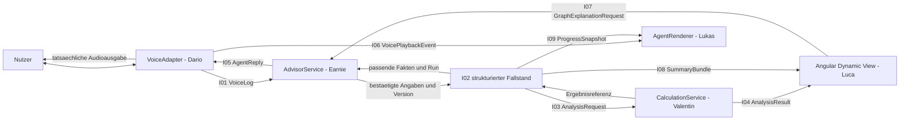
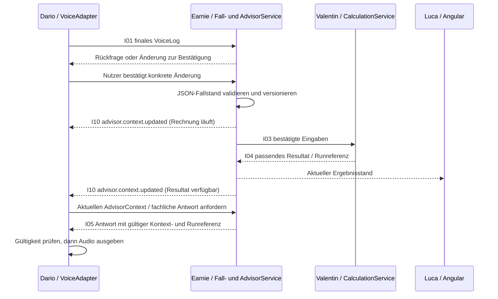

# Pax LifeMap – Workflow und Schnittstellen aus dem Workshop

Stand: 31.10.2026 · Entwurf 1.1. Grundlage sind `IMG_7233.HEIC`, die bestätigten Bereiche aus `IMG_7232.HEIC` und der [aktualisierte Detailplan](implementation-plan.md). Die Rollen sind bestätigt; die folgenden Typnamen, Felder, Fehlercodes und Transportvorschläge konkretisieren die Skizze und beschreiben die teamübergreifende Zielarchitektur. Die Backend-Anteile I02–I04/I07–I10 sind inzwischen implementiert; die [Requirements-Matrix](../reports/life-insurance-requirements.md) ordnet nachweisbaren Code und offene Team-Integration zu.

## 1. Der sichtbare Workflow

Das Foto zeigt Nutzer ↔ Dario, Dario → Earnie mit der Beschriftung „Voice Log“, ein mit Earnie/Valentin und der Rückgabe zu Dario verbundenes Dokumentsymbol, Valentin → Luca mit „Result“ und Dario → Lukas. Der Nutzer hat das Dokumentsymbol als gemeinsamen JSON-Fallstand präzisiert. Die Pfeile allein bestimmen weder Protokoll noch Datenbank noch synchrone/asynchrone Verarbeitung.



Die zusätzliche Struktur im Diagramm ist der Umsetzungsvorschlag für eindeutige Übergaben. Namen bezeichnen Codeverantwortung, keine vorgeschriebenen Benutzer-Accounts. Ein `producer="Dario"` in einem Payload wäre kein Berechtigungsnachweis. Sitzung, Fallbesitzer und gegebenenfalls Servicezugriff werden außerhalb dieser Beschriftung geprüft.

## 2. Was jeder Bereich liefert

| Bereich | Eingang | Ausgang | Verantwortungsgrenze |
|---|---|---|---|
| Dario: Voice | Bewusste Spracheingabe oder freigegebener Antworttext | Finales Transkript/VoiceLog; Audio und reale Playback-Ereignisse | Keine eigene Finanzrechnung, keine eigenständige Auswahl anderer Antwortbeträge |
| Earnie: KI | VoiceLog/Text, bestätigter Fall, zulässiger Grafikbezug | Rückfrage, bestätigbarer Patch, faktengestützte AgentReply und Summary | Keine ungeprüfte direkte Profilmutation, kein Erfinden von Renten oder Prämien |
| Valentin: Logik | Validierter bestätigter Snapshot und Szenarioparameter | AnalysisResult, Datenreife, Prüfgründe und Quellen-/Modellreferenzen | Keine versteckte neue Kundenbehauptung aus einem unsicheren Transkript |
| Luca: UI | AnalysisResult, Fallstand, Antworten und Summary | Grafik, fünf Ansichten, Auswahl-/Bestätigungsaktionen | Keine zweite Schattenrechnung aus anders interpretierten Providerfeldern |
| Lukas: Avatar | Playback-/Arbeitszustände und ProgressSnapshot | Agentdarstellung, Fortschrittsring/-text | Keine eigene Beratung, kein aus Tonfall erzeugter Risikostatus |

Ein neuer Textinput darf Darios STT umgehen, geht aber in denselben Advisor-/Bestätigungsweg. Ein neuer berechneter Wert kann an Luca ausgeliefert werden, bevor die AI-Erklärung fertig ist. Text/Audio verwenden anschließend genau die Referenz dieser Ausgabe.

## 3. Gemeinsamer Nachrichtenkopf

Jede fallbezogene Übergabe enthält eine Schema-Version, eine eindeutige `messageId`, `caseId` und eine `correlationId`. Gesprächsübergaben tragen zusätzlich `turnId`. Profil-, Szenario- und Rechenbezug sind dort Pflicht, wo fachliche Zahlen erklärt oder angezeigt werden.

```ts
type ContextRef = {
  schemaVersion: '1.0';
  messageId: string;
  caseId: string;
  correlationId: string;
  turnId?: string;
  profileVersion?: number;
  scenarioVersionId?: string;
  runId?: string;
};
```

**Drei verschiedene Versionsprüfungen:**

1. `expectedCaseRevision` schützt Schreibvorgänge vor konkurrierendem Überschreiben.
2. `profileVersion + scenarioVersionId + calculationInputHash` identifizieren die fachliche Eingabe eines Rechenlaufs.
3. `turnId + contextId + runId` binden eine Erklärung und Audioausgabe an die aktuelle Auswahl.

Eine reine Änderung des Gesprächstempos muss nicht automatisch jede unveränderte Finanzrechnung ungültig machen. Eine geänderte Einkommens-/Szenarioversion dagegen schon. Technische Darstellungszustände sind keine heimlichen Änderungen des fachlichen Profils.

## 4. Die Schnittstellen

### I01 – VoiceLog: Dario → Earnie

Pflicht: Nachrichtenkopf, `turnId`, `source`, `locale`, `text`, `transcriptStatus="final"`. Für verändernde Vorschläge zusätzlich die erwartete Fallrevision. Zwischenresultate bleiben im Voice-Client; sie gelten nicht als bestätigtes Einkommen. Ein finales Transkript ist ebenfalls noch keine bestätigte fachliche Profiländerung.

```json
{
  "schemaVersion": "1.0",
  "messageId": "message_demo_01",
  "caseId": "case_demo",
  "correlationId": "correlation_demo_01",
  "turnId": "turn_demo_01",
  "source": "voice",
  "locale": "de-CH",
  "text": "Wir moechten in fuenf Jahren ein Haus kaufen.",
  "transcriptStatus": "final",
  "expectedCaseRevision": 12
}
```

Der JSON-Wert ist ein synthetisches Beispiel, kein Log einer tatsächlichen Aufnahme. Locale-Support wird beim Speech-Anbieter geprüft. Roh-Audio gehört nicht standardmäßig in VoiceLog, allgemeine Telemetrie oder Git.

### I02 – CaseSnapshot: Earnies Fallservice ↔ strukturierter Übergabestand

Pflicht: Nachrichtenkopf, `caseRevision`, `profileVersion`, `dataClassification`, freigegebene Profilprojektion, Ziele, Daten-/Reviewstatus und Verweise auf Szenarien/Rechenläufe. Die vollständigen fachlichen Objekte verwenden den gemeinsamen Datenvertrag aus Kapitel 8 des Detailplans; die Schnittstellenbeschreibung definiert keine zweite inkompatible Person-/Geldstruktur.

Schreibrechte liegen beim validierenden Fallservice. Ein LLM darf nur erlaubte Feldvorschläge liefern. Erst die fachlich/benutzerseitig erforderliche Bestätigung und erfolgreiche Versionsprüfung erzeugen einen neuen bestätigten Stand. Rechenmodule lesen konsistente Snapshots und ergänzen referenzierte Ergebnisse; sie verändern nicht nebenbei die Kundenaussage.

### I03 – AnalysisRequest: strukturierter Stand → Valentin

Pflicht: Nachrichtenkopf, `profileVersion`, `scenarioVersionId`, `calculationInputHash`, gewünschte Ergebnisbereiche und Betriebsmodus. Die Anfrage referenziert einen tatsächlich vorhandenen freigegebenen Snapshot oder enthält eine validierte Projektion daraus. Sie übermittelt keine frei wählbare Provider-URL und keinen Client-Bearer-Token.

Fehlender Bedarf, unklare Periode oder widersprüchliche Kapitalzuordnung führen zu `needs_input`, nicht zu automatisch passenden Beispielzahlen. Ein nur behaupteter `confirmed=true`-Wert aus dem Modell erfüllt die Vorbedingungen nicht.

### I04 – AnalysisResult: Valentin → Luca und Ergebnisreferenz zurück

Pflicht: Nachrichtenkopf, `profileVersion`, `scenarioVersionId`, `runId`, `calculationInputHash`, Status pro Bereich, Geld-/Periodenfelder, Annahmen, Herkunft und Reviewgründe. `requires_review`, `estimated`, `needs_input`, `provider_error` und `stale` bleiben von `valid` unterscheidbar.

Die Grafik und ihr erklärender Tab lesen dieses Resultat. Monats-/Jahreswerte und Kapital/Einkommen sind explizit typisiert. Luca prüft, ob der Resultatbezug noch zur aktiven Fall-/Szenarioversion passt. Ein verspätetes Ergebnis überschreibt keine neuere Auswahl. Alte Resultate dürfen getrennt als Historie sichtbar bleiben.

### I05 – AgentReply: Ergebnis/Fallkontext → Dario und sichtbarer Text

Pflicht: Nachrichtenkopf, `turnId`, `replyId`, `contextRevision`, `kind`, `locale`, `text` und gegebenenfalls erforderliche Benutzerbestätigung. Bei einer Zahlen-/Grafik-Erklärung zusätzlich `contextId`, passende Versionen, `runId` und konkrete Ergebnis-/Quellenreferenzen. Eine Frage vor der ersten Berechnung braucht dagegen noch keinen erfundenen Rechenlauf.

Arten: `question`, `patch_proposal`, `explanation`, `summary_notice`, `error`. Earnie erzeugt verständlichen Text auf vorhandenen Fakten. Dario spricht denselben Inhalt zahlengetreu; eine kontrollierte Ausspracheformatierung darf die Zahl nicht inhaltlich ändern. Es entsteht keine zusätzliche unabhängige Audio-Beratung.

### I06 – VoicePlaybackEvent: Dario → Lukas

Pflicht: Nachrichtenkopf, `turnId`, `replyId`, `playbackId`, Ereignis `started | ended | cancelled | error`. Ein `started` wird erst bei tatsächlichem Audiostart ausgelöst. „AI-Text fertig“ oder „Audio angefordert“ ist kein Speaking-Nachweis.

Stop, neue Grafikversion oder ein neuer inkompatibler Turn beenden die alte Ausgabe. Späte Events eines widerrufenen `playbackId` werden ignoriert. Listening/Thinking können als gesonderte technische Arbeitsereignisse denselben Agentvertrag ergänzen. Die P0-Anwendung nimmt nicht gleichzeitig ihr eigenes TTS wieder auf.

### I07 – GraphExplanationRequest: Luca → Earnie, fachliche Referenz bei Valentin

Pflicht: Nachrichtenkopf, `turnId`, `contextId`, `GraphContext` mit Person, Kennzahl, Zeitraum und Run-/Versionsbezug sowie konkrete Nachfrage. Der Fach-/Fallservice validiert die referenzierte Stelle, Earnie formuliert anschließend anhand der erlaubten Ergebnisfakten. Dario/Lukas erhalten die passende Antwort-/Playback-Kette.

```json
{
  "schemaVersion": "1.0",
  "messageId": "message_demo_07",
  "caseId": "case_demo",
  "correlationId": "correlation_demo_07",
  "turnId": "turn_demo_07",
  "contextId": "context_demo_retirement",
  "graphContext": {
    "caseId": "case_demo",
    "profileVersion": 3,
    "scenarioVersionId": "scenario_demo_retirement",
    "runId": "run_demo_03",
    "graphId": "retirement_timeline",
    "metricId": "income_gap",
    "personId": "person_demo_01",
    "periodStart": "2056-06",
    "periodEnd": "2056-12"
  },
  "question": "Weshalb entsteht in dieser Phase eine Luecke?"
}
```

Diese Kennungen/Zeiten sind beispielhaft. Der Client kann keine fremde Case-/Run-ID autorisieren. Veralteter Kontext führt zu einer Aktualisierungsaufforderung, nicht zur Erfindung einer passenden Erklärung.

### I08 – SummaryBundle: gleicher Snapshot → Kunde und Fachperson

Pflicht: Nachrichtenkopf, `snapshotId`, relevante Versions-/Runreferenzen, Ziele, Maßnahmen, Annahmen, Reviewstatus, offene Fragen sowie lesbare Kunden-/Fachperson-Projektion. Die Fachpersonensicht ergänzt Quellen und Prüfaufgaben; beide zeigen dieselben fachlichen Beträge.

Der Export kennt `audience=customer | advisor`, aber kein voreingestelltes fremdes E-Mail-Ziel. Für einen echten Empfänger-/Versandweg sind eine freigegebene Integration und ein konkreter Auftrag erforderlich. „Candidate“ ist noch eine vorläufig interpretierte Empfängerbezeichnung. Ein Draft wird im Kundenexport nicht als verbindlich fertig dargestellt.

### I09 – ProgressSnapshot: Datenreife → Lukas und Progress-Tab

Pflicht: Nachrichtenkopf, Datenstand, `domain="data_capture"`, Fortschrittsgruppen, Prozentwert oder unbekannt und gesonderter `reviewOpen`-/Journey-Status. Berechnungs-/Falllogik bestimmen den Fortschritt; der Avatar rendert ihn.

Der Fortschritt kommt nicht aus Spracherkennung, Gesichtsausdruck oder der Zahl gesprochener Sätze. Eine kleinere Risikolücke erhöht nicht automatisch den Aufnahmestand. Hundert Prozent Aufnahme und offene Fachprüfung sind gemeinsam darstellbar.

## 5. Ablauf eines vollständigen Turns

1. Dario zeigt ein finales korrigierbares Transkript bzw. Luca nimmt Text auf.
2. Earnie validiert den Turn, formuliert Rückfrage oder schlägt eine erlaubte Änderung vor.
3. Nötige Bestätigung erzeugt beim Fallservice einen neuen freigegebenen Snapshot.
4. Valentin verarbeitet eine passende AnalysisRequest und speichert die Ergebnisreferenz.
5. Luca zeigt AnalysisResult, ohne auf eine frei generierte Zusammenfassung warten zu müssen.
6. Earnie nutzt genau diese Fakten für AgentReply; Dario gibt den sichtbaren Inhalt wieder.
7. Lukas aktualisiert technische Darstellung anhand realer Audio-/Arbeitsereignisse und separater Fortschrittsdaten.
8. Summary exportiert denselben bestätigten Stand. Ein neuer inkompatibler Turn widerruft alte Erklärung/Audiowiedergabe.

Bei einer reinen Begriffsfrage ohne neue Fachdaten sind nicht alle Schritte nötig. Es wird keine unnötige Neuberechnung und keine künstliche Profilerhöhung ausgelöst.

## 6. Fehler, Abbruch und Idempotenz

| Fall | Antwort/Verhalten | Owner |
|---|---|---|
| Kein finales verständliches Transkript | Erneut sprechen oder Text verwenden; keine Profiländerung | Dario |
| Schreibvorschlag gegen alte Revision | `VERSION_CONFLICT`, aktuellen Stand erneut bestätigen | Earnie |
| Fehlende Fachangabe | `NEEDS_INPUT` mit Feld-/Grundreferenz | Valentin + Earnie |
| Resultat gehört nicht zum aktuellen Szenario | Nicht als aktuellen Graph anzeigen | Luca + Valentin |
| Erklärung referenziert alten Run | `STALE_CONTEXT`, Audio stoppen/aktualisieren | Earnie + Dario |
| Voice-/Modell-/Rechenprovider aus | Passender sichtbarer Fehler und erlaubter Fallback | zuständiger Adapterowner |
| Dieselbe `messageId` erneut | Ein fachlicher Vorgang; gespeichertes Ergebnis bzw. Konflikt bei anderem Payload | Earnie + Valentin |
| Alter Playback-Callback nach Stop | Ignorieren; Agent wird nicht wieder aktiv | Dario + Lukas |
| Fremde Case-/Run-ID | Keine Details oder Daten offenlegen | Backend-Gateway/Fallservice |

Fehlerantworten enthalten keine Tokens, Rohdokumente oder fremden Falldaten. Idempotenzschlüssel und Schema-Versionen sind überprüfbar. Retry auf Audio-/Vertragsaktionen führt nicht zu doppelter Aufnahme, mehrfacher Einreichung oder doppelter Sprachausgabe.

## 7. Transport und erster Integrationstest

Diese Verträge sind unabhängig davon nutzbar, ob die erste Umsetzung ein gemeinsamer Prozess, Modulaufrufe oder dokumentierte HTTP-Requests verwendet. Eine neue Queue, gemeinsam überschreibbare JSON-Datei, Redis oder ein zweites Fallmodell wird aus dem gezeichneten Dokument nicht ungefragt abgeleitet. Der gemeinsame JSON-Fallstand ist nun bestätigt. Der konkrete Speicher und der HTTP-/SSE-Transport bleiben Umsetzungsvorschläge; Abschnitt 9 konkretisiert den dynamischen Voice-Kontext.

Für den ersten Test baut jeder Owner eine kleine zu seinem Vertrag passende Fixture. Die Kette besteht aus einer neuen Eingabe, einer bestätigten Änderung, einer neuen Berechnung, einer UI-Ausgabe und genau einer zur aktiven Auswahl gehörenden Sprachausgabe. Ein zweiter Turn und ein bewusst verspätetes Ergebnis prüfen Abbruch/Versionsschutz. Der Avatar muss auch ohne Video korrekt reagieren.

Die [maschinenlesbare Vertragsübersicht](../catalog/interface-contracts.json) enthält Produzent/Empfänger, Pflichtfelder, Semantik und synthetische Beispiele. Sie ist eine Planungsbeschreibung und kein bereits implementiertes oder vollständiges Runtime-JSON-Schema. Die gemeinsamen Fachschemas bleiben die Quelle für tatsächliche Validierung.

## 9. Gemeinsame JSON und dynamischer Gesprächskontext für Dario

**Bestätigt:** Der Nutzer beschreibt das Dokumentsymbol als „eher gemeinsame json“. Dafür planen wir einen gemeinsamen, versionierten JSON-Fallstand. Speichertechnik und Transport sind Umsetzungsvorschläge. Eine einzelne Datei, die mehrere Agenten gleichzeitig überschreiben, ist dafür nicht erforderlich.

**Empfehlung für P0:** Earnies Backend verwaltet den Fall und erzeugt einen kleinen `AdvisorContext`. Darios VoiceAdapter erhält Änderungsereignisse und lädt den aktuellen Kontext. Vor jedem fachlichen Antwortturn wird dessen Gültigkeit nochmals geprüft. Earnie liefert den freigegebenen Antworttext, Valentin die Zahlen. Dario übernimmt Sprachein-/ausgabe und echte Playback-Ereignisse für Lukas.



### 9.1 Was Darios Agent tatsächlich bekommt

Der vollständige JSON-Fall bleibt im berechtigten Backend. `AdvisorContext` ist eine Projektion mit `caseId`, `caseRevision`, monotoner `contextRevision`, Profil-/Szenariobezug, bestätigten relevanten Angaben, offenen Pflichtfeldern, Tempo, aktiver Grafikreferenz, zulässigen Fakten und Rechen-/Reviewstatus. Er enthält die nächste Rückfrage und gegebenenfalls eine passende `AgentReply` mit `replyId`, `turnId` und Runreferenz.

Freigegebene Zahlen enthalten Kennzahl, Wert, Währung/Einheit, Periode, Herkunft und `runId`; unbekannte oder veraltete Werte sind nicht als beantwortbare Fakten enthalten. Rohdokumente, gesamte Krankengeschichte, Bearer-Token und interne Prompts gehören nicht in diese Sprachprojektion. Die Anbieterfreigabe bestimmt zusätzlich, welche Felder überhaupt an einen externen Voice-Dienst dürfen.

Synthetischer Ausschnitt während einer laufenden Rechnung:

```json
{
  "caseId": "case_demo",
  "caseRevision": 12,
  "contextRevision": 18,
  "profileVersion": 3,
  "scenarioVersionId": "scenario_demo_home",
  "tempo": "compact",
  "calculationStatus": "running",
  "answerableFacts": [],
  "maySpeakAmounts": false,
  "nextQuestion": {
    "text": "Wie hoch sind eure monatlichen Fixkosten?",
    "requestedFields": ["household.monthlyExpenses"]
  }
}
```

Die Rückfrage ist ein Beispiel für einen Fall, in dem genau dieses Feld noch fehlt. Kein angefangener oder erwarteter Rechenwert wird als fertige Rentenlücke vorgelesen. Eine Änderung der Darstellung oder des Tempos kann den Gesprächskontext verändern, ohne die fachliche Profilversion zu erhöhen.

### 9.2 I10 – AdvisorContextUpdate: Earnie → Dario und betroffene Ansichten

Pflicht: gemeinsamer Nachrichtenkopf, `eventId`, `contextRevision`, `reason`, serverseitig erzeugte `contextRef` und `interruptPolicy`. Ereignisse melden einen veränderten Stand; vor der Verwendung wird die dazugehörige autorisierte aktuelle Projektion geladen. Sie ersetzen keine Fachantwort.

Ereignisgründe: `confirmed_profile_changed`, `analysis_started`, `analysis_ready`, `graph_context_changed`, `review_state_changed`, `conversation_preference_changed`. Der Backend-Dienst übernimmt nur Rechenergebnisse, deren fachliche Eingabereferenz noch passt. Ein verspäteter alter Run erzeugt keine neue aktuelle Sprachfreigabe.

Vorgeschlagene Endpunkte, passend zum bestehenden API-Entwurf:

| Endpunkt | Aufgabe | Verantwortung |
|---|---|---|
| `GET /api/cases/:caseId/advisor/context` | Aktuellen berechtigten AdvisorContext lesen | Earnie; Valentin prüft Fakten-/Runreferenzen |
| `GET /api/cases/:caseId/advisor/events` | Kleine fallbezogene Änderungsereignisse abonnieren | Earnie Backend; Dario/Luca konsumieren |
| `POST /api/cases/:caseId/advisor/messages` | Finales Transkript/Text und aktuelle Kontextreferenz; Rückfrage oder AgentReply | Dario → Earnie; vorhandener Nachrichteneingang |

**Transportvorschlag:** HTTP-Requests für Eingaben/Bestätigungen, Server-Sent Events (SSE) für die Updates an Angular/VoiceAdapter. SSE ist ein einseitiger Server→Client-Kanal; Audio-Streaming ist davon getrennt. Ein gegebenenfalls benötigter bidirektionaler Audio-Kanal kann beim freigegebenen Voice-Adapter separat WebSocket verwenden. [MDN: SSE](https://developer.mozilla.org/en-US/docs/Web/API/Server-sent_events/Using_server-sent_events), [MDN: WebSocket](https://developer.mozilla.org/en-US/docs/Web/API/WebSockets_API).

Ein SSE-Ereignis enthält Referenzen und Status, keine vollständige Finanzakte. Der Stream prüft Session und Fallzugriff beim Öffnen und berücksichtigt Widerruf/Ablauf auch während einer bestehenden Verbindung; keine Zugangstoken in der URL. P0 braucht dafür keinen zusätzlichen Message Broker. HTTP-Routen, Authentifizierung und Ereignisabonnement bleiben im gemeinsamen Backend.

### 9.3 Wie das in ein laufendes Gespräch eingreift

1. **Zu Sitzungsbeginn:** aktuellen Kontext laden, dann die erste passende Frage stellen.
2. **Nach bestätigter Änderung:** JSON atomar fortschreiben, Kontext aktualisieren und Ereignis senden. Der VoiceAdapter kennt danach fehlende Daten und laufende Berechnungen.
3. **Vor einer Antwort:** aktuelle Kontextreferenz prüfen; Earnie gibt eine Antwort auf genau diesen Stand zurück. Nach längerer Generierung nochmals die fachliche Gültigkeit prüfen, bevor Audio beginnt. Bei veralteter Antwort wird neu angefordert.
4. **Während des Sprechens:** eine neue Einkommens-/Szenarioversion oder eine andere aktive Grafikreferenz kann die aktuelle Aussage ungültig machen. Dann Audio abbrechen, `cancelled` an Lukas melden und die aktuelle Antwort laden. Ein reiner Tempowechsel unterbricht keine fachlich unveränderte Aussage unnötig.
5. **Bei Rechnung im Hintergrund:** nur eine passende neutrale Überleitung oder sinnvolle nächste Frage; keine erwarteten Beträge vorwegnehmen. Ein fertiges Ergebnis aktualisiert Grafik und Antwortgrundlage.
6. **Bei Verbindungsabbruch:** Kontext als möglicherweise veraltet behandeln; neue finanzielle Audioantworten pausieren. Nach Wiederverbindung einen frischen Snapshot laden. P0 setzt auf vollständige Zustandsabstimmung statt auf garantierte Wiederholung jedes Zwischenereignisses. Doppelte Events werden über ID/Revision ignoriert.

Bei Nutzerunterbrechung gilt derselbe Abbruchvertrag. P0 kann Push-to-talk und einen sichtbaren Stop-Knopf verwenden; automatische gleichzeitige Unterbrechungserkennung muss nicht für den ersten Durchstich fertig sein. Keine eigene Sprachausgabe landet wieder als neue Kundenaussage in der Aufnahme.

### 9.4 Falls Dario bereits einen eigenen Voice-Agenten verwendet

Der Adapter kann ihm ein Tool `get_advisor_context` und für fachliche Antworten `request_advisor_reply` anbieten. Die Tools laufen im berechtigten Backend, sind auf den gebundenen Fall beschränkt und geben eine geprüfte Projektion beziehungsweise Earnies `AgentReply` zurück. Der Agent darf keine beliebigen URLs/Case-IDs oder Rechenprovider aufrufen. Ein einmaliger großer Startprompt bildet spätere Änderungen nicht zuverlässig ab.

Die konkrete Anbieterschnittstelle für Tools oder Sitzungsupdates wird vor der Umsetzung geprüft; die Toolnamen hier sind unsere eigene Anwendungsspezifikation. Für P0 ist ein einzelner fachlicher Antwortweg am einfachsten: Earnie formuliert, Dario spricht den Text. Ein separater generativer Voice-Agent bekommt keine unabhängige Befugnis, Finanzbeträge oder Produktempfehlungen zu erzeugen. Die synthetische Demo kann denselben Vertrag mit Text und lokalem Stub abnehmen, falls noch kein freigegebener Speech-Dienst verfügbar ist.

### 9.5 Arbeitsaufteilung und erster gemeinsamer Nachweis

- **Earnie:** kanonischer JSON-Fallservice, ContextBuilder, autorisierte Context-/Events-Routen und Antwortbindung.
- **Valentin:** gültige Ergebnisreferenzen und Freigabestatus, Invalidierung bei geänderten Recheneingaben.
- **Dario:** Subscription, Kontextaktualisierung vor Turns, Audioabbruch und Werkzeugadapter falls benötigt.
- **Luca:** dieselben Revisionen in Grafik/Chat, aktuelle Auswahl übermitteln und fehlende Verbindung anzeigen.
- **Lukas:** `started/ended/cancelled/error` korrekt übernehmen; Progress bleibt separat.

**Durchstich:** Kunde bestätigt einen neuen Eigenheimwunsch. Während die Rechnung läuft, fragt der Agent sinnvoll weiter. Nach dem Resultat erklären Grafik und Sprache denselben Run. Eine weitere bestätigte Einkommensänderung während der Ausgabe stoppt die alte Aussage und hält den Avatar korrekt an. Nach künstlichem Verbindungsabbruch wird der aktuelle Kontext wiederhergestellt, ohne alte Antworten doppelt abzuspielen. Diese Konkretisierung gehört in die vorhandenen Integrationspakete; ihre Zeitschätzungen werden mit der echten Restzeit nochmals geprüft.


## 10. Implementierter Backend-Anschluss (31.10.2026)

Der [Start-/Integrationsleitfaden](../../../code/README.md) und `/api/openapi.json` beschreiben die ausführbaren Routen. Die TypeScript-/Zod-Verträge in `code/packages/contracts` sind für implementierte Payloads maßgeblich. Die obigen Turn-/Voice-Nachrichten bleiben die Integrationsaufgabe von Dario und Earnie; es wird keine dort noch fehlende Antwortgenerierung behauptet.

Der gemeinsame Fall wird im geschützten Backend gehalten. Earnie liest vor jeder Antwort `/advisor/context`; `/advisor/events` meldet Kontextrevisionen zum erneuten Einlesen. Luca setzt `/graph-context`, Szenarien und gespeicherte `/comparisons`; Lukas verwendet `progress` mit getrenntem `reviewOpen`. Finanzielle Profiländerungen werden vorgeschlagen, vom Kunden akzeptiert und anschließend separat bestätigt/berechnet. Kein Transkript mutiert still den bestätigten Fall. Die gemeinsame Team-Abnahme bleibt ausstehend.


## 10. Implementierter Backend-Anschluss (31.10.2026)

Der [Start-/Integrationsleitfaden](../../../code/README.md) und `/api/openapi.json` beschreiben die ausführbaren Routen. Die TypeScript-/Zod-Verträge in `code/packages/contracts` sind für implementierte Payloads maßgeblich. Die obigen Turn-/Voice-Nachrichten bleiben die Integrationsaufgabe von Dario und Earnie; es wird keine dort noch fehlende Antwortgenerierung behauptet.

Der gemeinsame Fall wird im geschützten Backend gehalten. Earnie liest vor jeder Antwort `/advisor/context`; `/advisor/events` meldet Kontextrevisionen zum erneuten Einlesen. Luca setzt `/graph-context`, Szenarien und gespeicherte `/comparisons`; Lukas verwendet `progress` mit getrenntem `reviewOpen`. Finanzielle Profiländerungen werden vorgeschlagen, vom Kunden akzeptiert und anschließend separat bestätigt/berechnet. Kein Transkript mutiert still den bestätigten Fall. Die gemeinsame Team-Abnahme bleibt ausstehend.
