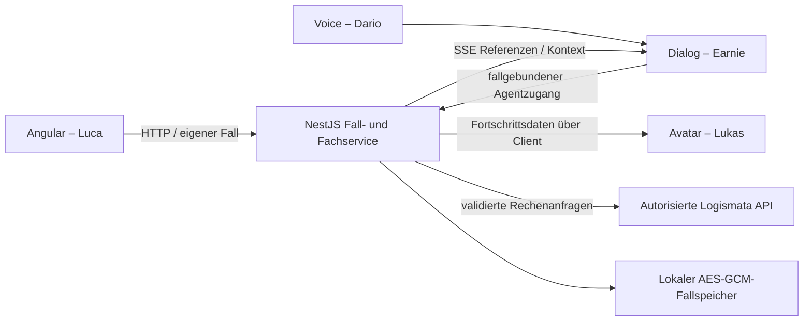

# API, gemeinsamer JSON-Fall und Datenbank

Stand: 31.10.2026 · Architekturentscheid für den synthetischen BaselHack-PoC.

JSON beschreibt die Daten, die API regelt den Zugriff, und die Persistenz bewahrt den Stand über einen Neustart. Diese drei Aufgaben ergänzen sich. Die gemeinsame Anwendung besitzt bereits eine NestJS-API und einen dauerhaften verschlüsselten lokalen Speicher. Eine zusätzliche Datenbank ist für den aktuellen Betrieb mit einem Backend-Prozess nicht nötig.

## Vorhandener Stand

Das austauschbare Team-Datenformat ist [InsuranceCaseDto](../../../code/packages/contracts/src/insurance-case.ts). Die tatsächlichen HTTP-/SSE-Routen und Rollen beschreibt der [Team-API-Leitfaden](team-api-guide.md).

| Baustein | Tatsächlich implementiert |
|---|---|
| Anwendung | Ein Node-/NestJS-Prozess, HTTP und SSE, lokale Angular-Origins |
| Datenzustand | Gemeinsame Fallaggregate, bestätigte Profile, Läufe, Vorschläge, Reviews, Demo-Journey, Sitzungen, Audit und NPS |
| Speicher | In-Memory-Zustand plus vollständiger verschlüsselter persistierter Stand in `code/.local/lifemap/cases.enc` |
| Schreibschutz | Serialisierte Transaktionen, neue verschlüsselte Datei mit atomarem Austausch und Prozesssperre |
| Kryptografie | AES-256-GCM mit frischem Nonce/Integritätsprüfung, Schlüssel/Dateien privat, Verzeichnis 0700 |
| Benutzerkonflikte | `expectedCaseRevision` und fachliche Profil-/Runreferenzen; parallele Änderungen werden nicht still überschrieben |
| Lebensdauer | Fälle nach 24 Stunden, Sitzungen nach einer Stunde, Agentzugänge nach höchstens 15 Minuten; regelmässige Bereinigung |
| Externer Zugriff | Logismata mit vorhandenem geschütztem Token; keine neue Datenbank-/Cloud-/Modellübertragung |

Der Speicher ist **keine SQL-Datenbank**. Er schreibt den gesamten begrenzten Zustand und eignet sich für einen einzelnen PoC-Prozess. Prozesssperre und Dateispeicher sind kein Mehrinstanz- oder Clusterbetrieb. Es gibt keine SQL-Migrationen, Datenbankreplikation oder produktive Backup-/KMS-Architektur.

## Entscheidung für den jetzigen Hackathon-Stand

Ein Backend besitzt den Fallzustand; Angular und die Agentintegration benutzen dessen API. Die fünf Teammitglieder können am selben Repository arbeiten und für Einzelentwicklung jeweils ihren lokalen Dienst starten. Diese lokalen Instanzen besitzen dann verschiedene Datenbestände. Für einen gemeinsamen Demo-Durchlauf müssen UI und Agent denselben Backend-Prozess und dieselbe berechtigte Kundensitzung bzw. deren Agentfreigabe verwenden.

`npm start` bindet weiterhin nur an Loopback. Ein auf einem anderen Laptop laufender Dienst wird dadurch nicht automatisch erreichbar. Für einen gemeinsamen Netz-/Pax-Dev-Host müssen Zielumgebung, Erreichbarkeit, HTTPS, zugelassene Origins, Berechtigungen, Servergeheimnisse und dauerhafter Speicher konkret konfiguriert werden. Diese Arbeit öffnet weder einen öffentlichen Port noch lädt sie Finanzdaten auf einen neuen Cloud-Dienst hoch.

## Wann eine Datenbank sinnvoll wird

Für mehrere Backend-Instanzen, serverübergreifende Sitzungen, grössere Datenmengen, gezielte Abfragen und kontrollierte Backups würde ich **PostgreSQL** vorsehen. PostgreSQL unterstützt JSON-Dokumente und transaktionale konkurrierende Änderungen; das ist eine technische Grundlage, keine automatische Datenschutzfreigabe. [JSON-Datentypen](https://www.postgresql.org/docs/current/datatype-json.html), [Transaktionsisolation](https://www.postgresql.org/docs/current/transaction-iso.html).

SQLite wäre eine mögliche lokale SQL-Alternative, löst aber nicht allein die Anforderungen an gemeinsamen Betrieb mehrerer Backend-Prozesse auf unterschiedlichen Hosts. Ein direkter Zugriff aus Angular oder dem Sprachmodell auf eine Datenbank würde die vorhandenen Rollen-, Bestätigungs- und Fachregeln umgehen und ist nicht der vorgesehene Integrationsweg.

## Konkreter PostgreSQL-Ausbau als nächster Schritt

Dieser Abschnitt ist ein Migrationsentwurf, **kein implementierter Datenbankadapter**.

1. **Repository-Zugriffe asynchron machen.** Der aktuelle Service liest synchron aus einem bereits geladenen Zustand und mutiert transaktional eine Kopie der gesamten Datenbank. Das lässt sich nicht korrekt durch blosses Ersetzen einer Dateiadresse durch eine PostgreSQL-URL verteilen. Fall-, Sitzungs-, Audit- und Befehlszugriffe benötigen gezielte Repository-Operationen.
2. **Fallaggregate speichern.** Tabelle `cases` mit Fall-ID, Eigentümerreferenz, Schema-Version, Fall-/Kontextrevision, Ablauf und geschütztem Payload. Die fachliche Nutzlast entspricht weiterhin `InsuranceCaseState`; interne Besitz-/Idempotenzinformationen sind keine Clientfelder.
3. **Finanzpayload schützen.** Bei beibehaltener anwendungsseitiger Verschlüsselung liegt die Nutzlast als Ciphertext mit Nonce, Tag und Schlüsselreferenz vor; AAD bindet mindestens Fall-ID und Versionskontext. Sie ist dann nicht als Klartext-JSONB durchsuchbar. JSONB ist für ausdrücklich freigegebene nicht sensible Metadaten oder eine separat bewertete Speicherarchitektur geeignet. Eine SQL-Datenbank ersetzt keine Schlüsselverwaltung.
4. **Revision atomar prüfen.** Ein Update ändert den Fall nur, wenn `case_revision = expected_revision`. Kein Treffer bedeutet Konflikt/409. Profiländerung, neue Referenzen, Audit und Ereignisbenachrichtigung müssen zur selben Transaktion gehören. Fachrechner laufen ausserhalb einer langen offenen SQL-Transaktion; beim Speichern bleibt die vorhandene Prüfung gegen verspätete Rechenläufe notwendig.
5. **Sitzungen und Idempotenz gemeinsam halten.** Sitzungen als gehashte Token mit Rolle/Besitz/Fallbindung und Ablauf verwalten. Befehle pro Fall/Aktion/Idempotenzschlüssel mit Request-Fingerprint und geschütztem Ergebnis eindeutig speichern. Ein Retry mit anderer Nutzlast bleibt ein Konflikt; Tokens werden nicht als Klartextdaten gespeichert.
6. **Ereignisse nach Commit verteilen.** Eine transaktionale Outbox enthält technische Fall-/Kontextreferenzen. Alle Backend-Instanzen können darauf reagieren und den aktuellen Kontext für ihre SSE-Verbindungen nachladen. Das aktuelle Polling über lokalen Speicher ist hierfür nicht ausreichend. Finanzprofile gehören nicht in ungeschützte Benachrichtigungs-Payloads.
7. **Löschung, Backup und Betrieb festlegen.** Fallablauf, Feedback-/Agentbereinigung, Audit-Aufbewahrung, Backups, Schlüsselrotation, Zugriffsrollen, TLS/IAM, Standort und Wiederherstellung mit Pax prüfen. Vor echter Kundennutzung sind die entsprechenden fachlichen und rechtlichen Freigaben erforderlich.
8. **Migration nachweisen.** Bestehende verschlüsselte Fälle nur kontrolliert mit verfügbarer Schlüsselverwaltung importieren. Neustart-/Wiederherstellungs-, Parallelitäts-, Idempotenz-, Rollen- und SSE-Widerrufstests gegen den neuen Adapter ausführen; anschliessend erst dessen Betriebsmodus aktivieren.

Mögliche Tabellen sind `cases`, `sessions`, `commands`, `audit_events`, `outbox` und `feedback`. Unveränderliche Profile und Rechenläufe können zunächst im geschützten Fallaggregat bleiben; bei späterer Auslagerung behalten sie dieselben IDs, Eingabehashes und Referenzregeln. Das Team-Datenformat und die Kundenbestätigung bleiben unabhängig von der physischen Tabellenaufteilung.

## Was die anderen jetzt tatsächlich brauchen

Luca braucht Basisadresse/Proxy, Kundensitzung und das Shared-Paket. Earnie braucht denselben Fallservice und einen berechtigten Agentzugang. Dario benötigt die aktuellen Kontext-/Turnreferenzen sowie den abgestimmten VoiceLog-/AgentReply-Vertrag. Lukas benötigt Fortschritts- und tatsächliche Playbackereignisse. Keines der vier Front-/Agentmodule muss die verschlüsselte Datei direkt öffnen oder einen eigenen Fallstore anlegen.
