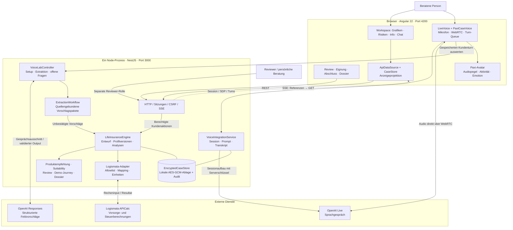
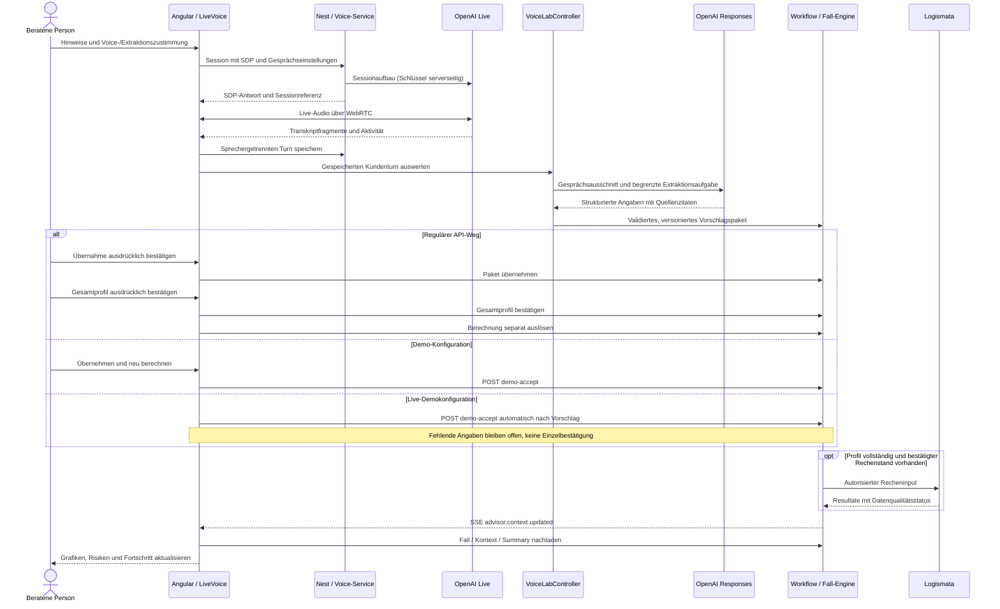
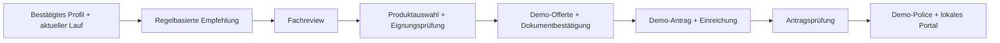

# Pax LifeMap – Architektur für die Evaluation

**Stand: 01.11.2026 · BaselHack 2026**

**Referenz:** Main-Snapshot [`a02004f27cc36044cff68066a907ba1695c1dca6`](https://github.com/mannaluca02/basel_hack/tree/a02004f27cc36044cff68066a907ba1695c1dca6).

[Interaktive Ansicht öffnen/herunterladen](current-architecture.html) · [Repo-Übersicht](../../../readme.md)

Diese Dokumentation beschreibt die im Referenzcommit implementierte Architektur. Die HTML-Datei lässt sich offline im Browser öffnen; Markdown und Mermaid-Diagramme sind direkt auf GitHub sichtbar. Die Quellenlinks sind auf den Referenzcommit fixiert. Lokale Arbeiten auf `feature/live-voice-debug`, insbesondere das separate Debug-Projekt und der persistente Debug-Stepper, gehören nicht zu diesem Main-Snapshot. Codeprüfung ist kein Nachweis eines vollständig durchgeführten Live-Gesprächs.

## 1. Ziel und Architekturprinzip

Pax LifeMap verbindet ein natürliches Beratungsgespräch mit einer nachvollziehbaren Finanz- und Vorsorgeanalyse. Die Oberfläche zeigt Grafiken, Risiken, Informationen und Gesprächsverlauf sowie den Demo-Abschluss bis zur Police im lokalen Portal.

Das System ist ein **modularer Monolith**: Ein NestJS-Prozess bündelt Sitzungsschutz, Voice-Anbindung, Extraktionsworkflow, Fall-Engine, Rechneradapter und Demo-Journey. Die Angular-App ist der Client. Externe Dienste liefern Live-Sprache, strukturierte Extraktion und Fachberechnungen. Der verschlüsselte Fallstore ist die gemeinsame fachliche Datenquelle; Browserzustand und Avatar sind Projektionen beziehungsweise Darstellung.

## 2. System- und Containeransicht

**Wichtig beim Lesen:** SSE überträgt Änderungsreferenzen, kein vollständiges Finanzprofil. Die App lädt danach Fall, Kontext und passende Ansichten neu. Audio fliesst direkt zwischen Browser und OpenAI, nicht durch die Fall-Engine. `@pax/contracts` und `@pax/domain` sind gemeinsam verwendete Codepakete, keine eigenen Dienste.

## 3. Verantwortlichkeiten und Codebezug

Alle Links in dieser Tabelle zeigen auf den dargestellten Main-Snapshot.

| Baustein | Verantwortung | Quelle |
|---|---|---|
| Angular-App | Navigation, Grafiken, Risiken, Chat, Mehrsprachigkeit und Fallprojektion | [ApiDataSource](https://github.com/mannaluca02/basel_hack/blob/a02004f27cc36044cff68066a907ba1695c1dca6/code/apps/web/src/app/core/advisor/api/api-data-source.ts) |
| Native Voice | Session-Lebenszyklus, Turn-Queue, Gesprächssteuerung und Live-Demoautomatik | [LiveVoice](https://github.com/mannaluca02/basel_hack/blob/a02004f27cc36044cff68066a907ba1695c1dca6/code/apps/web/src/app/core/voice/live-voice.ts), [PaxiCaseVoice](https://github.com/mannaluca02/basel_hack/blob/a02004f27cc36044cff68066a907ba1695c1dca6/code/apps/web/src/app/core/voice/paxi-case-voice.ts) |
| Avatar | Lokaler Renderer aus `avatar-prototype`, vor Start/Build synchronisiert; Aktivität, Pegel und Emotion | [PaxiAvatar](https://github.com/mannaluca02/basel_hack/blob/a02004f27cc36044cff68066a907ba1695c1dca6/code/apps/web/src/app/features/paxi/paxi-avatar.ts) |
| Bootstrap / HTTP | Providerkonfiguration, Modulkomposition, Rollen, Fallbindung, Cookie/CSRF und SSE | [live-options.ts](https://github.com/mannaluca02/basel_hack/blob/a02004f27cc36044cff68066a907ba1695c1dca6/code/apps/api/src/live-options.ts), [app.ts](https://github.com/mannaluca02/basel_hack/blob/a02004f27cc36044cff68066a907ba1695c1dca6/code/apps/api/src/insurance/app.ts), [http.ts](https://github.com/mannaluca02/basel_hack/blob/a02004f27cc36044cff68066a907ba1695c1dca6/code/apps/api/src/insurance/http.ts) |
| Voice-Orchestrierung | Provider-Session, Persona/Skills, gespeicherte Turns, Setup ohne Person und Feldextraktion | [service.ts](https://github.com/mannaluca02/basel_hack/blob/a02004f27cc36044cff68066a907ba1695c1dca6/code/apps/api/src/voice/service.ts), [lab.ts](https://github.com/mannaluca02/basel_hack/blob/a02004f27cc36044cff68066a907ba1695c1dca6/code/apps/api/src/voice/lab.ts), [lab-questions.ts](https://github.com/mannaluca02/basel_hack/blob/a02004f27cc36044cff68066a907ba1695c1dca6/code/apps/api/src/voice/lab-questions.ts) |
| Fachliche Runtime | Vorschläge, Entwurf, bestätigte Profilversionen, Analysen, Empfehlungen, Review und Handover | [runtime.ts](https://github.com/mannaluca02/basel_hack/blob/a02004f27cc36044cff68066a907ba1695c1dca6/code/apps/api/src/insurance/runtime.ts), [engine.ts](https://github.com/mannaluca02/basel_hack/blob/a02004f27cc36044cff68066a907ba1695c1dca6/code/apps/api/src/insurance/engine.ts) |
| Fachrechnung | Reine Domainfunktionen plus Logismata-Provider; 24 freigegebene Rechenoperationen, zusätzliche Tools separat aufrufbar | [domain](https://github.com/mannaluca02/basel_hack/tree/a02004f27cc36044cff68066a907ba1695c1dca6/code/packages/domain/src), [Logismata-Client](https://github.com/mannaluca02/basel_hack/blob/a02004f27cc36044cff68066a907ba1695c1dca6/code/apps/api/src/logismata/client.ts) |
| Abschluss | Eignungsprüfung, Produktauswahl, Dokumente, Demo-Antrag, simulierte Prüfung und Demo-Police | [JourneyView](https://github.com/mannaluca02/basel_hack/blob/a02004f27cc36044cff68066a907ba1695c1dca6/code/apps/web/src/app/features/journey/journey-view.ts), [DemoJourney](https://github.com/mannaluca02/basel_hack/blob/a02004f27cc36044cff68066a907ba1695c1dca6/code/apps/api/src/insurance/demo-journey.ts) |
| Persistenz / Verträge | Verschlüsselter gemeinsamer Fallstore; Zod-Laufzeitschemas und TypeScript-Typen | [store.ts](https://github.com/mannaluca02/basel_hack/blob/a02004f27cc36044cff68066a907ba1695c1dca6/code/apps/api/src/insurance/store.ts), [contracts](https://github.com/mannaluca02/basel_hack/tree/a02004f27cc36044cff68066a907ba1695c1dca6/code/packages/contracts/src) |

## 4. Vom Gespräch zur Grafik

### Bestätigungssemantik je Startmodus

- **API:** Feldvorschlag → ausdrückliche Übernahme → separate Gesamtprofilbestätigung → separat ausgelöste Berechnung.
- **Demo:** Start mit vorbereiteter, bestätigter und berechneter synthetischer Persona. „Übernehmen und neu berechnen“ bündelt spätere Aktionen über `demo-accept`.
- **Live-Demo (`dev:live`):** Start mit leerem synthetischem Fall. Alter und Pensum ermöglichen zunächst einen Personenrahmen; weitere Antworten ergänzen das Profil. `LiveVoice` ruft `demo-accept` nach neuen Paketen automatisch auf. Fehlende Pflichtangaben verhindern Bestätigung/Berechnung, angenommene Angaben bleiben im Entwurf. Ein technisch erzeugtes bestätigtes Profil ist hier **kein Nachweis einer ausdrücklichen Kundenbestätigung jedes Werts**.

Die native Integration schliesst Transkriptfragmente bei Sprecherwechsel oder nach lokaler Ruhe als `client-settled` ab. Das API-Label `final` ist kein Nachweis von Provider-Finalität oder vollständig gehörter Wiedergabe. Eine LLM-Extraktion kann trotz struktureller Validierung falsch sein; Quellzitate und Feldmapping ersetzen die fachliche Prüfung nicht.

## 5. Vom Analyseergebnis zum Demo-Abschluss

Die Angular-Ansicht **Abschluss** macht diese Backend-Zustände bedienbar. Prämien bleiben `null`, wenn keine echte Tarifierung vorhanden ist. Ausgewählte fondsgebundene Produkte benötigen die separate Eignungsprüfung. Dossier und Produktdokumente sind abrufbar; Dokumentreferenzen werden mit SHA-256 gebunden.

Im Demo-Start kann `demo-review` die Reviewer-Schritte über das Demo-Prüfkonto und die regulären Rollen-/Prüfmethoden simulieren. Ausserhalb dieses Starts braucht es den separaten Reviewer. Die Simulation ist keine tatsächliche Pax-Fachfreigabe. Persönliche Übergabe setzt den Handover-Zustand und stoppt digitale Arbeit; sie ist keine bereits hergestellte Telefonverbindung.

## 6. Laufzeitvarianten und Startbefehle

Die Befehle dieser Tabelle gelten für den **Referenzcommit**; ein abweichender Feature-Branch kann andere Skripte enthalten. Details zur Installation stehen im [Web-README des Snapshots](https://github.com/mannaluca02/basel_hack/blob/a02004f27cc36044cff68066a907ba1695c1dca6/code/apps/web/README.md).

| Start | Oberfläche / API | Voice und Datenhaltung |
|---|---|---|
| `npm start` in `code/apps/web` | 4200, Mock-Daten | Skriptgespräch, kein Fall-Backend nötig |
| `npm run start:api` in `code/apps/web` + `npm start` in `code` | 4200 → 3000 | Native Voice nach Anmeldung/Zustimmung; regulärer Fallstore und Live-Rechner |
| `npm run dev:demo` in `code` | 4200 → 3000 | Vorbereitete Persona, native Voice, Live-Rechner, Übernahme per Button |
| `npm run dev:live` in `code` | 4200 → 3000 | Leerer synthetischer Fall, native Voice, automatische Demo-Übernahme; Live-Rechner nach vollständigem Profil |
| `npm run dev:debug` in `code` | 4200 → 3000 | Dieselbe App und `LiveVoice`-Instanz, zusätzlicher Voice-Lab-Tab und Trace; Live-Rechner |
| `npm run dev:paxi` in `code` | App 4200, Nest 3000, Paxi 3100 | Optionales Voice-Fenster; Express im selben Backend-Prozess; HTTP-Case-Bridge |
| `npm run start:voice-lab` in `code` + `npm run start:debug:lab` in `code/apps/web` | 4300 → 3030 | Isolierter Lab-Start, temporärer AES-GCM-Store und exakter Rechner-Replay; Voice/Extraktion können weiterhin live sein |

Der normale Backend-Start benötigt `LOGISMATA_BEARER_TOKEN`. Native Live-Voice benötigt zusätzlich `PAX_SYNTHETIC_VOICE_ENABLED=1`, `OPENAI_API_KEY`, Modellverfügbarkeit und die beiden Zustimmungen. Die Schlüssel bleiben serverseitig in der gitignorierten Root-`.env`. `live-options.ts` verdrahtet den Responses-Transport; ein Voice-Flag allein garantiert keinen verfügbaren Modellzugang. Live-Rechnerfehler wechseln nicht still auf Replay.

### Optionale Integrationswege

- **Paxi-Fenster:** `VoiceAgentLink` und `postMessage` steuern das Fenster. `case-bridge.mjs` verwendet fallgebundene kurzlebige Agent-Grants und HTTP für Turns, Vorschläge, Rückfragen, Empfehlung und Stopp. Fallverknüpfte Gespräche schreiben keine zusätzliche JSON-Logdatei; unverbundene Standalone-Gespräche behalten ihre eigene lokale JSON-Ablage.
- **ErniDialogModule:** Separat registrierbare, begrenzte synthetische Dialog-Demo. Die native App nutzt `VoiceLabController` und den wiederverwendeten Responses-Transport, nicht `ErniDialogService.turn()`. Der normale Start und der Lab-Launcher registrieren dieses optionale Modul nicht.
- **Debug:** Im dokumentierten Main ist Voice Lab eine Konfiguration derselben Angular-App. Das separate Debug-Projekt des lokalen Feature-Branches ist eine abweichende Entwicklungslinie.

## 7. Daten, Konsistenz und Vertrauensgrenzen

| Aspekt | Implementierter Mechanismus |
|---|---|
| Kanonischer Zustand | Fall, Entwurf, Vorschlagspakete, bestätigte Profilversionen, Runs und Journeyobjekte im `EncryptedCaseStore`; private Sitzungsdaten bleiben serverseitig |
| Persistenz | Lokale AES-GCM-Dateiablage unter `code/.local/lifemap/`, Transaktionen und Prozesssperre; auf einen lokalen Node-Prozess ausgelegt, keine eingerichtete SQL-/Cloud-Datenbank |
| Versionsschutz | Fallrevision, Profilversion, Entwurfshash und Run-/Szenarioreferenzen; Idempotenz für wiederholte Aktionen, veraltete Ergebnisse werden nicht als aktuelle Analyse dargestellt |
| Zugänge | Kundensitzung, separate Reviewer-Rolle und fallgebundener Agentzugang; Cookie-basierte Schreibzugriffe mit CSRF-Schutz |
| Providergrenze | Audio an OpenAI Live; Textausschnitte für strukturierte Extraktion an OpenAI Responses; autorisierter Recheninput an Logismata. Lokale Verschlüsselung bedeutet nicht lokale Modellverarbeitung |
| Lebenszyklus | Kundensitzung eine Stunde, Agent-Grants 15 Minuten, Fälle 24 Stunden; periodische Bereinigung und explizite Falllöschung |
| Geteilte Verträge | `@pax/contracts` mit Zod und TypeScript; Geldwerte intern in CHF-Rappen, Perioden/Brutto/Netto und unbekannte Werte bleiben unterscheidbar |

## 8. Evaluationsumfang und Nachweise

**Implementiert:** Angular-Workspace, native Voice-/Extraktionsanbindung, integrierter Avatar, gemeinsamer Fallservice, versionierte Fachrechnung, Live-/Replay-Providertrennung, Szenarien, Empfehlungen, Review, Eignung und Demo-Abschluss samt Dossier/Portal.

**Demo-/Produktionsgrenzen:** Ausschliesslich synthetische Falldaten. Die Live-Demoautomatik ersetzt keine ausdrücklichen Einzelbestätigungen. Demo-Policen tragen `coverageInForce:false` und `legalEffect:'none'`. Echte Tarifierung, Underwriting, Identität/AML, Signatur, Policierung sowie produktive IAM-/KMS-/TLS-/Storage-Integration sind nicht als angebunden nachgewiesen. Der Avatar ist Darstellung, kein Beleg für die Richtigkeit oder das tatsächliche Hören einer Antwort. Geplante Echtzeit-Orchestrierung ist von bereits implementierter Gesprächssteuerung zu unterscheiden.

| Prüfaspekt | Nachweis im Referenzcommit |
|---|---|
| Backendstart und Providerverdrahtung | [live-options.test.mjs](https://github.com/mannaluca02/basel_hack/blob/a02004f27cc36044cff68066a907ba1695c1dca6/code/tests/live-options.test.mjs) |
| Leerer Live-Start, offene Fragen, Sprachweg | [live-start.test.mjs](https://github.com/mannaluca02/basel_hack/blob/a02004f27cc36044cff68066a907ba1695c1dca6/code/tests/live-start.test.mjs), [live-questions.test.mjs](https://github.com/mannaluca02/basel_hack/blob/a02004f27cc36044cff68066a907ba1695c1dca6/code/tests/live-questions.test.mjs), [live-voice-journey.test.mjs](https://github.com/mannaluca02/basel_hack/blob/a02004f27cc36044cff68066a907ba1695c1dca6/code/tests/live-voice-journey.test.mjs) |
| Review, Profil und Abschluss | [review-and-profile.test.mjs](https://github.com/mannaluca02/basel_hack/blob/a02004f27cc36044cff68066a907ba1695c1dca6/code/tests/review-and-profile.test.mjs), [contract-journey.test.mjs](https://github.com/mannaluca02/basel_hack/blob/a02004f27cc36044cff68066a907ba1695c1dca6/code/tests/contract-journey.test.mjs) |
| Persistenz, SSE und Grafikreferenzen | [storage-and-runtime.test.mjs](https://github.com/mannaluca02/basel_hack/blob/a02004f27cc36044cff68066a907ba1695c1dca6/code/tests/storage-and-runtime.test.mjs), [sse-reading.test.mjs](https://github.com/mannaluca02/basel_hack/blob/a02004f27cc36044cff68066a907ba1695c1dca6/code/tests/sse-reading.test.mjs), [graph-context.test.mjs](https://github.com/mannaluca02/basel_hack/blob/a02004f27cc36044cff68066a907ba1695c1dca6/code/tests/graph-context.test.mjs) |
| Dokumentierter externer Rechnerlauf | [Bereinigter Live-Bericht](https://github.com/mannaluca02/basel_hack/blob/a02004f27cc36044cff68066a907ba1695c1dca6/documentation/baselhack/reports/life-insurance-live-verification.json); historischer Nachweis, kein neuer Lauf durch diese Dokumentationsänderung |

Die verlinkten Tests zeigen den vorgesehenen Prüfumfang. Für diese Architekturaktualisierung wurden die Quellen im Referenzcommit geprüft; es werden keine neuen Live-Provider-Ergebnisse oder Testerfolgszahlen behauptet.
