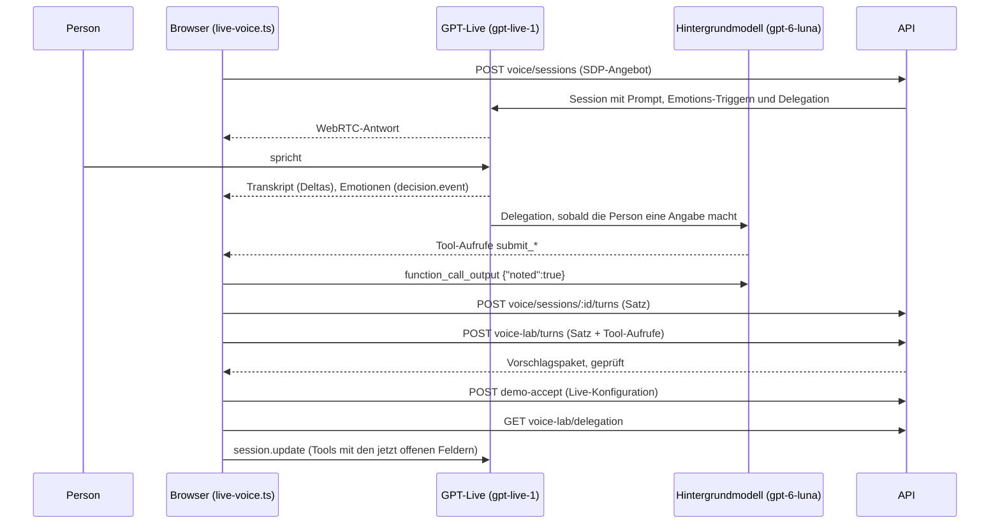

# Live-Stimme

Stand: 01.11.2026. Wie Paxi spricht, zuhört und das Gehörte in den Fall bringt.

## Ablauf



1. **Session.** `POST voice/sessions` legt die GPT-Live-Session serverseitig an (`apps/api/src/voice/providers.ts`); der OpenAI-Schlüssel bleibt auf dem Server. Der Prompt besteht aus Darios Persona und Skills (`code/voice-agent/persona.md`, `skills/`) plus den Grenzen der App (`apps/api/src/voice/prompt.ts`).
2. **Sätze.** GPT-Live liefert nur Transkript-Deltas. Der Browser fasst sie zu Sätzen zusammen (Sprecherwechsel oder 1,5 s Ruhe, `paxi-case-voice.ts`) und speichert jeden Satz am Fall.
3. **Notizen.** Macht die Person eine Angabe, gibt GPT-Live den Satz an sein Hintergrundmodell weiter (Responses-Delegation, `apps/api/src/voice/lab-delegation.ts`). Das ist GPT-6 Luna auf dem Fast-Tier mit mittlerem Reasoning. Es ruft dieselben drei Auslesungen als Tools auf, die das Backend sonst selbst macht:
   - `submit_setup_facts`: Alter und Pensum, solange der Fall noch keine Person hat;
   - `submit_intake_observations`: die acht Intake-Felder (Einkommen, Pensum, Zivilstand, Pensionskasse, 3a, Wohnkosten, Pensionsalter, Risiko);
   - `submit_answers`: die offenen Profilfragen mit ihren aktuellen Feld-IDs.
4. **Prüfung.** Der Browser hängt die Tool-Aufrufe an den Satz (`report-inbox.ts`). `voice-lab/turns` behandelt sie wie eigene Modellausgabe: Das Zitat muss wörtlich im gespeicherten Satz der Person stehen, das Feld muss offen sein, Wert und Einheit müssen passen. Daraus wird ein Vorschlagspaket; erst die Annahme ändert den Entwurf.
5. **Übernahme.** In der Live-Konfiguration übernimmt die App jedes Paket sofort, bestätigt das Profil, sobald es vollständig ist, und rechnet. In den anderen Konfigurationen bestätigt die Person über die Übernahme-Karte.
6. **Nächste Frage.** Nach jedem Satz holt der Browser die aktuellen Tools (`voice-lab/delegation`) und gibt sie per `session.update` an GPT-Live; in der Live-Konfiguration ausserdem die offenen Profilfragen (`voice-lab/questions`), deren nächste Paxi als App-Notiz bekommt.

## Rückfall

Lehnt OpenAI die Delegation ab, startet die Session ohne sie, und das Backend liest jeden Satz selbst aus: dieselben drei Auslesungen über die Responses API mit `gpt-6-luna` (`ANALYSIS_MODEL`, `apps/api/src/model/responses.ts`). Dasselbe gilt mit `LIVE_REPORTS=0`. Ohne Delegation für einen Satz, etwa bei Smalltalk, wird nichts ausgelesen.

## Emotionen

GPT-Live klassifiziert jedes Transkript-Fragment mit Decisions-Triggern in neun Emotionen (`apps/api/src/voice/emotions.ts`, dieselben wie im Avatar). Der Browser zeigt nur die jeweils neueste und gibt sie an den Avatar weiter. Ohne Decisions-Berechtigung startet die Stimme ohne Emotionen.

## Grenzen im Gespräch

Paxi verlangt keine echten Namen, Geburtsdaten oder Gesundheitsdaten, erfindet keine Beträge, behauptet nie eine Übernahme oder Bestätigung und übergibt nie an eine Kollegin oder einen Kollegen. Ein ausdrücklicher Wunsch aufzuhören hat Vorrang (`prompt.ts`). Mehr dazu in [Compliance](compliance.md).

## Sicherheit

Die Tool-Aufrufe kommen über den Browser ins Backend. Das Backend prüft sie gegen das Transkript, das es selbst gespeichert hat, und nur mit erteilter Extraktions-Einwilligung. Ein manipulierter Browser könnte trotzdem Werte mit passendem Zitat einreichen. Für erfundene Daten ist das vertretbar; vor echten Kundendaten gehört die Delegation auf eine serverseitige Verbindung (Sideband) zur Session.

## Starten und prüfen

In der Root-`.env`: `OPENAI_API_KEY` und `PAX_SYNTHETIC_VOICE_ENABLED=1` (das schaltet auch die Extraktion ein). Dann im Verzeichnis `code/`:

```sh
npm run dev:live   # leerer Fall, Paxi stellt die Person im Gespräch auf und rechnet
npm run dev:demo   # Demo-Fall Müller, Übernahme über die Karte
```

Der Mikrofon-Knopf erscheint nur, wenn das Backend GPT-Live und die Extraktion anbietet; ohne Extraktion startet kein Gespräch, statt still auf die Regel-Erkennung zurückzufallen. Der Modellweg wird beim Start verdrahtet (`apps/api/src/live-options.ts`): nach einer Änderung an der `.env` das Backend neu starten.

Paxis Gesprächsführung kommt aus `code/voice-agent/persona.md` und den Skills mit `assigned: true` (`friendly-conversation`, `proposing-plans`); `GET /api/voice/settings` liefert sie, die gewählten Skills, das Zeitbudget und ein bevorzugtes Thema gehen beim Start als `conversationSettings` in den Prompt. Änderungen an den Skills gelten ab der nächsten Session.

Im Browser zeigt die Konsole unter dem Filter `[paxi]` Fehler mit Code (`api_error`, `voice_error`). Automatisch geprüft wird der Weg über HTTP mit ersetztem OpenAI: `tests/live-voice-journey.test.mjs`, `tests/live-start.test.mjs`, `tests/live-reports.test.mjs`, `tests/live-questions.test.mjs`; ein ganzes erfundenes Gespräch mit dem echten Modell läuft mit `npm run test:live:conversation`.

