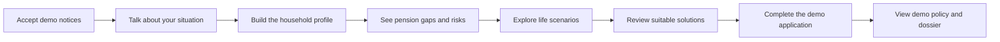
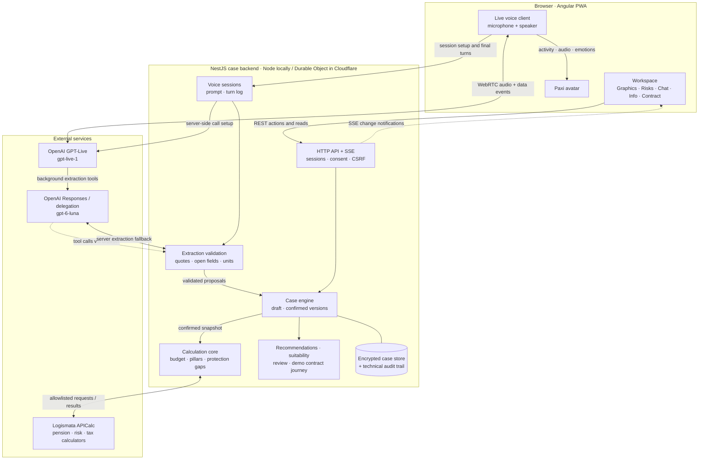
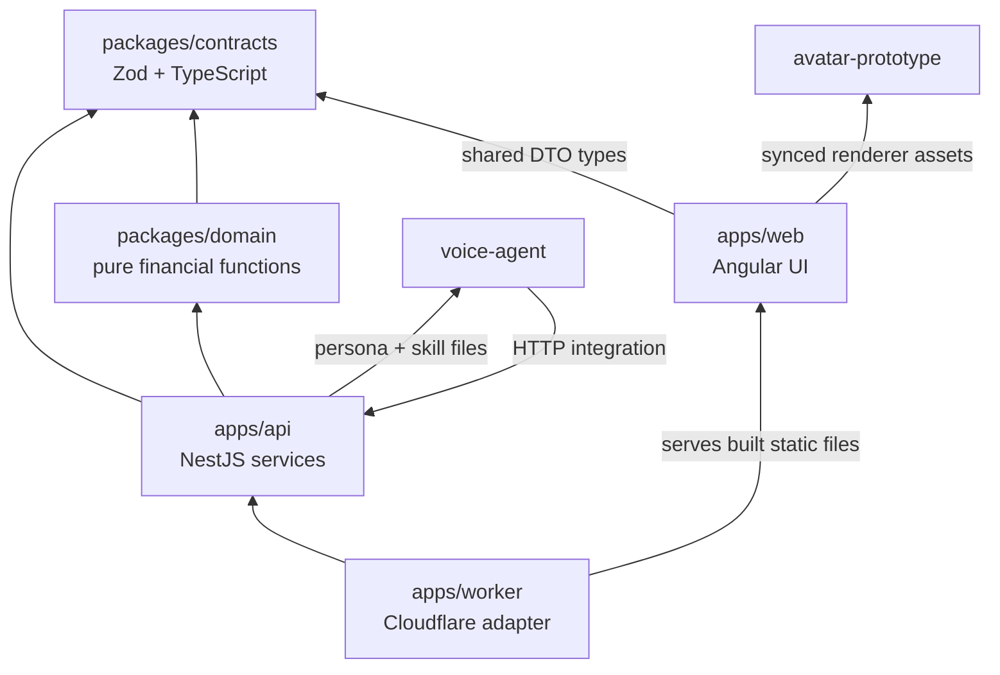
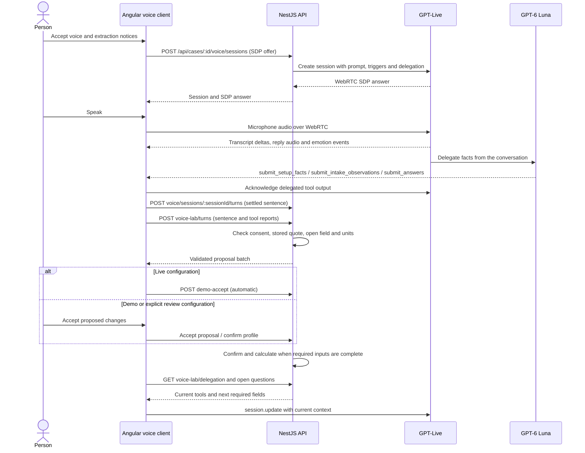
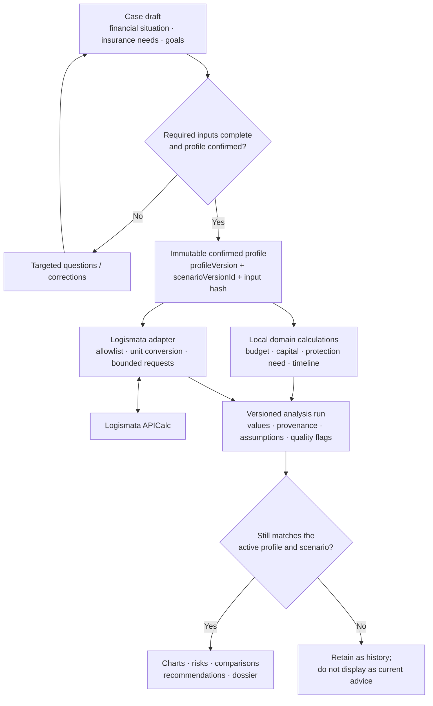
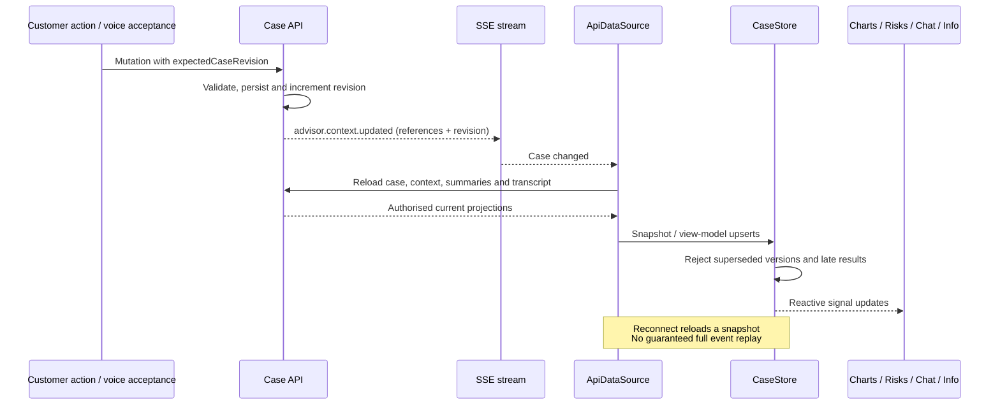
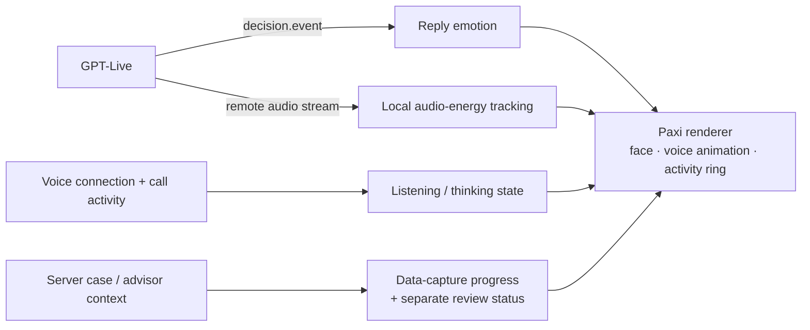
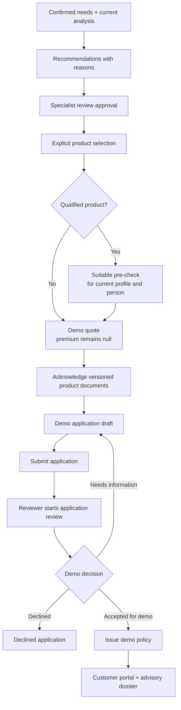
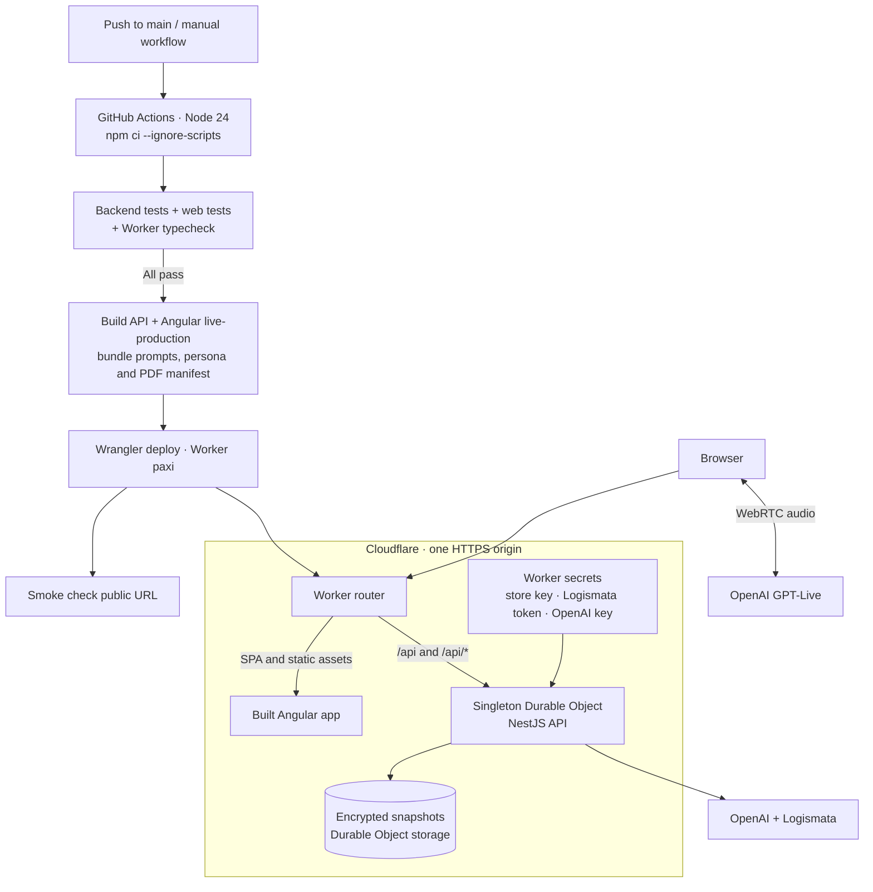

# Paxi — Pax Digital Advisor

**Talk through your life plans. See what they mean for your financial future.**

Paxi is a voice-first pension and life-insurance advisory prototype built for the **Pax Challenge at BaselHack 2026**. It turns a conversation about income, family, housing and retirement into a structured financial picture, interactive charts and explainable product recommendations. An animated avatar accompanies the conversation, and a persisted demo journey continues through to a policy in the customer portal.

**[Try the live demo](https://paxi.rushworks.workers.dev)** · [Documentation](documentation/README.md) · [Developer guide](code/README.md) · [Challenge](documentation/challenge_material/challenge.md)

> This is a working hackathon prototype using **synthetic data only**. Calculations use the real Logismata API; quotes, application reviews and policies are demonstrations. Demo policies provide no insurance cover and have no legal effect.

## Contents

- [Why Paxi?](#why-paxi)
- [What you can do](#what-you-can-do)
- [Try the demo](#try-the-demo)
- [Run locally](#run-locally)
- [System architecture](#system-architecture)
- [Repository and modules](#repository-and-modules)
- [Live voice and extraction](#live-voice-and-extraction)
- [Calculations and financial data](#calculations-and-financial-data)
- [Live UI and avatar](#live-ui-and-avatar)
- [Recommendation to demo policy](#recommendation-to-demo-policy)
- [Storage and access](#storage-and-access)
- [Tests and checks](#tests-and-checks)
- [Deployment](#deployment)
- [Documentation map](#documentation-map)
- [Team](#team)
- [License](#license)

## Why Paxi?

Swiss pension planning spans three pillars: state provision (AHV/AVS), occupational provision (BVG/LPP) and private provision. Understanding how they fit together becomes harder when life changes: starting a family, buying a home or retiring early can alter both available income and protection needs.

The [Pax challenge](documentation/challenge_material/challenge.md) asks for self-service advice that starts with the person's whole situation. Paxi follows that order: understand the household, make the gaps visible, explore alternatives, then discuss suitable products. The language model handles conversation and proposes structured facts; the calculation layer supplies the financial results.

## What you can do

| Capability | In the prototype |
| --- | --- |
| Conversational intake | Speak to Paxi; follow-up questions collect missing facts about the household, income, pension benefits, expenses and goals. |
| Holistic pension view | Bring together all three pillars, budget, assets, retirement income and disability/death protection needs. |
| Life scenarios | Compare family, home-ownership and retirement scenarios against the current situation. |
| Live workspace | Switch between Graphics, Risks, Chat, Info and the Contract journey while the case updates. |
| Multilingual experience | Switch between German, French, Italian and English; amounts use Swiss locale formatting. |
| Expressive avatar | See listening/thinking activity, voice-driven animation, reply emotions and data-capture progress. |
| Explainable recommendations | See product candidates, reasons, assumptions and review requirements after needs analysis. |
| End-to-end demo | Complete the suitability pre-check where needed, review product documents, submit a demo application and view a demo policy and advisory dossier. |

### The user journey



## Try the demo

1. Open **https://paxi.rushworks.workers.dev** on a phone or desktop browser.
2. Read and accept the synthetic-data, voice and model-extraction notices, then allow microphone access.
3. Describe an **invented** situation: start with age and employment rate, then answer Paxi's follow-up questions.
4. Watch the profile and charts grow. Early visualisations are provisional; a full calculation follows when the required profile is complete.
5. Explore the tabs and continue to the Contract journey to inspect recommendations, documents and the demo portal.

The public app uses the `live-production` configuration: it starts an empty case and automatically accepts validated extraction proposals. The local `demo` configuration starts from the Müller persona and offers an acceptance card. The standard development configuration exposes sign-in and the explicit review workflow.

## Run locally

### Prerequisites

- **Node.js 24** (see [`.nvmrc`](.nvmrc)) and npm. The backend supports Node 22–24; the Angular app requires `^22.22.3` or `^24.15.0` within that range.
- A **Logismata bearer token** from the [challenge hub](https://pax-hackathon-2026.vercel.app), under Tools.
- An **OpenAI API key** with access to the configured live-voice and extraction models for the voice experience.
- Microphone access; remote hosting requires HTTPS, while loopback development works locally.

From the repository root:

```sh
cp .env.example .env
npm --prefix code ci --ignore-scripts
```

Edit the root `.env` with your credentials and enable voice:

```dotenv
LOGISMATA_BEARER_TOKEN=<your-logismata-token>
OPENAI_API_KEY=<your-openai-key>
PAX_SYNTHETIC_VOICE_ENABLED=1
LIVE_MODEL=gpt-live-1
LIVE_VOICE=juni
```

Then start the complete app:

```sh
npm --prefix code run dev:live
```

Open **http://127.0.0.1:4200**. The API runs at **http://127.0.0.1:3000**, with `/api` proxied by the Angular dev server. Ctrl-C stops both processes. The backend compiles on startup; avatar assets are synchronised by the web app's prestart script.

All local Node credentials and feature flags belong in the gitignored root `.env`; [`.env.example`](.env.example) documents them. Enabling synthetic voice with an OpenAI key also wires model extraction; consent is still required per case. Restart the backend after changing configuration. Never put secrets in Angular environment files: those ship to the browser.

> The challenge Logismata token expires on **3 November 2026 at 23:59:59**. Live calculations require a valid token; automated backend tests replace external providers and need no provider credentials.

### Development modes

Run these commands from `code/`:

| Command | Behaviour |
| --- | --- |
| `npm run dev:live` | Empty case, integrated voice intake, automatic proposal acceptance and calculation. |
| `npm run dev:demo` | Precalculated synthetic Müller case, integrated voice and an acceptance card. |
| `npm run dev:paxi` | Demo workspace with the standalone voice agent in its own window on port 3100. First run `npm --prefix voice-agent ci`. |
| `npm start` | API only, port 3000; separate customer/reviewer access codes are generated locally. |
| `npm --prefix apps/web start` | Standard Angular development app with sign-in and review controls; run alongside the API. |

Public API entry points are [`/api/status`](https://paxi.rushworks.workers.dev/api/status), [`/api/privacy`](https://paxi.rushworks.workers.dev/api/privacy) and [`/api/openapi.json`](https://paxi.rushworks.workers.dev/api/openapi.json). Case data requires a session. See the [developer guide](code/README.md) for manual API integration.

## System architecture

The NestJS API owns the canonical case. The browser reads authorised projections and submits actions; voice and extraction supply proposals. Audio travels directly between the browser and GPT-Live over WebRTC, while the backend creates the provider session and retains the OpenAI API key.



An SSE message announces that the case changed; it does **not** carry the complete financial record. The app reloads the authorised snapshot. Audio streaming is separate from SSE. The [architecture guide](documentation/architecture.md) explains the runtime in more detail.

## Repository and modules

```text
.
├── .env.example                 Local Node configuration template
├── .github/workflows/           CI and Cloudflare deployment
├── assets/pax/                  Provided Pax brand assets
├── code/                        npm workspace and shared lockfile
│   ├── apps/api/                NestJS API, case engine, voice and provider adapters
│   ├── apps/web/                Angular PWA, charts, review UI and live voice
│   ├── apps/worker/             Cloudflare Worker and Durable Object adapter
│   ├── packages/contracts/     Shared Zod schemas and TypeScript contracts
│   ├── packages/domain/        Pure financial and intake logic
│   ├── voice-agent/            Standalone Paxi server, persona and conversation skills
│   ├── avatar-prototype/       Reusable avatar renderer and interface notes
│   ├── fixtures/               Synthetic households and integration examples
│   ├── scripts/                Development and live-verification tools
│   └── tests/                  Backend, contract and journey tests
├── documentation/              Architecture, compliance, plans and challenge references
├── site/                       Static project presentation
└── license.txt                 MIT license and third-party exclusions
```

### Module relationships

Arrows below mean “uses”; prompt and asset relationships are labelled separately from code dependencies.



| Layer | Main technologies |
| --- | --- |
| Web | Angular 22, standalone components, signals, RxJS, SCSS, ECharts, Transloco, service worker |
| API and contracts | TypeScript, NestJS, Zod, REST, Server-Sent Events, generated OpenAPI |
| Conversation | OpenAI GPT-Live, WebRTC, GPT-6 Luna extraction; optional ElevenLabs adapter |
| Persistence | AES-256-GCM encrypted snapshots; local filesystem or Durable Object storage |
| Hosting and checks | Cloudflare Workers/Durable Objects, Wrangler, GitHub Actions, Node test runner, Vitest |

## Live voice and extraction

Paxi's conversation is built from the [persona](code/voice-agent/persona.md) and assigned [skills](code/voice-agent/skills/), combined with the backend's [voice prompt](code/apps/api/src/voice/prompt.ts). It asks for missing information rather than inventing financial values.



The browser groups transcript deltas into sentences at a speaker change or after 1.5 seconds of silence. Delegated extraction has three stages: set up the person, collect the eight intake fields, then answer remaining profile questions. The API checks each proposed fact against the stored customer sentence before it can change the draft.

If delegation is unavailable, the session can fall back to backend extraction through the Responses API. `LIVE_REPORTS=0` explicitly selects backend extraction for each turn. Voice can also run without emotion classification when Decisions access is unavailable. See [live voice](documentation/live-voice.md) for the exact fallback and consent rules.

**Acceptance matters:** models only propose. The live demo automates the customer-side acceptance and profile-confirmation actions; the standard review workflow keeps proposal acceptance and whole-profile confirmation separate. Browser-forwarded extraction reports are checked against the stored transcript, but a server-side provider connection remains a requirement before real customer use.

## Calculations and financial data

The calculation layer combines pure local financial functions with **24 implemented Logismata operations**. These cover pension limits, risk and retirement calculations, income/budget, saving/withdrawals, locations and taxes. Auxiliary tax tools are explicit calls, rather than being added to every pension analysis.



Important data rules:

- Monetary values in shared contracts are **integer CHF cents (Rappen)**. Provider conversion happens at the adapter boundary.
- Unknown (`null`), confirmed zero, estimates and review-required results remain distinct.
- Monthly and annual flows are separate from one-off capital; neither the UI nor the language model invents a second financial calculation.
- `expectedCaseRevision` protects writes. Profile/scenario versions and input hashes identify calculation inputs; `runId` and context references bind displayed and explained results.
- Provider errors do not silently switch live calculations to replay. Review flags remain visible even when a request returned HTTP 200.
- Local liquidity projections and provider retirement projections are separate models; their values are not simply added together.

See the [financial rules and operations](code/README.md#fachliche-rechenregeln), [shared contracts](code/packages/contracts/src/index.ts) and [requirements matrix](documentation/baselhack/reports/life-insurance-requirements.md).

## Live UI and avatar

### One case, multiple views

The browser's `CaseStore` projects the server case into view slices. Components read those slices rather than contacting providers or maintaining their own financial records.



### Paxi's face and progress



The renderer is reused from `code/avatar-prototype` and synchronised into the Angular app. Audio-energy segments drive visual speaking activity only: they are **not evidence of audible playback or customer confirmation**. Progress measures data capture, not how well insured the person is; 100% intake can coexist with an open specialist review.

Implementation entry points: [data source](code/apps/web/src/app/core/advisor/api/api-data-source.ts), [case store](code/apps/web/src/app/core/advisor/store/case-store.ts), [avatar voice adapter](code/apps/web/src/app/core/voice/voice-avatar.ts) and [avatar interface](code/avatar-prototype/AVATAR-INTERFACE.md).

## Recommendation to demo policy

Needs analysis comes before product selection. A current confirmed analysis supports explainable recommendations; review approval and explicit product selection gate the demo quote. Qualified products—**FondsStar, LifeStar and Auszahlungsplan**—also require the product/person-specific suitability pre-check.



These are persisted, version-checked transitions with idempotency keys. In demo mode the backend simulates the specialist steps and labels them accordingly; the regular workflow uses a separate reviewer role. Document IDs and SHA-256 hashes bind the acknowledgement to the quote's document versions.

Real Pax tariff, underwriting, identity/AML, health-declaration, signature and policy-issuance integrations were not supplied. Premiums remain `null` with `pax_tariff_api_unavailable`; every demo policy carries **“DEMO – KEIN VERSICHERUNGSSCHUTZ”**, `coverageInForce: false` and `legalEffect: 'none'`. The portal and dossier list the steps required for a real contract.

The app also exposes a human-advisor handover control. It pauses digital processing of the case; Paxi does not promise that a colleague has been contacted. Details: [compliance](documentation/compliance.md) and [handover contract](documentation/baselhack/plans/human-advisor-handover.md).

## Storage and access

The API owns one logical JSON case store. There is **no separate SQL application database**; the deployed Durable Object uses Cloudflare's SQLite-backed storage for encrypted snapshots.

| Concern | Local Node runtime | Cloudflare runtime |
| --- | --- | --- |
| Case storage | `code/.local/lifemap/cases.enc` | One Durable Object, encrypted chunks and an atomic manifest |
| Encryption | AES-256-GCM; private local key | AES-256-GCM; `LIFEMAP_STORE_KEY` secret |
| Writes | Serialised transactions, atomic file replacement, process lock | Serialised transactions inside the Durable Object |
| Retention cleanup | Interval timer | Durable Object alarms |
| Hosting | API on port 3000, Angular proxy on 4200 | Angular and `/api` on one HTTPS origin |

- Customer access is scoped to owned cases; reviewer access starts with a review request. Agent grants expose limited, case-bound context and proposal capabilities.
- Browser sessions use HttpOnly cookies; cookie-authenticated writes require a CSRF token and origin checks. Provider credentials stay server-side.
- Three notices cover profile/calculator transfer (`lifemap-synthetic-v2`), voice (`voice-synthetic-v1`) and model extraction (`extraction-synthetic-v1`). One consent does not replace another.
- Sessions expire after **1 hour**, agent grants after at most **15 minutes**, and cases after **24 hours**. Audit records contain technical actions rather than full profiles.
- The public demo uses one shared Durable Object and holds at most **25 cases**. A new demo start at capacity can evict an older case; the demo-start endpoint is not rate-limited.

Real customer use requires further approved security, privacy, retention, key-management and provider integrations. See [storage architecture](documentation/architecture.md#datenhaltung) and [compliance](documentation/compliance.md) for the implemented boundaries.

## Tests and checks

Run from `code/` after workspace installation. The default backend tests replace OpenAI and Logismata; the explicitly named live tests make real external requests with synthetic data.

| Command | Coverage |
| --- | --- |
| `npm test` | TypeScript build, contracts, backend logic, HTTP routes and persisted journeys. |
| `npm --prefix apps/web test -- --watch=false` | Angular/Vitest tests. |
| `npm --prefix apps/web run check:tokens` | Design-token usage and WCAG AA text contrast checks. |
| `npm --prefix apps/web run check:i18n` | Missing, extra, empty and referenced translation keys in DE/FR/IT/EN. |
| `npm run typecheck -w @pax/worker` | Worker bindings and TypeScript checks. |
| `npm run test:all` | Backend, standalone voice agent and web tests; install voice-agent dependencies first. |
| `npm run test:coverage` | Backend coverage; corresponding commands exist in web and voice-agent packages. |
| `npm run test:live` | Real Logismata operations and a synthetic end-to-end backend journey. |
| `npm run test:live:conversation` | Synthetic full conversation using the real extraction model; `LIVE_CALCULATOR=1` also uses Logismata. |
| `npm run check:persistence -w @pax/worker` | Isolated local Worker restart and encrypted-persistence verification; requires Python 3. |

The [requirements matrix](documentation/baselhack/reports/life-insurance-requirements.md) maps challenge requirements to implementation and verification. The [Worker guide](code/apps/worker/README.md) lists build prerequisites and deployed smoke checks.

## Deployment

The public demo is a Cloudflare Worker named **`paxi`**. It serves the Angular `live-production` build and routes `/api` requests to the singleton Durable Object running the same NestJS API as local development.



The [deployment workflow](.github/workflows/deploy-cloudflare.yml) runs on pushes to `main` and manual dispatch; deployments are serialised. GitHub holds `CLOUDFLARE_API_TOKEN` and `CLOUDFLARE_ACCOUNT_ID`. Runtime provider credentials and `LIFEMAP_STORE_KEY` remain in Cloudflare secrets, outside the frontend build and CI environment.

For local Worker development, `setup:local` generates a separate ignored `.dev.vars`; the Worker does not automatically load the root `.env`. The standalone voice-agent server is not deployed—its persona and skills are bundled into the integrated voice backend. Deployment, smoke checks, diagnostics and rollback commands are in the [Worker guide](code/apps/worker/README.md) and [deployment instructions](code/README.md#deploy-on-cloudflare).

## Documentation map

The diagrams above describe the current runtime. The workshop interface document also preserves the original I01–I10 collaboration diagrams and proposed integration flow.

| Document | What to find |
| --- | --- |
| [Documentation index](documentation/README.md) | Entry point to system, domain and challenge material. |
| [Architecture](documentation/architecture.md) | Components, runtime modes, storage and operational constraints. |
| [Live voice](documentation/live-voice.md) | Session/extraction sequence, background delegation, emotions and fallbacks. |
| [Compliance](documentation/compliance.md) | Consent, synthetic-data rules, suitability and real-contract requirements. |
| [Developer guide](code/README.md) | API setup, financial rules, provider operations and deployment commands. |
| [Web guide](code/apps/web/README.md) | Angular structure, view state, i18n and live-voice integration. |
| [Worker guide](code/apps/worker/README.md) | Cloudflare architecture, local verification, secrets and diagnostics. |
| [Team API guide](documentation/baselhack/plans/team-api-guide.md) | Roles, routes, payloads, revisions and SSE. |
| [Workshop interfaces I01–I10](documentation/baselhack/plans/interface-contracts.md) | Original module handoffs, workflow diagram and context-update sequence. |
| [Avatar interface](code/avatar-prototype/AVATAR-INTERFACE.md) | Renderer contract, voice/emotion sequence and visualisation limits. |
| [Standalone voice agent](code/voice-agent/README.md) | Independent Paxi server, persona, skills and questionnaire. |
| [Requirements matrix](documentation/baselhack/reports/life-insurance-requirements.md) | Challenge requirements, implemented features and test evidence. |
| [Challenge material](documentation/challenge_material/) | Challenge brief, API specification, legal framework and supplied examples. |
| [Provider/product references](documentation/baselhack/references/README.md) | Product documentation and Logismata request/response examples. |

## Team

Built at BaselHack 2026 by **Dario, Earnie, Valentin, Luca and Lukas**. Workshop responsibilities span voice, AI/advisory orchestration, calculations, the Angular interface and Paxi's avatar; see the [interface responsibilities](documentation/baselhack/plans/interface-contracts.md#2-was-jeder-bereich-liefert).

## License

Original project code and documentation are available under the [MIT License](license.txt).

Third-party material is excluded: Pax trademarks, logos and fonts (including `assets/pax/`, `site/media/fonts/` and `code/apps/web/public/brand/`), and supplied challenge, product and provider documentation (including `documentation/challenge_material/` and `documentation/baselhack/references/`). Those materials remain subject to their respective owners' rights.
