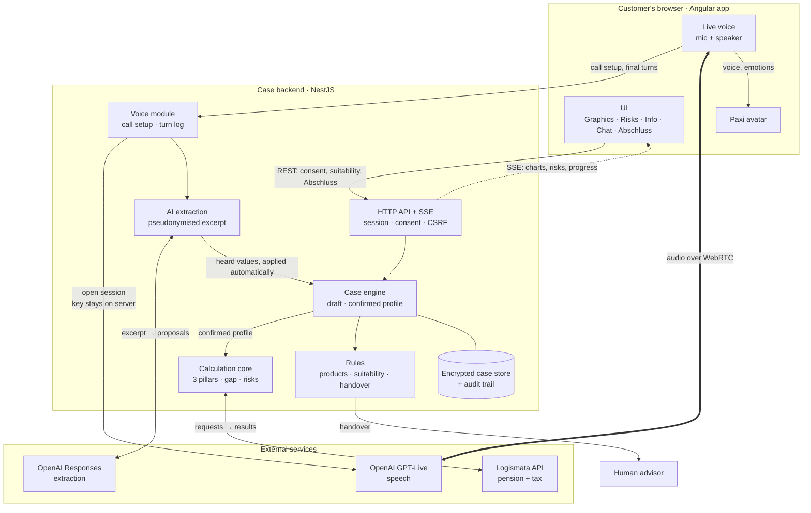

# Pax Digital Advisor – BaselHack 2026

Paxi, ein KI-Vorsorgeberater für die Pax Challenge, mit dem man spricht. Live: https://paxi.rushworks.workers.dev

- [Dokumentation](documentation/README.md): Architektur, Live-Stimme, Compliance, Schnittstellen, Fachgrundlagen
- [Code: Start, Tests, Konfigurationen und Deployment](code/README.md)
- [Challenge-Material](documentation/challenge_material/)

Alle lokalen Zugangsdaten (Logismata-Token, OpenAI-Schlüssel, Flags) stehen in einer einzigen Datei `.env` im Repo-Root, die von Git ausgeschlossen ist. Die Vorlage ohne echte Werte ist [`.env.example`](.env.example).

## Projektvorlage zum Ausfüllen

## [Project Name]
[Download Link]
[GitHub Repository](https://github.com/mannaluca02/basel_hack)
mannaluca02/basel_hack

[Brief Project Description - One line summary]

[Detailed Project Description - 2-3 paragraphs explaining what the project does, the problem it solves, and how it works]

### Motivation
[Explain why this project was created, what problem it addresses, and what inspired the team]

### How it works
[Technical explanation of how the project functions, key features, and implementation details]



### Technologies Used
- [Technology 1]
- [Technology 2]
- [Technology 3]

### Setup Instructions
1. [Step 1]
```
[Command 1]
```
2. [Step 2]
```
[Command 2]
```
3. [Step 3 (optional)]
```
[Command 3]
```

### Demo/Screenshots
[Description of demo or screenshots]
- [Screenshot 1 description]
- [Screenshot 2 description]

### Awards/Achievements
[Awarded [place] prize in BaselHack [year]]
[Any other notable achievements or recognition]

### Contributors
[Contributor 1], [Contributor 2], [Contributor 3], [Contributor 4], [Contributor 5]

### Additional Notes
[Any additional information, future plans, or special considerations]
