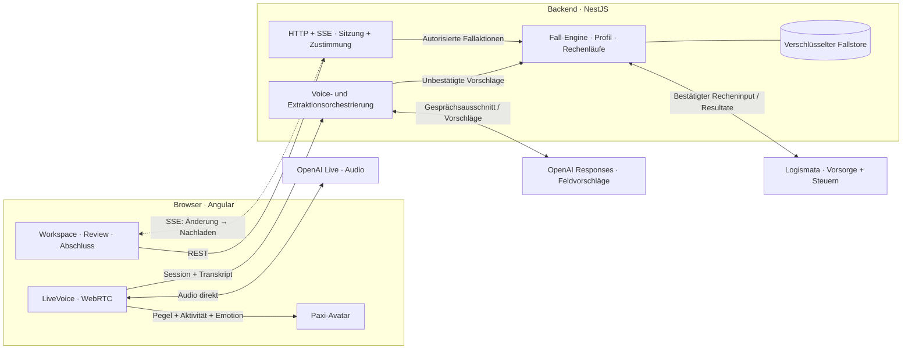

# Pax Digital Advisor – BaselHack 2026

Pax LifeMap ist der Digital-Advisor-Prototyp für die Pax-Challenge am BaselHack 2026: Gesprächsbasierte Aufnahme, Finanz- und Vorsorgeanalyse, Szenarien und ein lokaler Demo-Vertragsweg. Angular-Oberfläche, Live-Voice und Avatar greifen auf einen gemeinsamen NestJS-Fallservice mit echten Rechen-APIs zu.

## Architektur für die Evaluation

**[Architekturdokumentation mit Diagrammen, Datenfluss und Implementierungsgrenzen](documentation/baselhack/reports/current-architecture.md)** · **[Interaktive Architekturansicht (HTML)](documentation/baselhack/reports/current-architecture.html)**

Stand: **01.11.2026 · Main-Snapshot [`a02004f`](https://github.com/mannaluca02/basel_hack/tree/a02004f27cc36044cff68066a907ba1695c1dca6)**. Die Markdown-Ansicht ist direkt auf GitHub lesbar. Die HTML-Datei lokal im Browser öffnen; sie enthält fünf interaktive Ansichten und eine Druckansicht. Der lokale Feature-Branch kann vom dokumentierten Main-Stand abweichen.



Das Modell liefert **Feldvorschläge**, die Fachlogik berechnet die Zahlen. Der reguläre API-Weg trennt Übernahme, Profilbestätigung und Berechnung. Der Live-Demomodus automatisiert diese Aktionen im Kundenkontext; diese Automatik ist keine ausdrückliche Bestätigung jeder Angabe. Der Abschlussbereich erstellt ausschliesslich Demo-Policen ohne Versicherungsschutz.

## Dokumentation und Einstieg

- [Voice-Feature: Setup, Integration und API](code/voice-agent/README.md)
- [Separate Debugging App: Voice → Backend (lokaler Feature-Branch)](code/apps/web/debugging-app/README.md)
- [Voice Lab: Tests und Live-Nachweise](documentation/baselhack/plans/voice-lab-mvp.md)
- [Echtzeit-Gesprächsführung: Architektur und Implementierungsspezifikation](documentation/baselhack/plans/realtime-conversation-orchestration.md)
- [Verbindliche Team-Schnittstellen und gemeinsamer Fall-DTO](documentation/baselhack/plans/team-api-guide.md)
- [API, Speicher und Datenbank-Ausbau](documentation/baselhack/plans/persistence-and-api.md)
- [Logik-Backend: Start, API und Team-Integration](code/README.md)
- [Backend-Requirements und Live-Nachweise](documentation/baselhack/reports/life-insurance-requirements.md)
- [Implementierungsstand und offene Fachfragen](documentation/baselhack/reports/logic-backend-implementation.md)
- [Bestätigte Workshop-Entscheide und Rollen](documentation/baselhack/plans/workshop-decisions.md)
- [Workflow und Schnittstellen aus dem Workshop](documentation/baselhack/plans/interface-contracts.md)
- [Detaillierter Angular-Umsetzungsplan](documentation/baselhack/plans/implementation-plan.md)
- [Ticket-Backlog für fünf Personen](documentation/baselhack/plans/implementation-backlog.md)
- [Gesamtplan und Quellen](documentation/baselhack/plans/advisor-plan.md)
- [Aufteilung für fünf Personen](documentation/baselhack/plans/team-plan.md)
- [Materialübersicht und Archivaufbau](documentation/baselhack/README.md)
- [Vollständiges Quellenverzeichnis](documentation/baselhack/references/README.md)
- [Bereits vorhandene Challenge-Unterlagen](documentation/challenge_material/)

Alle lokalen Zugangsdaten (Logismata-Token, OpenAI-Schlüssel, Flags) stehen in einer einzigen Datei `.env` im Repo-Root, die von Git ausgeschlossen ist. Die Vorlage ohne echte Werte ist [`.env.example`](.env.example).

## Projektvorlage zum Ausfüllen

## [Project Name]
[Download Link]
[GitHub Repository](https://github.com/mannaluca02/basel_hack)
mannaluca02/basel_hack

[Brief Project Description - One line summary]

[Detailed Project Description - 2-3 paragraphs explaining what the project does, the problem it solves, and how it works]

### Motivation
[Explain why this project was created, what problem it addresses, and what inspired the team]

### How it works
[Technical explanation of how the project functions, key features, and implementation details]

### Technologies Used
- [Technology 1]
- [Technology 2]
- [Technology 3]

### Setup Instructions
1. [Step 1]
```
[Command 1]
```
2. [Step 2]
```
[Command 2]
```
3. [Step 3 (optional)]
```
[Command 3]
```

### Demo/Screenshots
[Description of demo or screenshots]
- [Screenshot 1 description]
- [Screenshot 2 description]

### Awards/Achievements
[Awarded [place] prize in BaselHack [year]]
[Any other notable achievements or recognition]

### Contributors
[Contributor 1], [Contributor 2], [Contributor 3], [Contributor 4], [Contributor 5]

### Additional Notes
[Any additional information, future plans, or special considerations]
